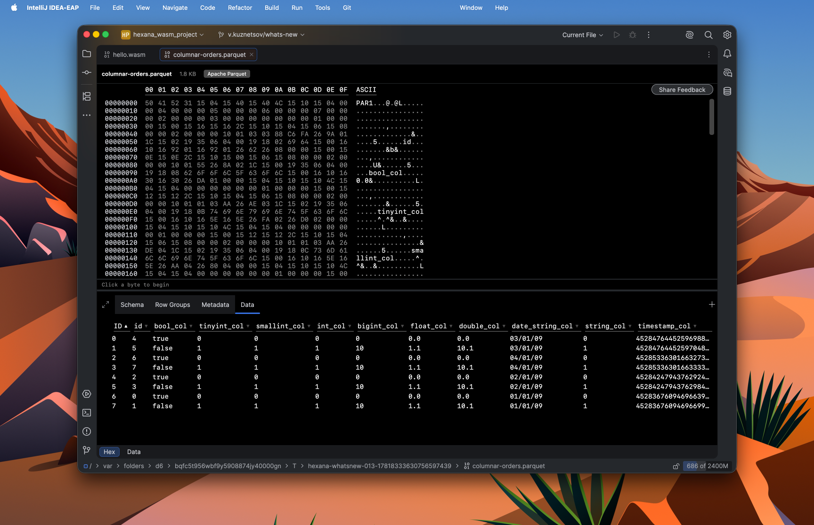
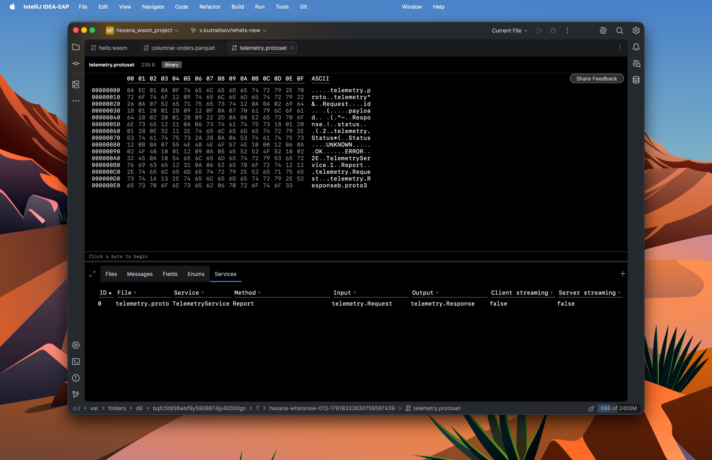
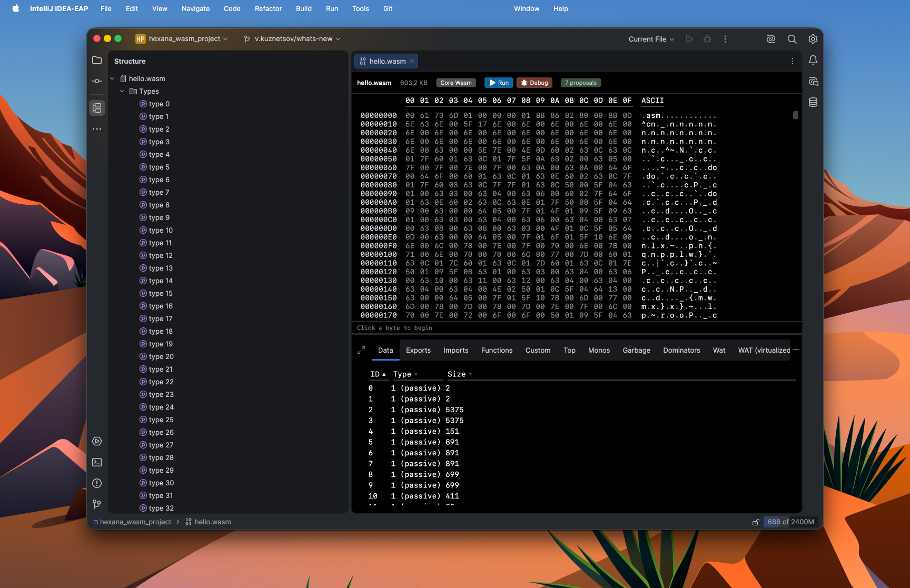
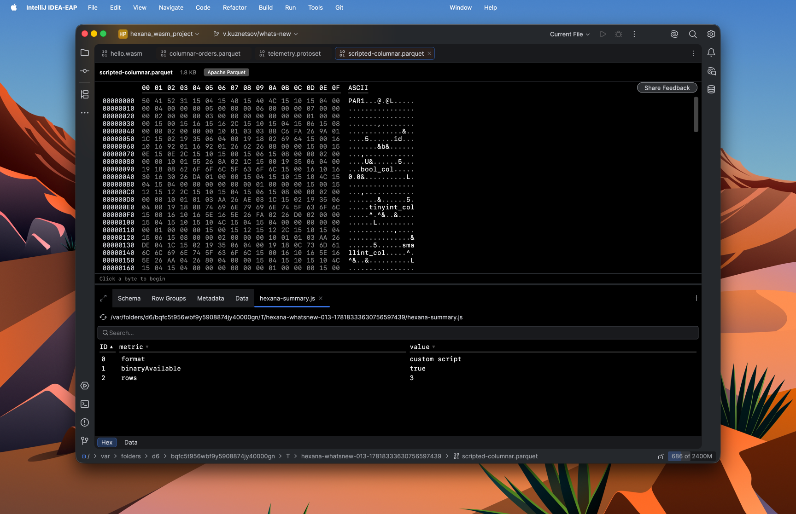

# Hexana 0.13 Release Notes

Released **2026-07-08**. No breaking changes from 0.12.

0.13 adds inspection for two widely-used columnar data formats — Apache Parquet and Apache Arrow IPC — each with structural metadata tabs and a decoded Data tab that links rows back to their hex ranges. Protocol Buffers gains coverage in two forms: compiled descriptor sets open as structured tables, and any file can be decoded as a schema-less wire message from the context menu. The Structure tool window now populates from WASM modules, WASM components, and ELF binaries. Custom JavaScript tabs let you write per-binary analysis scripts that render as tables or plain output. wazero joins the run-configuration runtimes, and all tables now share one consistent searchable control.

## Apache Parquet and Arrow IPC inspection

Hexana detects Parquet and Arrow files by content magic — `PAR1` for Parquet, `ARROW1` for the Arrow IPC file format, and the `0xFFFFFFFF` continuation marker for the Arrow IPC stream format — rather than by extension.

### Structural tabs

A Parquet file opens to three tabs:

- **Schema** — the schema tree with field names and types.
- **Row Groups** — each row group expands to its column chunks, showing path, type, codec, and value count.
- **Metadata** — file-level metadata.

An Arrow file opens to three equivalent tabs:

- **Schema** — field names and types.
- **Record Batches** (file format) or **Messages** (stream format), depending on which Arrow IPC form the file uses.
- **Metadata**.

### Data tab

Both formats gain a **Data** tab that decodes actual content into a table with one column per schema leaf field and one row per record. Selecting a row highlights that record's bytes in the hex editor as disjoint spans, at the best granularity each value allows — an exact per-value range for uncompressed PLAIN data, a page or chunk box for compressed or encoded data.

The first row group (Parquet) or first record batch (Arrow) is decoded, capped at 10,000 rows, with a note when the file contains more rows or batches.

**Encoding and compression coverage:**

- Page compression: SNAPPY, GZIP, ZSTD, and LZ4 on the JVM.
- Parquet encodings: PLAIN, dictionary, RLE/bit-packed, the DELTA variants, and BYTE_STREAM_SPLIT, with Dremel definition levels for nullable columns.
- Arrow buffer reconstruction for primitive, boolean, string/binary, and the temporal, interval, and decimal types.

Parquet INT96 values (legacy 12-byte timestamps) are decoded and shown as their signed 96-bit integer in base-10, matching the BigInteger representation other Parquet tooling exposes.

A file recognised as Parquet or Arrow that decodes to no rows (empty or malformed) still shows the Data tab with an explanatory empty state instead of hiding it.

## Protocol Buffers descriptor sets

Compiled Protocol Buffers descriptor sets — `.desc` / `.protoset` files produced by `protoc --descriptor_set_out` — now open for inspection. Hexana recognises them by content structure (a leading length-delimited field whose embedded `FileDescriptorProto` name ends in `.proto`) as well as by the `.desc` / `.protoset` extensions.

A descriptor set opens to five tabs:

- **Files** — the `.proto` files included in the descriptor set.
- **Messages** — all message types, flattened with dotted qualified names (`Outer.Inner`).
- **Fields** — field number, label, type, and any message or enum type reference.
- **Enums** — enum types, flattened the same way as messages.
- **Services** — each method with its input and output types and streaming flags.

Schema-less wire messages (bare `.pb` files) carry no field names or types and cannot be detected reliably; use the **Open As Protobuf Message** action below for those.

## Open As Protobuf Message

**Open As Protobuf Message** in the project-view context menu decodes any file as a raw Protocol Buffers wire message — best-effort, without a schema. Because a bare wire message has no magic bytes, this is an explicit action rather than auto-detection.

The decoder walks the wire format and shows one row per field:

- Positional path, field number, guessed type, value, and byte range.
- Length-delimited fields are disambiguated: a payload that parses cleanly as a nested message expands into indented child rows; otherwise it is shown as a UTF-8 string when printable, or a hex byte preview.
- Varint, 64-bit, and 32-bit fields are rendered with their numeric and floating-point interpretations.

Selecting a row highlights that field's bytes in the hex view. Decoding is fault-tolerant: malformed or non-protobuf input degrades to a marker row instead of failing, so the action is safe to try on any file. Field names and declared types are not recovered (they are not present in a schema-less message).

## Structure tool window

The IDE's **Structure** tool window now populates for WASM modules, WASM components, and ELF files, giving the standard IDE navigation surface for binaries opened in Hexana. Clicking an entry navigates to the corresponding location in the editor.

## Custom scriptable JS tabs

Any open binary can gain user-written JavaScript analysis tabs:

- Click **+** in the tab bar to add a script tab. A dialog with instructions and an API reference is shown.
- Use `print` in your script to show information; use `binary` to access the binary data.
- Output in CSV or TSV form is shown as a table.

## wazero run support

WASM run configurations now support **wazero** as a runtime. Module execution only — running individual functions is not supported under wazero.

## Changed

- All table views now use the same table control and have proper built-in search.
- Table view rendering performance is improved.

## Upgrading to 0.13

No breaking changes. All 0.13 additions are automatic or additive.

- **Parquet and Arrow files** open automatically — detection is by content magic, so no extension association is needed.
- **Protobuf descriptor sets** open automatically for `.desc` / `.protoset` files, or when the content structure matches.
- **Open As Protobuf Message** appears in the project-view context menu; it is an explicit action and never fires automatically.
- **The Structure tool window** populates as soon as a WASM module, component, or ELF file is open in Hexana.
- **Scriptable tabs** are added per file with the **+** button in the tab bar.
- **wazero** becomes available as a runtime choice in WASM run configurations once installed.
- Everything runs on your machine. No data is sent anywhere.

## Known limitations in 0.13

- The Parquet / Arrow Data tab decodes the first row group or first record batch only, capped at 10,000 rows; a note indicates when more data exists.
- Schema-less protobuf decoding cannot recover field names or declared types — they are not present in the wire format.
- wazero runs modules only; individual function runs are not supported under it.
- Carryover from 0.12: Android DEX support is basic; archive member disassembly uses the experimental native-binary backend; browser debugging targets Chrome only; native-binary support and the Cranelift / Redline disassembler backend are experimental; Java integration covers Java sources only; quick-fixes are not yet wired on the WebAssembly Java or WIT inspections.

## Earlier releases

- [Hexana 0.12 release notes](changelog-0.12.md) — 0.12 (2026-06-24): static-library archives, Component Model diff and WAT view, Exports/Imports row affordances, Android DEX, ZIP64.
- [Hexana 0.11 release notes](changelog-0.11.md) — 0.11 (2026-06-11) and 0.11.1 (2026-06-17): module diff with structural matching, Kotlin/Wasm source navigation, Node.js and browser runtimes, GraalVM Native Image with embedded SBOM and OSV vulnerability reachability.
- [Hexana 0.10 release notes](changelog-0.10.md) — 0.10 (2026-05-27), plus the 0.10.1–0.10.3 patch line.
- [Hexana 0.9 release notes](changelog-0.9.md) — 0.9 (2026-05-07), 0.9.1 (2026-05-20).
