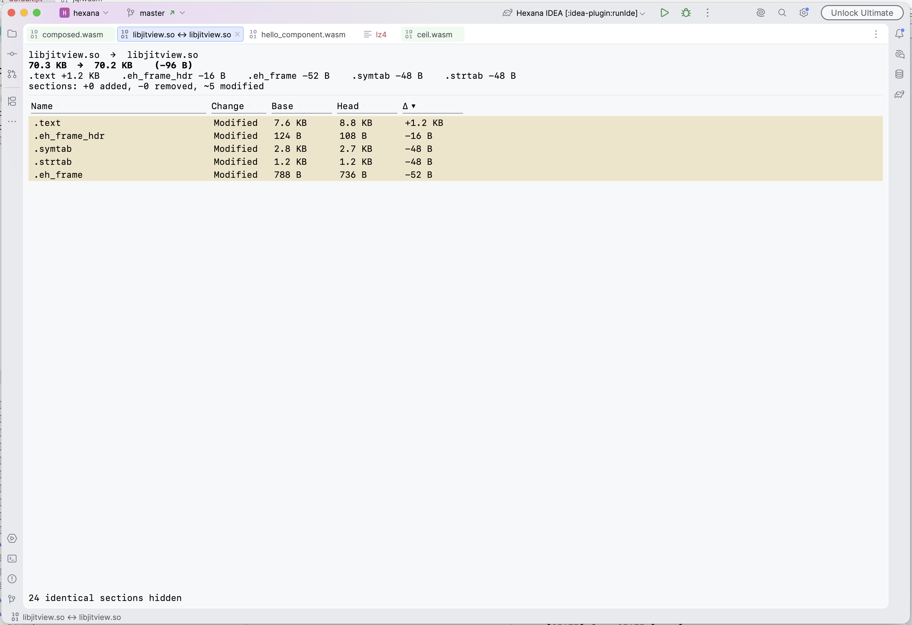
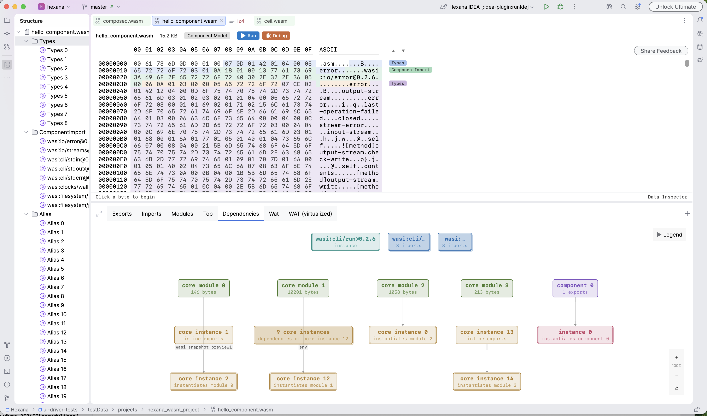
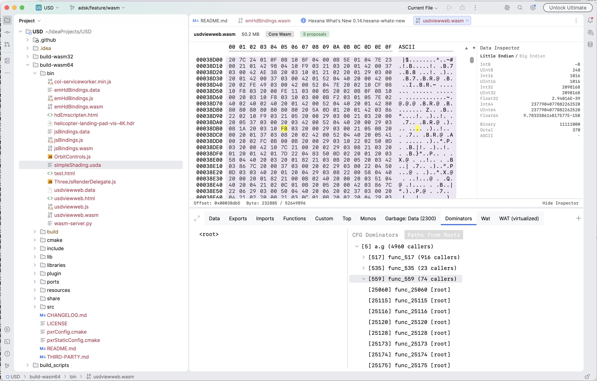
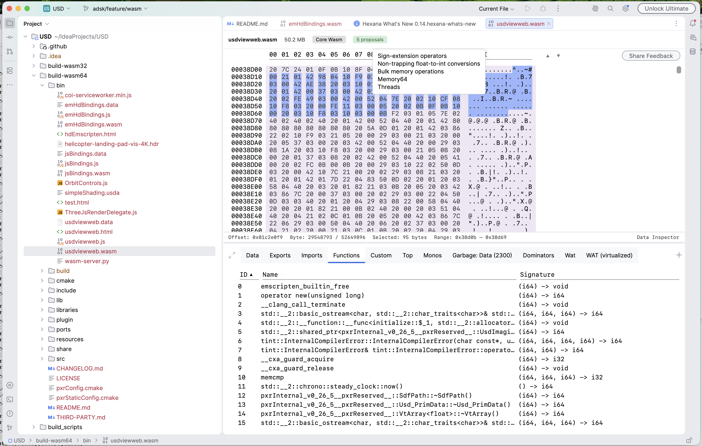
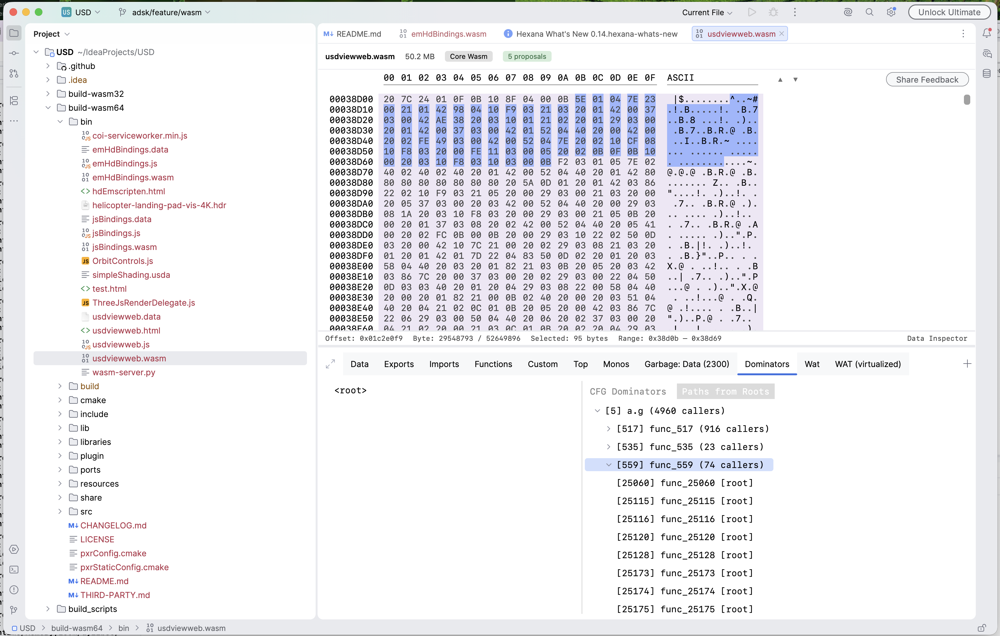
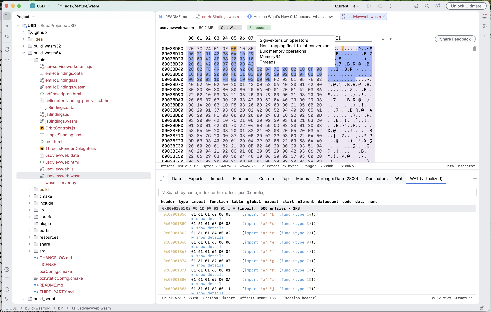

# Hexana 0.14 Release Notes

Released **2026-07-22**. No breaking changes from 0.13.

0.14 adds a native binary diff action with per-section deltas, a dependency diagram for WASM Component Model binaries, a data inspector panel, semantic section highlighting with point-and-click navigation, a new MCP schema version, and a synthetic indirect-call node that makes Emscripten-style C++/WASM modules analyzable. The release also fixes a Functions-tab freeze on large modules, compacts dominator storage so that 50 MB memory64 builds like OpenUSD's `usdviewweb.wasm` now open within a default 2 GB heap, and cleans up several UX rough edges.

## Native binary diff

A new **Compare With…** action for native binaries (ELF, Mach-O, PE) shows a diff between two files. Select two native binary files in the project view and invoke the action from the context menu.

The diff lists every section found in either build: **Name**, **Change** classification (Modified, Added, Removed), **Base** size, **Head** size, and the **Δ** byte delta. Sections that are bit-for-bit identical are folded behind a "N identical sections hidden" line so the view opens on what changed.

## WASM Component dependency diagram

Component Model binaries gain a **Dependencies** tab that visualises the relationships among the component's internals: interface imports such as `wasi:cli/run@0.2.0`, core modules with their byte sizes, nested components, and the core and component instances created from them. Runs of similar instances collapse into a single group node (for example "9 core instances"). A **Legend** identifies node kinds by colour — Import, Core Module, Nested Component, Core Instance, Component Instance, Export, and terminal leaf nodes. Click a group to expand or collapse it; scroll zooms and drag pans the diagram.

## Data inspector

A **Data Inspector** panel now appears to the right of the hex view whenever bytes are selected. It decodes the selected bytes as a suite of scalar types simultaneously: signed and unsigned 8/16/32/64-bit integers in both little-endian and big-endian order, 32-bit and 64-bit IEEE 754 floats, UTF-8 text, and other common representations. The panel updates live as you move the selection. Click **Data Inspector** in the hex view's bottom bar to toggle it.

## Section highlighting and navigation

Sections in WASM modules and native binary files are now highlighted semantically — code, data, types, imports, exports, and so on are marked by kind — and you can jump between sections directly from the editor.

(In 0.15 the section labels additionally become click targets that open the corresponding information tab — see the [0.15 release notes](changelog-0.15.md).)

## MCP schema v3 and tool profile changes

Hexana's MCP toolset now uses schema version 3. All tools that return lists now advertise bounded inputs — for example `indices.maxItems` — so MCP clients can validate oversized requests before sending them, rather than receiving an error response.

The embedded IntelliJ MCP provider now exposes the **29-tool default profile**. Advanced and raw-detail tools — `list_binary_functions`, `search_binary_functions`, `query_binary`, `resolve_component_dependencies`, `list_component_surface`, `list_custom_sections`, `list_code_section_offsets`, `functions_for_indices`, `get_locals_for_functions`, `get_instructions_for_functions`, `get_memory_for_indices`, `get_globals_for_indices`, `list_types`, `list_value_types`, `list_reference_types`, `get_types_for_indices`, `list_data`, and `query_artifacts` — remain available from the standalone MCP server's `advanced` profile.

## Indirect-call synthetic node in the call graph

The call graph now models indirect calls through a single synthetic `<indirect calls>` node: each function containing a `call_indirect` gets one edge to it, and it fans out to the function table. In the **Dominators** view, functions reachable only through indirect calls now group under that node instead of scattering across the tree.

On indirect-call-heavy C++/Emscripten modules this change replaces a callers-times-table-entries product of edges — hundreds of millions on real modules — with a linear count (one edge per calling function, one per table entry). That edge explosion was what made such modules impossible to analyze before; the fix is what enabled the memory64 case study below.

## Large-module and memory64 scalability fixes

Three independent fixes combine to make large modules — including 64-bit memory (memory64 / wasm64) builds — analyzable within a default 2 GB IDE heap.

**Functions tab no longer freezes the IDE on first open.** The module-wide inputs it needs — function signatures, the call graph, and the dominator analysis behind the unreachable-function badges — were previously computed on the UI thread at first cell render. They now run during background tab loading while the tab shows a placeholder, so the editor stays responsive and the tab appears fully rendered.

**Compact dominator storage.** Dominator results are now stored in a single flat `int` buffer instead of boxed hash maps. The dominance frontier — a near-quadratic structure that nothing in the product consumed — is no longer computed at all.

**Linear indirect-call edges.** See the synthetic node description above: the edge-count change is also the fix that eliminates the `OutOfMemoryError` on large Emscripten modules.

Together these changes bring a real-world benchmark to heel: OpenUSD's Emscripten-built `usdviewweb.wasm` (50 MB, 42k functions, memory64) previously drove the IDE past 10 GB of heap into an `OutOfMemoryError`. It now opens, renders the Functions tab, and completes garbage and dominator analysis within a default 2 GB heap, with UI stalls kept near one second. A bundled memory64 fixture and EDT-responsiveness driver test ship with this release to guard the regression.

## Fixed

- **Tabs with no data no longer spin indefinitely.** A tab header is shown optimistically while content loads in the background; when analysis finds nothing (for example, Garbage on a module with no findings, or Monos without monomorphised groups), the placeholder is now removed. A Garbage analysis with a single non-empty subtab now promotes to a "Garbage: ..." tab and replaces its placeholder rather than leaving it spinning next to the content.
- **Vertical splitter is draggable over its full height.** Previously the splitter only responded to pointer events over its lower half; the upper half now works too.
- **WASM Diff action works correctly when two files are selected.** Previously it always prompted for the second file regardless of the selection; it now uses both selected files directly.

## Upgrading to 0.14

No breaking changes. All 0.14 additions are automatic or additive.

- The **native binary diff** action appears in the project-view context menu when two native binary files are selected.
- The **Dependencies tab** appears automatically for Component Model binaries.
- The **Data Inspector** appears in the hex view bottom bar; click the label to toggle it.
- **Section highlighting** applies automatically to WASM and native binary files.
- The **MCP schema version** bumps to 3 automatically; existing integrations continue to work. The default tool profile for the embedded provider now exposes 29 tools.
- Everything runs on your machine. No data is sent anywhere.

## Known limitations in 0.14

- The Dominators tree renders empty in 0.14 due to a storage bug — see the 0.15 release notes for the fix.
- Carryover from 0.13: the Parquet / Arrow Data tab decodes the first row group or record batch only; schema-less protobuf decoding cannot recover field names; wazero runs modules only; Android DEX support is basic; native-binary and Cranelift backend support are experimental; Java integration covers Java sources only.

## Earlier releases

- [Hexana 0.13 release notes](changelog-0.13.md) — 0.13 (2026-07-08): Apache Parquet and Arrow IPC inspection with decoded Data tab, Protocol Buffers descriptor sets, Open As Protobuf Message, Structure tool window, custom scriptable JS tabs, wazero run support, unified table search.
- [Hexana 0.12 release notes](changelog-0.12.md) — 0.12 (2026-06-24): static-library archives, Component Model diff and WAT view, Exports/Imports row affordances, Android DEX, ZIP64.
- [Hexana 0.11 release notes](changelog-0.11.md) — 0.11 (2026-06-11) and 0.11.1 (2026-06-17): module diff with structural matching, Kotlin/Wasm source navigation, Node.js and browser runtimes, GraalVM Native Image with embedded SBOM and OSV vulnerability reachability.
- [Hexana 0.10 release notes](changelog-0.10.md) — 0.10 (2026-05-27), plus the 0.10.1–0.10.3 patch line.
- [Hexana 0.9 release notes](changelog-0.9.md) — 0.9 (2026-05-07), 0.9.1 (2026-05-20).