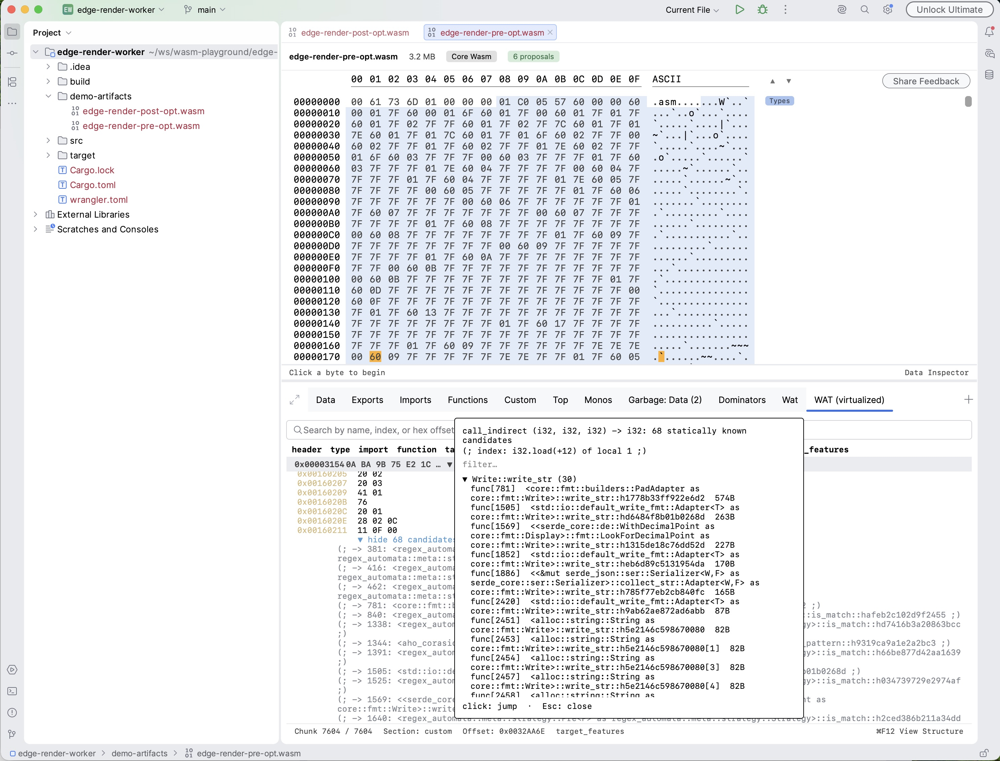
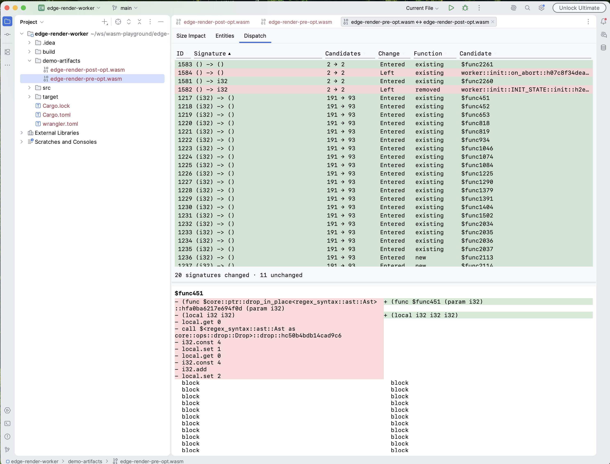
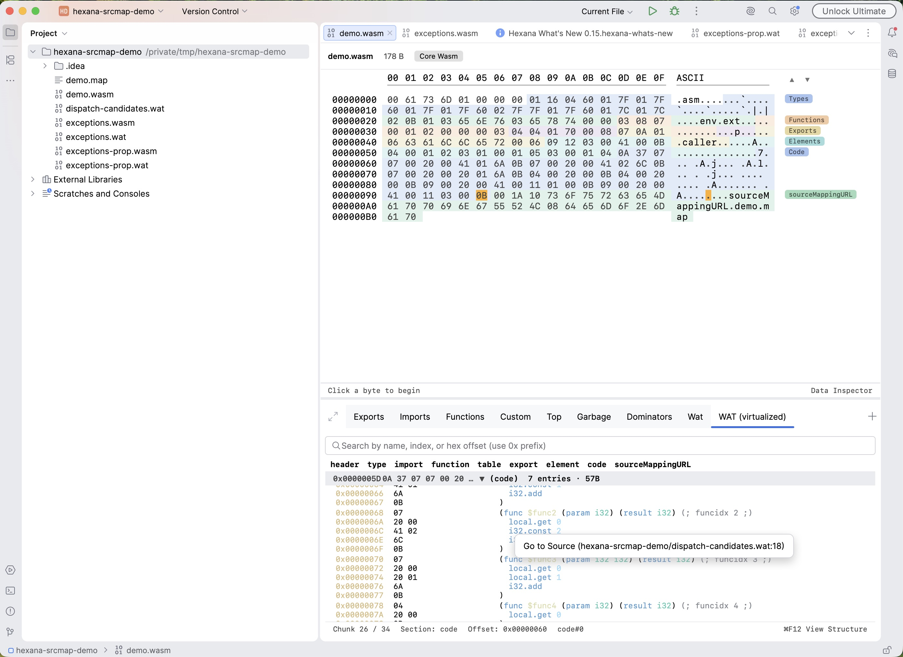
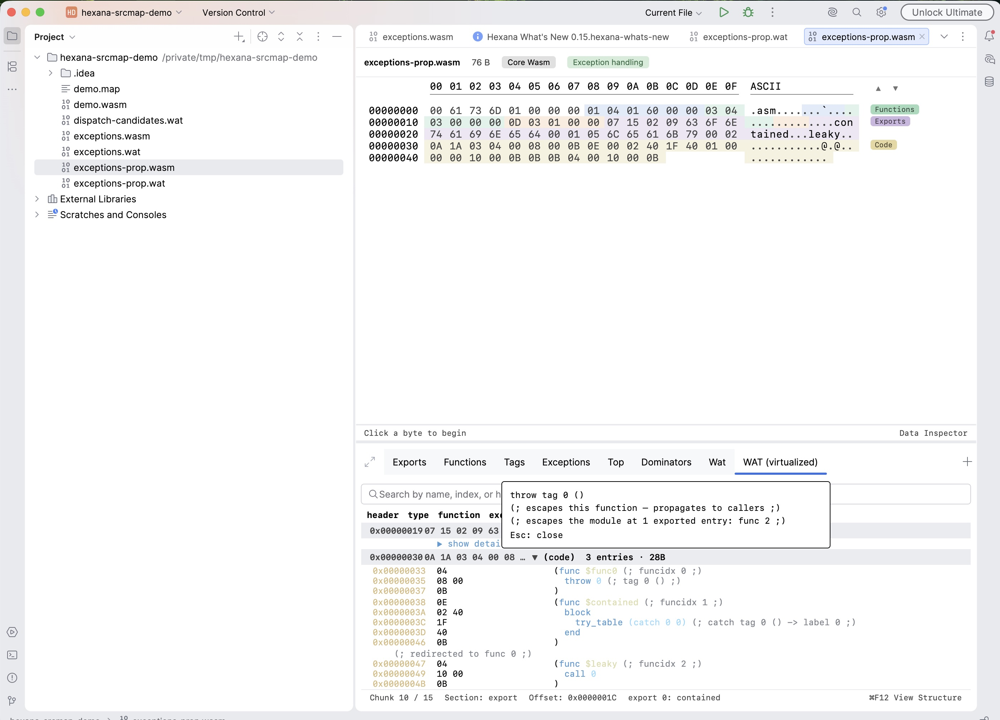
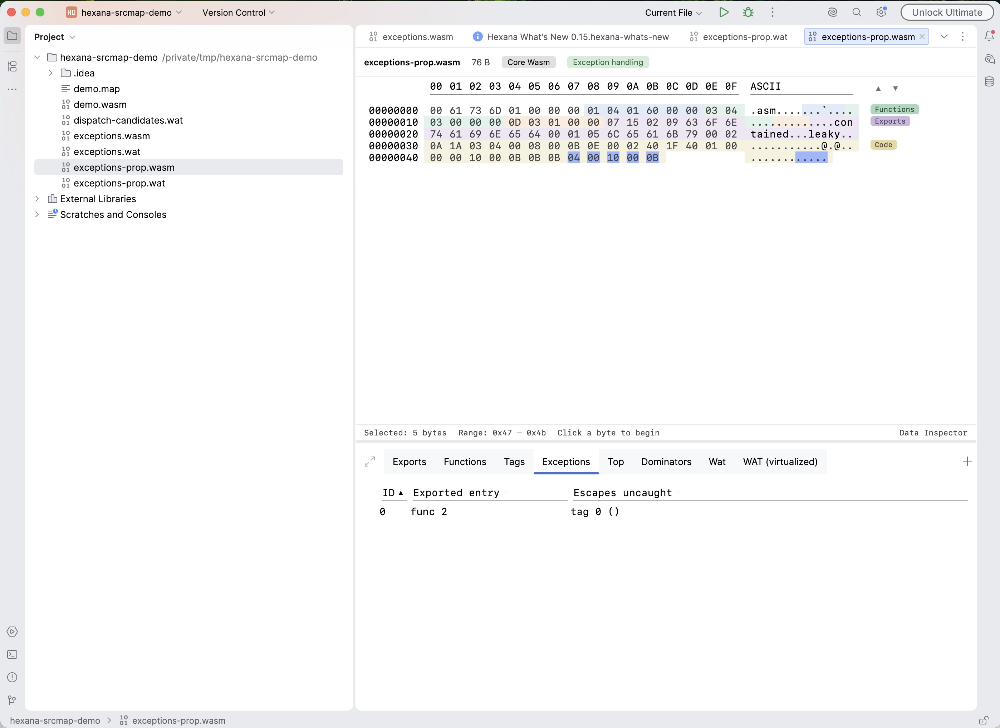
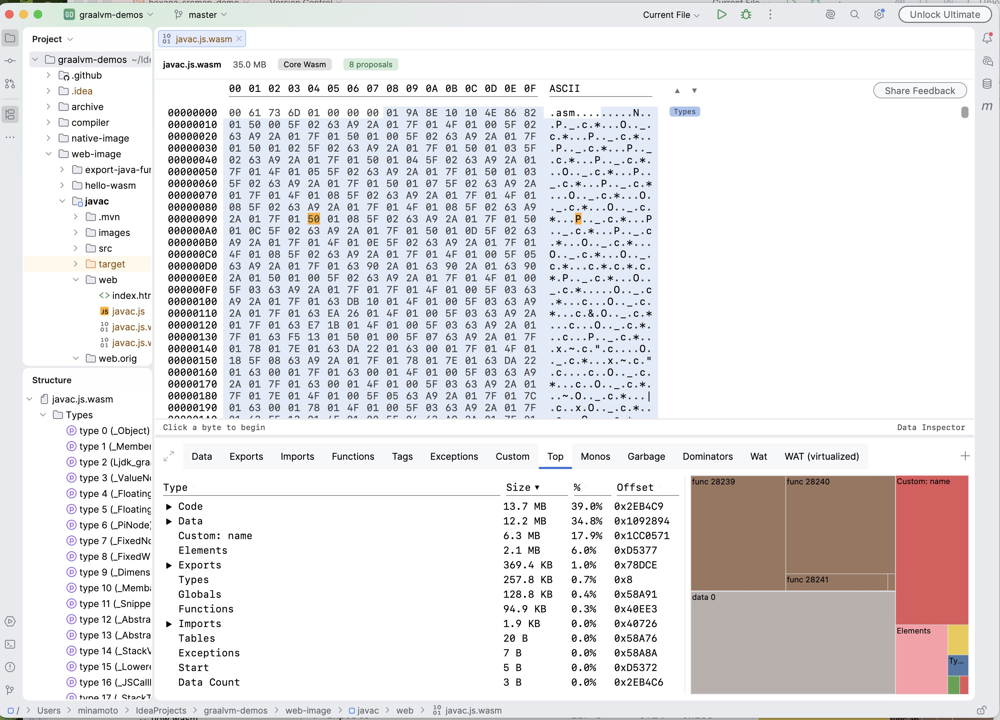
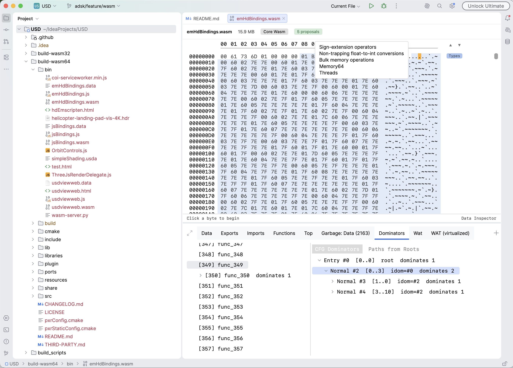

# Hexana 0.15 Release Notes

Released **2026-07-29**. No breaking changes from 0.14.

0.15 makes indirect calls navigable — every `call_indirect` in the WAT view now lists its statically known targets — and adds a **Dispatch** tab to the WASM diff that tracks which functions entered or left the table between two builds. Right-clicking any function row, export, or WAT instruction now offers **Go to Source** when debug information is present, resolving through DWARF or source maps including Kotlin/Wasm and Emscripten's `sourceMappingURL` convention. Exception-handling proposal instructions now render with full decoded annotations and two new tabs — **Tags** and **Exceptions** — expose the module's panic surface. The **Top** tab gains a treemap view. **Save As** works for nested modules and archive entries. The release also fixes the Dominators empty-tree regression from 0.14 and corrects source-location resolution for Rust-produced modules.

## call_indirect dispatch candidates in WAT

Every `call_indirect` and `return_call_indirect` row in the WAT (virtualized) view now shows its statically known dispatch candidates.

**How matching works.** Candidates are the functions in the element segments (active and passive) whose type signature matches the call site's type. Matching is structural: functions declared under different but identical type entries are merged. Functions written into the table at runtime via `table.set` are not visible to static analysis.

**Navigation.** Click the instruction row (or press Go to Declaration) to open a candidates popup. Each entry navigates to that candidate's body in the WAT view. Alternatively, expand the inline `show N candidates` row beneath the instruction for the full list as click-navigable rows.

**Explicit callout for trapping call sites.** When a signature has no matching table entries at all, the row says so explicitly: that call site can only trap. The lists are labelled "statically known", not "all possible targets", to make the approximation clear.

## Dispatch tab in WASM diff

The WASM module diff gains a **Dispatch** tab alongside **Size Impact** and **Entities**. It shows, per canonical signature, which dispatch candidates entered or left the function table between the two builds.

**Content-hash identity.** Cross-build candidate matching uses the same content-hash function matcher as the **Entities** tab. Names are not trusted because tools such as wasm-bindgen rename closure shims on every build. Each row distinguishes a brand-new or removed function from an existing function that merely entered or left the table — the quiet mechanism that pins code `wasm-opt` cannot remove.

**Clicking a row** opens the side-by-side WAT comparison for that candidate.

**Example: `wasm-opt -Oz` on workers-rs.** Running Binaryen's optimiser on a workers-rs module leaves the element segments byte-identical in count while duplicate-function elimination makes hundreds of table slots share one body. The Dispatch tab shows exactly that shrinkage per signature, which the Size Impact and Entities tabs do not surface.

## Go to Source

Right-clicking a row in the **Functions** or **Exports** tab, or an instruction row in the WAT view, now offers `Go to Source (dir/file.rs:123)` when debug information is present. Clicking opens the source file at the resolved line in the IDE editor.

**Resolution order.** Function rows resolve to the function's first mapped line (the signature). WAT instruction rows resolve per instruction. Locations come from DWARF when present, falling back to a source map otherwise.

**Source map discovery.** Source maps are now discovered through the module's `sourceMappingURL` custom section — the form Kotlin/Wasm and Emscripten emit. A path is resolved relative to the wasm file (absolute paths are accepted), and `data:` URLs with an inline map are decoded. The existing `<file>.map` sidecar convention is the fallback. Remote `http(s)` URLs are not fetched.

The WAT row context menu also carries the dispatch-candidates action on `call_indirect` rows.

## Exception-handling visibility

Exception-handling proposal instructions now render with full decoded annotations, and two new tabs expose the module's panic surface.

### Instruction rendering

`throw`, `try_table`, and `throw_ref` instructions now render with their real WAT text plus trailing comments that decode each index:

- `throw 0` — the tag index and its payload signature.
- `try_table (catch 0 1) (catch_all 2)` — each catch clause's tag and target label.
- `throw_ref` — rendered as-is (no index to decode).

### Click to resolve

Clicking a `throw` row resolves where it is caught: the enclosing `try_table` and clause (tag-specific or `catch_all`), or a report that the throw escapes the function. For an escaping throw, Hexana names the exported entry points whose callers can receive the exception uncaught.

### Tags tab

A **Tags** tab decodes the module's exception tags: index, origin, attribute, and payload type signature. This is the exception-handling equivalent of the **Types** tab for function types.

### Exceptions tab

An **Exceptions** tab shows the module's panic surface: exported entry points whose exceptions escape to the host, with the tags (and any dynamic `throw_ref` or host-import throws) that can get out.

**Sound under-approximation.** The analysis is a sound static under-approximation: the escapes it reports are real. `throw_ref` and imported-function throws, which static analysis cannot trace to individual tags, are tracked as a dynamic category, and a `catch_all` on the path correctly marks a throw as "caught".

## Clickable section labels

Semantic section labels are now clickable wherever a corresponding information tab exists. Clicking the label switches directly to that tab. (The label rendering arrived with 0.14's section highlighting; this release wires up the click target.)

## Save As for nested modules and archive entries

**Save As** is now available from the editor context menu for nested WASM modules (opened from a Component Model component or a diff submodule view) and for entries inside JAR and ZIP archives. The action writes the content to a separate file of your choice on disk.

## Top size treemap tab

The **Top** tab gains a size diagram for WASM and native binaries: a treemap that shows the largest entities by size as proportional areas, alongside the existing sortable breakdown.

## Changed: indirect-call hub nodes per signature

The call graph now models indirect calls through one hub node **per canonical signature** — for example `<indirect: (i32, i32) -> i32>` — instead of the single `<indirect calls>` node introduced in 0.14. Each indirect-calling function connects only to the hubs of the signatures it actually dispatches through, and each hub fans out only to the table functions matching that signature. In the **Dominators** and **Caller Paths** views the grouping now reads "retained by indirect callers of this signature" rather than one undifferentiated bucket. The edge count keeps the same linear bound as the 0.14 fix (call sites plus table entries, now partitioned by signature).

## Fixed

**Dominators tree empty in 0.14.** The compact dominator storage introduced in 0.14 used −1 as its "no parent" marker, which is also the virtual root's node id, so every function dominated directly by the root was dropped from the tree. Function-level CFG dominators were unaffected, which is how it slipped through testing. The tree now renders fully.

**Source locations resolve on Rust-produced modules.** The DWARF lookup previously found compilation units by their `low_pc` / `high_pc` attributes, which rustc does not emit (it uses range lists instead), so the hex view's "Open in sources" never appeared for Rust artifacts. The lookup now also consults the line tables directly. Two further mismatches are fixed: callers pass module-absolute offsets while WASM DWARF addresses are code-section-relative (queries are now converted, and DWARF-based navigation was one line off as a result), and a module that parses but has no DWARF — the Kotlin/Wasm case — no longer skips the source-map fallback.

**Nested table row sorting restored.** Rows of nested tables are sorted again according to the parent sorting rules. This also fixes the sort order in the **Top** tab.

**Rare UI freeze on tab switch fixed.** A freeze that had occasionally occurred when switching between the Decompiled and other tabs multiple times no longer happens.

## Upgrading to 0.15

No breaking changes. All 0.15 additions are automatic or additive.

- **call_indirect candidates** appear automatically in the WAT (virtualized) view for every `call_indirect` row.
- The **Dispatch tab** appears in the WASM diff editor alongside Size Impact and Entities.
- **Go to Source** appears in the right-click menu on function/export rows and WAT instruction rows when debug information is available.
- **Tags** and **Exceptions** tabs appear automatically for modules that contain exception-handling constructs.
- **Save As** appears in the editor context menu for nested WASM modules and archive entries.
- The **Top** tab's size treemap appears automatically for WASM and native binaries.
- Everything runs on your machine. No data is sent anywhere.

## Known limitations in 0.15

- `call_indirect` candidates reflect element-segment entries only; functions written into the table at runtime via `table.set` are not visible to static analysis.
- Exception analysis is a sound under-approximation: dynamic `throw_ref` paths and imported-function throws are tracked as a category, not traced to individual throw sites.
- Go to Source does not fetch remote `http(s)` source maps.
- Carryover from prior releases: the Parquet / Arrow Data tab decodes the first row group or record batch only; schema-less protobuf decoding cannot recover field names; wazero runs modules only; Android DEX support is basic; native-binary and Cranelift backend support are experimental; Java integration covers Java sources only.

## Earlier releases

- [Hexana 0.14 release notes](changelog-0.14.md) — 0.14 (2026-07-22): native binary diff, Component Model dependency diagram, data inspector, section highlighting and navigation, MCP schema v3, indirect-call synthetic node, memory64 scalability fixes.
- [Hexana 0.13 release notes](changelog-0.13.md) — 0.13 (2026-07-08): Apache Parquet and Arrow IPC inspection, Protocol Buffers descriptor sets, Structure tool window, custom scriptable JS tabs, wazero run support.
- [Hexana 0.12 release notes](changelog-0.12.md) — 0.12 (2026-06-24): static-library archives, Component Model diff and WAT view, Exports/Imports row affordances, Android DEX, ZIP64.
- [Hexana 0.11 release notes](changelog-0.11.md) — 0.11 (2026-06-11) and 0.11.1 (2026-06-17): module diff with structural matching, Kotlin/Wasm source navigation, GraalVM Native Image with embedded SBOM.
- [Hexana 0.10 release notes](changelog-0.10.md) — 0.10 (2026-05-27), plus the 0.10.1–0.10.3 patch line.
- [Hexana 0.9 release notes](changelog-0.9.md) — 0.9 (2026-05-07), 0.9.1 (2026-05-20).