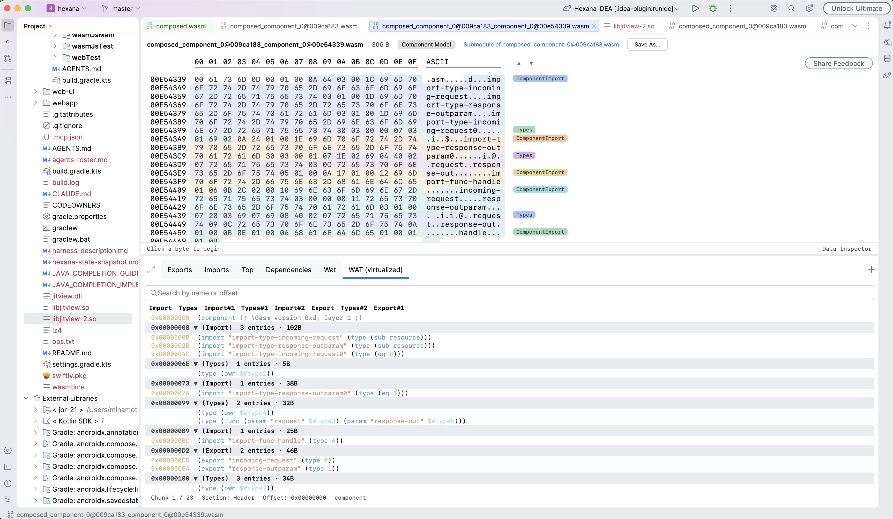
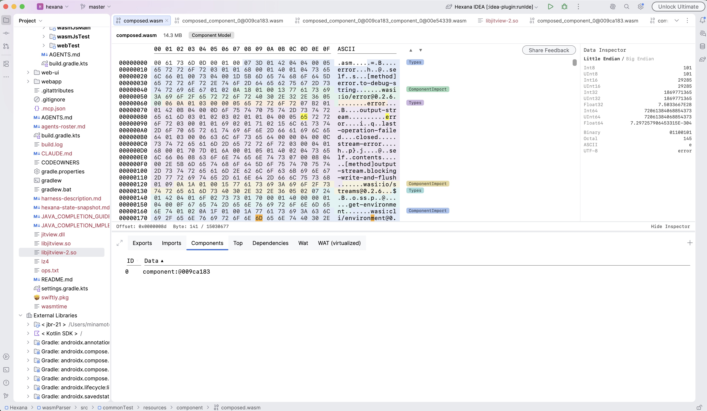

# Hexana 0.16 Release Notes

Released **2026-08-05**. No breaking changes from 0.15.

0.16 closes the last gap in Component Model coverage. Glue-only components (those with no embedded core modules) now render fully in the WAT (virtualized) view, and nested components open in their own editor with a **Components** tab for navigation, mirroring the existing **Modules** tab for core modules.

## WAT (virtualized) for glue-only components

The **WAT (virtualized)** tab of a Component Model binary no longer goes empty when the component embeds no core modules. Glue-only components (types, imports, exports, instances, aliases) now render their component-level constructs in the same virtualized panel core modules get: foldable per-section headers, search by name or offset, and a clickable offset gutter that jumps to the byte in the hex view.

Imports and exports are anchored to their exact byte ranges. Sections the parser cannot decode per record (for example `canon`) show an explicit "not decoded" row instead of failing the view.

Rendering works from the in-memory buffer, so it also covers nested components opened from the **Components** tab. The plain **Wat** tab now converts in-memory nested views directly from their bytes instead of failing with "No such file or directory".

## Components tab and nested component navigation

Nested components of a Component Model binary now open in their own editor view. A **Components** tab lists the embedded components the way **Modules** lists embedded core modules; clicking a row opens it.

Opening is recursive: modules and components inside an already-opened nested view open the same way. Byte offsets accumulate across levels, so every nested view is labelled with its absolute offset in the root file.

Nested in-memory views do not offer Run actions (there is no file on disk a run configuration could execute) and gain the full tab set of a disk-opened file, including the plain Wat tab and, for core modules, DWARF panels.

## Upgrading to 0.16

No breaking changes. All additions are automatic or additive.

- The **WAT (virtualized)** tab now renders for any Component Model binary, including those with no embedded core modules.
- The **Components** tab appears automatically for Component Model files that contain nested components.
- Nested components open recursively on click, with accumulated absolute byte offsets in the tab label.
- Everything runs on your machine. No data is sent anywhere.

## Known limitations in 0.16

- Sections the parser cannot decode per record (such as `canon`, `start`, and `value` sections) show an explicit "not decoded" row rather than full decoded content.
- Nested in-memory views do not offer Run actions.
- Carryover from prior releases: the Parquet / Arrow Data tab decodes the first row group or record batch only; schema-less protobuf decoding cannot recover field names; wazero runs modules only; Android DEX support is basic; native-binary and Cranelift backend support are experimental; Java integration covers Java sources only.

## Earlier releases

- [Hexana 0.15 release notes](changelog-0.15.md): 0.15 (2026-07-29): call_indirect dispatch candidates in WAT, Dispatch tab in WASM diff, Go to Source from DWARF and source maps, exception-handling visibility (Tags and Exceptions tabs), Top size treemap, Save As for nested modules and archive entries, and the 0.14 Dominators empty-tree fix.
- [Hexana 0.14 release notes](changelog-0.14.md): 0.14 (2026-07-22): native binary diff, Component Model dependency diagram, data inspector, section highlighting and navigation, MCP schema v3, indirect-call synthetic node, memory64 scalability fixes.
- [Hexana 0.13 release notes](changelog-0.13.md): 0.13 (2026-07-08): Apache Parquet and Arrow IPC inspection, Protocol Buffers descriptor sets, Structure tool window, custom scriptable JS tabs, wazero run support.
- [Hexana 0.12 release notes](changelog-0.12.md): 0.12 (2026-06-24): static-library archives, Component Model diff and WAT view, Exports/Imports row affordances, Android DEX, ZIP64.
- [Hexana 0.11 release notes](changelog-0.11.md): 0.11 (2026-06-11) and 0.11.1 (2026-06-17): module diff with structural matching, Kotlin/Wasm source navigation, GraalVM Native Image with embedded SBOM.
- [Hexana 0.10 release notes](changelog-0.10.md): 0.10 (2026-05-27), plus the 0.10.1-0.10.3 patch line.
- [Hexana 0.9 release notes](changelog-0.9.md): 0.9 (2026-05-07), 0.9.1 (2026-05-20).
