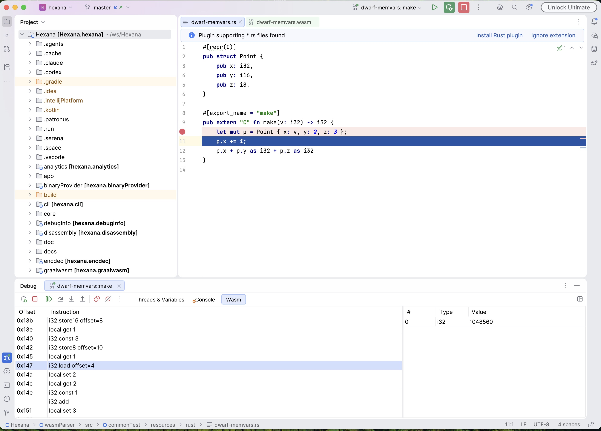
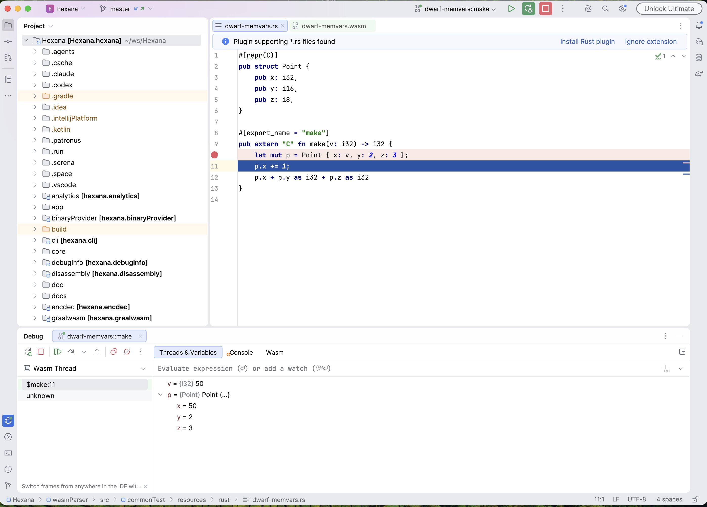
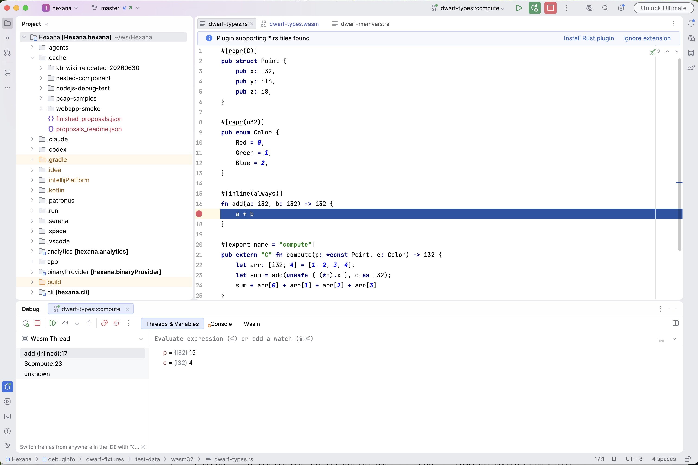
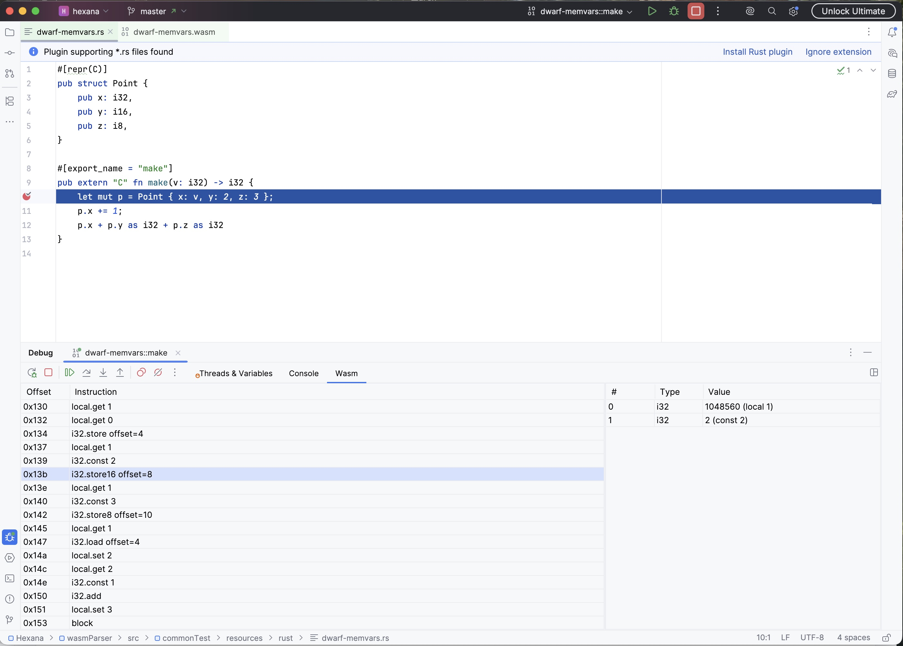
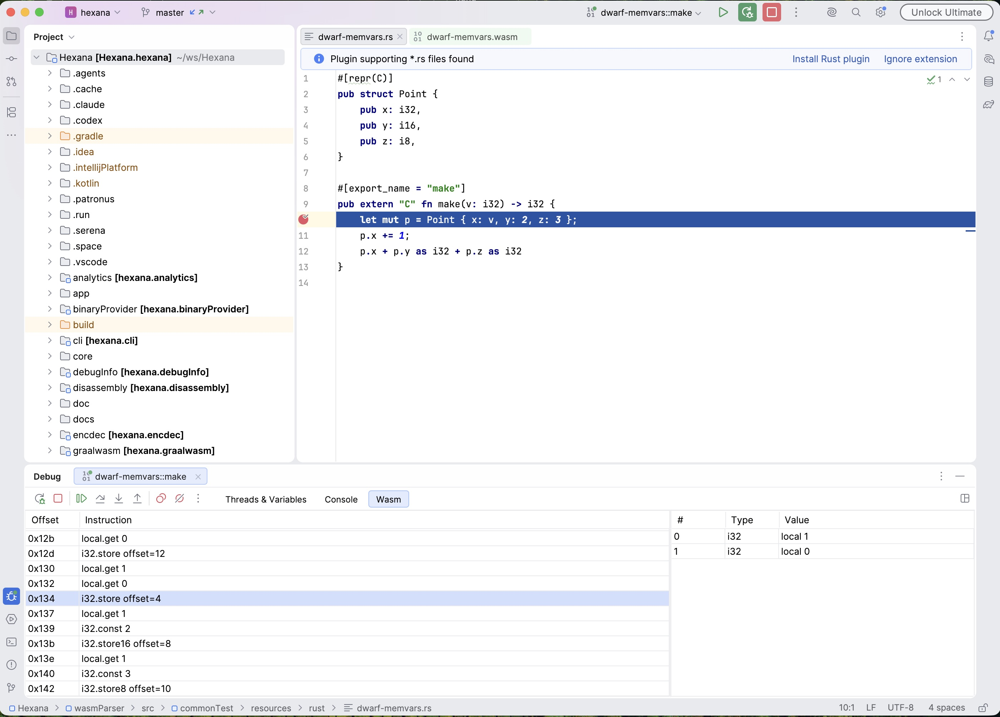
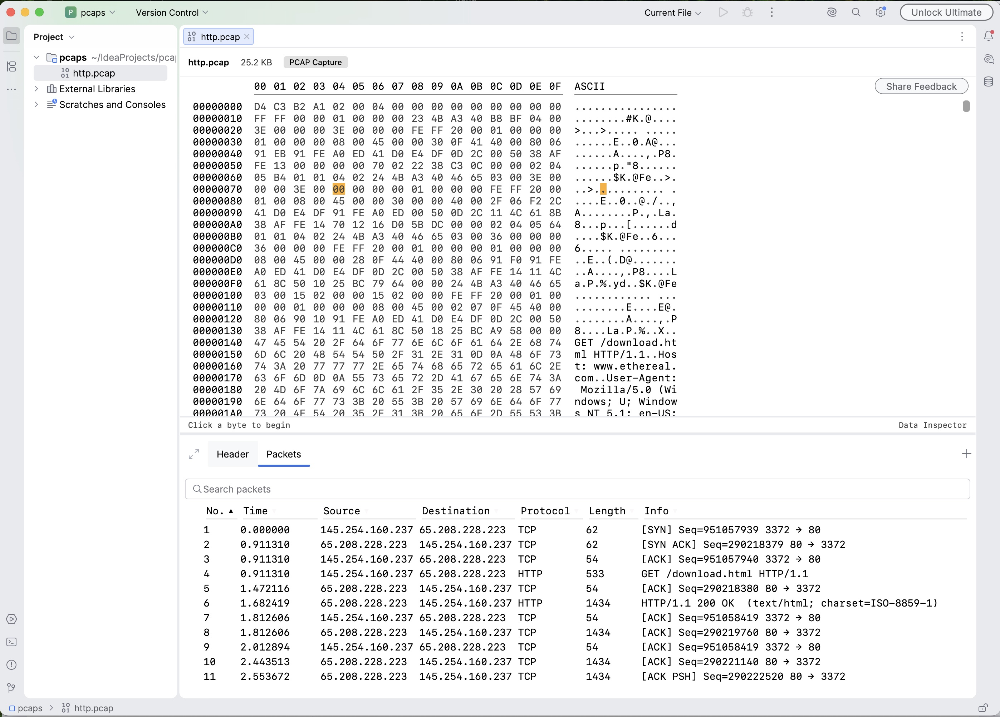

# Hexana 0.17 Release Notes

Released **2026-08-12**. No breaking changes from 0.16.

0.17 brings deep wasm debugger integration: a new **Wasm** tab in the debugger shows a live WAT disassembly of the paused function with the current instruction selected, plus a typed operand stack, both for Node.js/browser sessions (V8) and for wasmtime sessions (LLDB). Conditional breakpoints now translate DWARF source-variable names to V8's internal wasm-local names. Inlined call frames appear in the stack with `(inlined)` suffixes reconstructed from DWARF. Variables stored in linear memory (structs, arrays, enums; common in unoptimized builds) become visible in Node.js sessions: Hexana reads them from the module's memory over the debugger protocol and decodes them per their DWARF types. A new **Problems** tab lists every byte region the parser could not decode, with location, offset, size and a message, making unsupported instructions navigable rather than silent. Custom-descriptors proposal type encodings (exact reference types, `descriptor`/`describes` clauses) now parse correctly, fixing WasmGC modules from recent Kotlin/Wasm and J2CL toolchains that previously failed to load. The release also adds basic pcap/pcapng viewing, tar entry viewing, and direct opening of gzip-compressed files.

## Wasm debugger tab

### Node.js and browser sessions

A **Wasm** tab appears in the debugger when debugging a wasm module under Node.js or a browser. The left pane disassembles the paused function to WAT (same mnemonics and symbolic `call $name` operands as the WAT view, block bodies indented) with the current instruction selected and following every step. The right pane shows the live operand stack with typed entries.

**Stepping granularity.** While the Wasm tab is selected, one step is one wasm instruction. Otherwise a step runs until the source line changes. V8 natively steps wasm one instruction at a time, so a single source line previously took several Step Over clicks to cross.

**Conditional breakpoints.** Condition expressions are translated from DWARF source variable names to V8's internal wasm-local names before registration, so conditions use the same names the Variables view shows.

### Linear-memory variables under Node.js

Variables stored in linear memory now appear when debugging under Node.js. V8 only surfaces wasm locals and globals, so anything on the shadow stack or at a fixed address (structs, arrays, enums; typical for parameters and locals in unoptimized builds) was previously invisible. Hexana now locates them via DWARF, reads them from the module's memory over the debugger protocol, and decodes them per their DWARF types: structs expand to members at their recorded offsets, enums render by enumerator name, arrays are bounded, and reads are capped per variable.

### Inlined call frames

When a pause lands inside code the compiler inlined, the stack shows synthetic frames suffixed `(inlined)`, reconstructed from DWARF: the innermost inlined function at the pause location, each caller at its recorded call site. Variables and evaluation stay attached to the physical frame; stepping remains physical.

### wasmtime sessions

The **Wasm** tab also appears when debugging under wasmtime. The left pane disassembles the paused function with the current wasm instruction selected: wasmtime serializes a native-address-to-wasm-offset table into every compiled module, and the stopped pc is translated through it, giving per-instruction resolution even though LLDB only sees native code. Instructions that emit no machine code (such as `local.get` or `i32.const`) are never pause targets and are skipped, mirroring what the CPU executes.

**Symbolic operand stack.** Cranelift compiles the wasm stack machine away, so concrete values are not recoverable from the process. The right pane reconstructs the stack's depth, types and origins statically per wasm's validation rules. Each slot names where its value came from: a local (with its DWARF source name when known), a constant (the one case with a real value), or the producing instruction (`i32.add @0x52`, `call make @0x341f`). When the shape cannot be reconstructed (unsupported instructions, SIMD/atomics in the function), the pane says so explicitly instead of showing a wrong stack.

## Problems tab

When the parser hits bytes it cannot decode, it no longer discards the whole function body: decoding keeps everything up to the failure and records the rest as one unparsed region. Every such region appears as a row in the new **Problems** tab with its kind, location, byte offset, size and message.

**Navigation.** Clicking a row jumps to the affected function in the **WAT (virtualized)** tab; the context menu also offers the plain **Wat** tab, which scrolls to the nearest annotated line. Rows not tied to a function select the failed byte range in the hex view.

The tab appears only when the module actually has parse problems. It also covers component binaries: unknown instance-encoding tags and mid-entry decode failures in the core-instance section now appear here instead of crashing the **Dependencies** tab.

## Custom-descriptors type encodings

Type-section encodings from the custom-descriptors proposal (Phase 3) now parse with correct alignment: exact reference types (`(ref null (exact $t))`) and `descriptor`/`describes` clauses are recognised. WasmGC modules emitted with these encodings (recent Kotlin/Wasm and J2CL toolchains) previously failed to parse at all: the type section silently misparsed from the first exact type onward and every later function body degraded to an unparsed blob or a NullPointerException.

## pcap and pcapng viewing

Hexana opens pcap and pcapng files directly. The editor shows the hex view alongside a **Packets** tab listing each captured packet with its timestamp, source, destination, protocol, length and info. HTTP response bodies can be opened in a new tab from the context menu.

## tar entry viewing and gzip support

Tar archives can now be opened in Hexana, with entries visible and openable directly. Gzip-compressed files of supported kinds (such as `.wasm.gz`) can also be opened directly without manual decompression.

## Fixed

**Dependencies tab crash on unknown component instances.** Opening the **Dependencies** tab of a Component Model binary crashed with `NotImplementedError` when the core-instance section contained an entry the parser cannot decode. Such entries are now recorded as parse problems instead. The dependency graph and the component WAT text label the affected instances explicitly instead of failing.

**WAT scroll offset with rec groups.** Navigating to a function in the WAT (virtualized) tab (from the Problems tab, go-to-function or search) landed on the wrong function in modules whose type section contains collapsed `(rec ...)` groups: every collapsed group member before the target shifted the scroll one row further. The scroll index now accounts for group-collapsed rows.

**Hex byte column after unparsed opcode regions.** The WAT view's hex byte column garbled every line after an unparsed opcode region: the renderer advanced one byte instead of the region's full size.

**DWARF path matching for crates sharing file names.** Debugger pauses and breakpoints could open the wrong file in projects where several crates share source file names (`lib.rs`, `mod.rs`): DWARF paths were matched by base name only. Both display and breakpoint direction now prefer the longest matching path suffix.

**Linear-memory location fallback no longer claims wrong variable names.** In unoptimized wasm builds, the Variables view labeled compiler scratch locals with source variable names (the shadow stack pointer showed up as a struct variable). The positional name fallback no longer claims variables whose DWARF location is linear memory. V8's operand-stack object also no longer appears in Variables under a stolen variable name; its entries live in the **Wasm** tab.

**wasmtime breakpoints at crate roots.** Wasmtime breakpoint stops were silently skipped for crates that keep sources at the crate root (`<crate>/lib.rs` with no `src/` directory, common for standalone examples). The stop-location verification assumed the `<crate>/src/<file>` layout and auto-resumed past the breakpoint as a suspected wrong-file match. A matching crate directory directly above the file now confirms the stop; colliding generic tails such as `src/lib.rs` across different crates are still rejected.

**Breakpoint placement no longer queries DWARF on the UI thread.** Placing a breakpoint in a wasm source file previously tripped the platform's slow-operation assertion. The index snapshot is now cached in the background, preloaded at project open and refreshed immediately when any `.wasm` file in the project changes.

**Debug runner API on 2026.1+.** Starting a wasm debug session no longer logs a "[Split debugger] RunContentDescriptor should not be used" error on 2026.1+: all debug runners now start sessions through the platform's session-builder API where available, keeping the old path on IDEs that predate it.

## Upgrading to 0.17

No breaking changes. All 0.17 additions are automatic or additive.

- The **Wasm** tab appears automatically in the debugger when a wasm debug session (Node.js, browser, or wasmtime) is active.
- **Linear-memory variables** appear automatically in Node.js wasm debug sessions when DWARF is present.
- **Inlined frames** appear automatically in the debugger stack when DWARF inline records are present.
- **Conditional breakpoints** in wasm sessions now accept DWARF source-variable names.
- The **Problems** tab appears automatically for modules with parse failures.
- **Custom-descriptors** type encodings parse automatically; previously failing modules now load.
- pcap/pcapng files open directly; tar archives open directly; gzip-wrapped supported files open directly.
- Everything runs on your machine. No data is sent anywhere.

## Known limitations in 0.17

- The wasmtime operand stack shows types and origins, not live values (Cranelift compiles the wasm stack machine away). When the function uses SIMD or atomics, the pane reports that reconstruction is not available.
- Linear-memory variable reads are capped per variable and bounded in array length.
- Conditional breakpoints require V8-based runtimes (Node.js/browser); wasmtime does not support wasm-level conditions via LLDB.
- Carryover from prior releases: the Parquet / Arrow Data tab decodes the first row group or record batch only; schema-less protobuf decoding cannot recover field names; wazero runs modules only; Android DEX support is basic; native-binary and Cranelift backend support are experimental; Java integration covers Java sources only.

## Earlier releases

- [Hexana 0.16 release notes](changelog-0.16.md): 0.16 (2026-08-05): WAT (virtualized) rendering for glue-only Component Model binaries, Components tab for nested component navigation.
- [Hexana 0.15 release notes](changelog-0.15.md): 0.15 (2026-07-29): call_indirect dispatch candidates, Dispatch tab in WASM diff, Go to Source from DWARF and source maps, exception-handling visibility, Top size treemap, Save As for nested modules and archive entries.
- [Hexana 0.14 release notes](changelog-0.14.md): 0.14 (2026-07-22): native binary diff, Component Model dependency diagram, data inspector, section highlighting and navigation, MCP schema v3, indirect-call synthetic node, memory64 scalability fixes.
- [Hexana 0.13 release notes](changelog-0.13.md): 0.13 (2026-07-08): Apache Parquet and Arrow IPC inspection, Protocol Buffers descriptor sets, Structure tool window, custom scriptable JS tabs, wazero run support.
- [Hexana 0.12 release notes](changelog-0.12.md): 0.12 (2026-06-24): static-library archives, Component Model diff and WAT view, Exports/Imports row affordances, Android DEX, ZIP64.
- [Hexana 0.11 release notes](changelog-0.11.md): 0.11 (2026-06-11) and 0.11.1 (2026-06-17): module diff with structural matching, Kotlin/Wasm source navigation, GraalVM Native Image with embedded SBOM.
- [Hexana 0.10 release notes](changelog-0.10.md): 0.10 (2026-05-27), plus the 0.10.1-0.10.3 patch line.
- [Hexana 0.9 release notes](changelog-0.9.md): 0.9 (2026-05-07), 0.9.1 (2026-05-20).
