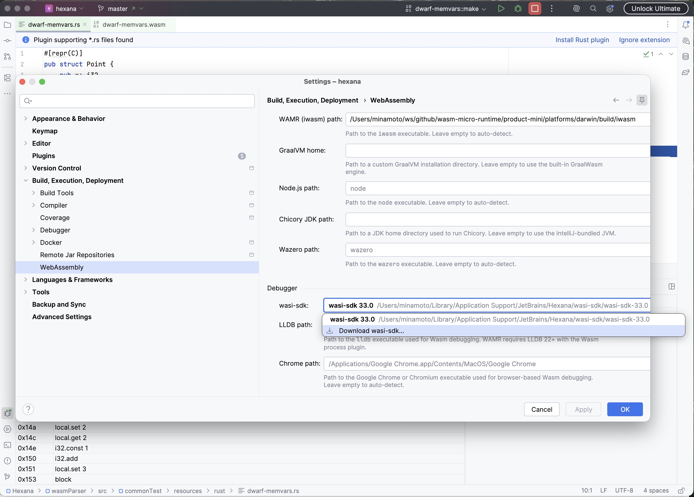

# Hexana 0.18 Release Notes

Released **2026-08-19**. No breaking changes from 0.17.

0.18 rewrites the wasmtime debug path: sessions now attach over wasmtime's built-in gdbstub (`wasmtime run -g <port>`) using LLDB's wasm process plugin, so arguments, locals, and the operand stack all show concrete values. The same per-instruction stepping and stack panel now appear when debugging under WAMR. A JDK-style wasi-sdk manager in Settings handles download, version selection, and sha256 verification so the wasm-capable LLDB is easy to install. Component Model WAT handling gets parsing, navigation, and annotation improvements. An expression evaluation crash that killed the LLDB process on wasmtime is fixed.

## Managed wasi-sdk installation

Wasm debugging needs an LLDB built with the wasm process plugin; the wasi-sdk distribution ships one. The **WebAssembly** settings page now has a JDK-style selector that lists installed wasi-sdk versions and includes a **Download wasi-sdk...** action.

**Download flow.** The action opens a version chooser fed from GitHub releases with download sizes shown. Each download is sha256-verified against the release digest, is cancellable, and installs side by side with existing versions. The SDK lands under the IDE's common data directory, so one download serves every project and every JetBrains IDE on the machine.

**Activation.** The managed SDK takes effect only through an explicit **Use as LLDB path** action (available in the settings row and in the install notification) that writes the ordinary LLDB path setting. The selection mechanism is otherwise unchanged.

**Notifications.** When a debug session cannot find LLDB, a notification offers the download. When LLDB is found but no wasi-sdk is installed and no explicit LLDB path is set, a one-time notification suggests it.

## Wasmtime debugging: gdbstub rewrite

Wasmtime debugging now attaches over wasmtime's built-in gdbstub guest debugger. The session starts `wasmtime run -g <port>` and connects LLDB over the gdb-remote protocol (`process connect --plugin wasm`). LLDB reads DWARF directly from the wasm module, so the JIT loader, the native-address-to-wasm-offset translation, and the trap workarounds of the old native path are gone.

Requires wasmtime 44 or newer (older versions fail early with an update hint) and an LLDB with the wasm process plugin (wasi-sdk ships one; recent LLVM builds include it as well).

**What changes in practice.**

- Arguments and locals show concrete values. Cranelift compiled them away before; the Variables view could only show storage-location hints.
- Stepping is per wasm instruction (see below).
- The debugger stack shows guest frames only.

### Per-instruction stepping under wasmtime

While the **Wasm** tab is selected, Step Over and Step Into advance exactly one wasm instruction, including instructions the old native path could never stop on (`local.get`, `i32.const`). With any other tab selected, stepping stays at source-line granularity.

### Live operand-stack values under wasmtime

The **Wasm** tab's operand stack shows live values at every stop. Each slot is read from the runtime (wasmtime's gdbstub serves the operand stack over the debug protocol; requires wasmtime 44 or newer) and rendered next to its statically reconstructed origin, for example `7 (i32.add @0x7c)`. The 0.17 release could only show origins because the native debug path had no access to values Cranelift compiles away. On runtimes that do not answer, the pane keeps the origin-only display.

## WAMR debugger tab

The **Wasm** debugger tab now also appears when debugging under WAMR. WAMR's gdbstub reports wasm byte offsets directly, so the current-instruction highlight and per-instruction stepping (Step Over and Step Into while the tab is selected) work the same way as under wasmtime.

**Operand stack.** Live values are shown for slots that mirror a local or a global, read over the debug protocol. WAMR's stub has no operand-stack accessor, so computed intermediates (arithmetic results, call returns) keep their statically reconstructed origin.

**Requirement.** Requires an iwasm built with `WAMR_BUILD_DEBUG_INTERP=1`. A stock iwasm (Homebrew, release tarballs) lacks the `-g` option; the session fails early with rebuild instructions.

## Exact current-instruction highlight

Instructions without immediates (`i32.add`, `end`, `drop`, and similar) have no recorded offsets in the parser model. Their rows now get offsets deduced from neighboring instructions, so the highlight lands on the correct row. The function's closing `end` (a legitimate pause target with the return values on the stack) is rendered as a row. Previously the highlight snapped to the nearest earlier offset-bearing row, which per-instruction stepping made visibly wrong.

## Component Model WAT improvements

- Parsing, reference resolution, and navigation are improved for Component Model constructs in WAT files.
- **Find Usages** for WAT declarations now works in the embedded WAT editor.
- Custom annotation sections such as `(@producers (processed-by "wit-component" "0.227.1") (language "Rust" ""))` no longer render as errors. Annotation contents are free-form by design, so an unrecognised word inside one is treated as annotation text and rendered in the metadata colour. Unrecognised words outside an annotation are still flagged.

## Fixed

**Expression evaluation crash.** Evaluating an expression in a wasmtime debug session no longer kills the LLDB process. LLDB's expression compiler cannot generate code for wasm targets and aborts on any expression that parses (an upstream LLVM defect, present in wasi-sdk and stock LLVM builds alike). Hexana now evaluates variable paths (`x`, `s.field`, `p->x`, `arr[0]`) through `frame variable`, which is unaffected, and rejects other expressions with an explanatory message instead of forwarding them.

## Upgrading to 0.18

No breaking changes. All 0.18 additions are automatic or additive.

- The **wasi-sdk manager** appears in Settings under Build, Execution, Deployment > WebAssembly.
- **Wasmtime gdbstub** is the new default path; requires wasmtime 44 or newer and a wasm-capable LLDB.
- The **Wasm** tab and per-instruction stepping appear automatically under WAMR when the debug session is live.
- **Exact instruction offsets** for no-immediate instructions apply automatically in the Wasm tab.
- Component Model WAT improvements and annotation handling take effect automatically when opening WAT files.
- Everything runs on your machine. No data is sent anywhere.

## Known limitations in 0.18

- Live operand-stack values under WAMR are limited to slots mirroring a local or a global; arithmetic intermediates show statically reconstructed origins only.
- WAMR debugging requires a custom iwasm build with `WAMR_BUILD_DEBUG_INTERP=1`; stock binaries are not supported.
- LLDB's expression compiler cannot evaluate arbitrary expressions on wasm targets (upstream LLVM limitation); only variable-path expressions work.
- Carryover from prior releases: the Parquet / Arrow Data tab decodes the first row group or record batch only; schema-less protobuf decoding cannot recover field names; wazero runs modules only; Android DEX support is basic; native-binary and Cranelift backend support are experimental; Java integration covers Java sources only.

## Earlier releases

- [Hexana 0.15 release notes](changelog-0.15.md): 0.15 (2026-07-29): call_indirect dispatch candidates in WAT, Dispatch tab in WASM diff, Go to Source from DWARF and source maps, exception-handling visibility, Top size treemap, Save As for nested modules and archive entries.
- [Hexana 0.14 release notes](changelog-0.14.md): 0.14 (2026-07-22): native binary diff, Component Model dependency diagram, data inspector, section highlighting and navigation, MCP schema v3, indirect-call synthetic node, memory64 scalability fixes.
- [Hexana 0.13 release notes](changelog-0.13.md): 0.13 (2026-07-08): Apache Parquet and Arrow IPC inspection, Protocol Buffers descriptor sets, Structure tool window, custom scriptable JS tabs, wazero run support.
- [Hexana 0.12 release notes](changelog-0.12.md): 0.12 (2026-06-24): static-library archives, Component Model diff and WAT view, Exports/Imports row affordances, Android DEX, ZIP64.
- [Hexana 0.11 release notes](changelog-0.11.md): 0.11 (2026-06-11) and 0.11.1 (2026-06-17): module diff with structural matching, Kotlin/Wasm source navigation, GraalVM Native Image with embedded SBOM.
- [Hexana 0.10 release notes](changelog-0.10.md): 0.10 (2026-05-27), plus the 0.10.1-0.10.3 patch line.
- [Hexana 0.9 release notes](changelog-0.9.md): 0.9 (2026-05-07), 0.9.1 (2026-05-20).
