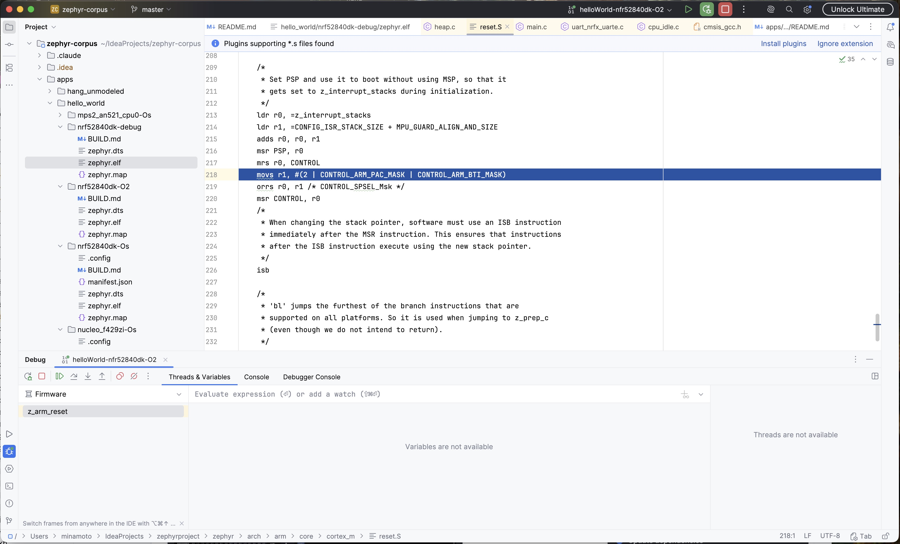

# Hexana 0.19 Release Notes

Released **2026-08-26**. No breaking changes from 0.18.

0.19 brings firmware ELF support to the IDE: opening a Zephyr-class ELF now offers Run and Debug buttons backed by QEMU or Renode, with tooling acquired on demand. A new **Memory** tab shows the Flash/RAM budget for ELF binaries in section-level detail, sourcing capacities from a linker map or devicetree. The release also fixes two long-standing correctness issues: Cortex-M ELFs now disassemble as Thumb-2 (previously decoded as A32, producing garbage), and GCC-built ELFs with DWARF now resolve source lines correctly.

## Run and Debug for firmware ELFs

Opening a Zephyr-class ELF now offers **Run** and **Debug** buttons in the editor header when a target profile resolves from the ELF header plus a `zephyr.dts` and `.config` found next to it (the same build-tree discovery the Memory tab uses).

**Emulator selection.** QEMU boards (`qemu_cortex_m3`, `mps2/an521`, `qemu_riscv32`, `qemu_cortex_a53`, and others) launch with exact machine flags from a curated table. MCU-class boards run under Renode, on a built-in platform where Renode ships one (nRF52840 DK, STM32F4 Discovery) or on a platform generated from the devicetree by dts2repl. The emulator choice is annotated with a recommendation and persists in the new **Hexana Firmware** run configuration. A combination the target cannot support fails at validation time naming the reason and the alternative; it never hangs as a stuck emulator.

**Console and watchdog.** Console output streams to the Run tool window behind a one-line emulation notice (unmodeled peripherals read zero, timing differs, radios are not simulated). A startup watchdog reports "did not reach console output" naming the first unimplemented-peripheral access from the Renode log. Stop kills the whole emulator process tree; nothing is left behind on IDE exit.

**Debug.** Debug attaches GDB in DAP mode to the emulator's frozen gdb stub with a configurable stop-at-entry policy (entry, `main`, or none). The preferred GDB is the Zephyr SDK's `arm-zephyr-eabi-gdb-py`; minimum GDB 14 with Python. An LLDB fallback covers machines without a suitable GDB.

**Tooling acquisition.** Emulator tooling is acquired on demand from the run configuration's Tools section with consent-gated, checksum-verified, cancellable downloads: the Renode 1.16.1 portable build, a per-architecture Zephyr SDK GDB toolchain, and a standalone CPython for dts2repl (all desktop platforms). Each tool is also overridable by path in **Settings | Build | Firmware Emulator**. QEMU comes from the system package manager.

## Memory tab for ELF binaries

A new **Memory** tab for executable and shared-object ELFs answers "how full is my device" with a section-level Flash/RAM budget view.

**Layout.** One block per memory region: used/capacity in human units (exact bytes on hover) and a fill bar that turns yellow at 80% and red at 95%. ROM regions are listed before RAM.

**Initialized data annotation.** Initialized data is annotated in both places it lives: "load image" in flash and "runtime copy" in RAM, keeping totals explainable. `.bss` counts only toward RAM; `noinit` sections are marked.

**Capacity sources.** Region capacities come from a linker map (`<name>.map`, `zephyr.map`, or any other `*.map` sibling that matches the ELF) or a Zephyr `zephyr.dts` found next to the ELF automatically. A footer names the active source. A map whose section addresses do not match the ELF (stale build) is detected and ignored with a warning. Without any source the tab still shows the full ROM/RAM breakdown from the ELF's load segments, capacity-free, and a notification strip offers "Link capacity source..." (a `.map`, a `.dts`, or manual flash/RAM sizes; remembered per file).

**Scope.** The budget measures address-space bytes, complementing the **Top** tab's file-byte profile: debug info that never reaches the device is excluded, and a zero-file-byte `.bss` heap arena shows up as the RAM consumer it is. Section rows navigate to the hex view. The tab appears for executable and shared-object ELFs, including fully stripped ones (no symbols or DWARF needed).

## Component Model Wasm debugger

The **Wasm** debugger tab now works for component-model binaries. Every embedded core module is indexed on its own, so the current-instruction highlight, per-instruction stepping, and operand stack follow the module the runtime reports the stop in instead of assuming a single core module.

## Fixed

**Cortex-M firmware disassembles as Thumb-2.** Cortex-M ELFs (Zephyr, ZMK, and similar) previously decoded as A32 from odd start addresses, producing garbage for every function. The M profile recorded in `.ARM.attributes` now selects the Thumb decoder for the whole file, and bit 0 of Thumb function symbol addresses (the interworking marker, not part of the real address) is stripped, so functions start at their even addresses and 32-bit wide encodings (`bl.w`, `mul.w`) decode exactly as objdump shows. A-profile ELFs keep per-symbol mode selection: A32 by default, Thumb for symbols carrying the marker bit.

**DWARF line tables parse for GCC-built ELFs.** The **Debug Info** tab reported "Debug info present, but Hexana did not resolve any source line rows" for GCC-built ELFs even though `.debug_info` and `.debug_line` were present (every Zephyr/ZMK Cortex-M firmware, DWARF4 and DWARF5 alike). GCC emits DWARF version 2/3 line-program headers even in `-gdwarf-4/5` builds, and the line parser misread them with the version 4 layout, failing on the first such unit and discarding the whole section. Clang and rustc emit v4/v5 headers, which always worked. Version 2/3 headers now parse, an unparseable line-table unit is skipped instead of taking the rest of the section down with it, and address-to-line resolution matches addr2line.

## Upgrading to 0.19

No breaking changes. All 0.19 additions are automatic or additive.

- **Run/Debug buttons** appear in the editor header for ELF files when a target profile resolves from the build tree.
- The **Memory** tab appears automatically for executable and shared-object ELFs.
- The **Wasm** debugger tab works for component-model binaries automatically.
- Cortex-M ELFs now disassemble as Thumb-2 automatically.
- DWARF line resolution for GCC-built ELFs is automatic.
- Everything runs on your machine. No data is sent anywhere.

## Known limitations in 0.19

- QEMU comes from the system package manager; Renode, GDB, and CPython are acquired on demand.
- Radios and timing-sensitive peripherals are not simulated; unmodeled peripherals read zero.
- Remote `http(s)` source maps are not fetched.
- Carryover from prior releases: the Parquet / Arrow Data tab decodes the first row group or record batch only; schema-less protobuf decoding cannot recover field names; wazero runs modules only; Android DEX support is basic; native-binary and Cranelift backend support are experimental; Java integration covers Java sources only.

## Earlier releases

- [Hexana 0.18 release notes](changelog-0.18.md): 0.18 (2026-08-19): WAMR debug support, wasmtime gdbstub, WASI SDK manager, VS Code debug parity.
- [Hexana 0.17 release notes](changelog-0.17.md): 0.17 (2026-08-13): Problems tab, Node.js DWARF debug, wasmtime address-map highlight, operand stack pane.
- [Hexana 0.16 release notes](changelog-0.16.md): 0.16 (2026-08-06): Component Model nested views, scripting v1 improvements.
- [Hexana 0.15 release notes](changelog-0.15.md): 0.15 (2026-07-29): call_indirect dispatch candidates, Dispatch tab in WASM diff, Go to Source, exception-handling visibility, Top treemap, Save As for nested modules.
- [Hexana 0.14 release notes](changelog-0.14.md): 0.14 (2026-07-22): native binary diff, Component Model dependency diagram, data inspector, section highlighting and navigation, MCP schema v3.
- [Hexana 0.13 release notes](changelog-0.13.md): 0.13 (2026-07-08): Apache Parquet and Arrow IPC inspection, Protocol Buffers descriptor sets, Structure tool window, custom scriptable JS tabs, wazero run support.
- [Hexana 0.12 release notes](changelog-0.12.md): 0.12 (2026-06-24): static-library archives, Component Model diff and WAT view, Exports/Imports row affordances, Android DEX, ZIP64.
- [Hexana 0.11 release notes](changelog-0.11.md): 0.11 (2026-06-11) and 0.11.1 (2026-06-17): module diff with structural matching, Kotlin/Wasm source navigation, GraalVM Native Image with embedded SBOM.
- [Hexana 0.10 release notes](changelog-0.10.md): 0.10 (2026-05-27), plus the 0.10.1-0.10.3 patch line.
- [Hexana 0.9 release notes](changelog-0.9.md): 0.9 (2026-05-07), 0.9.1 (2026-05-20).
