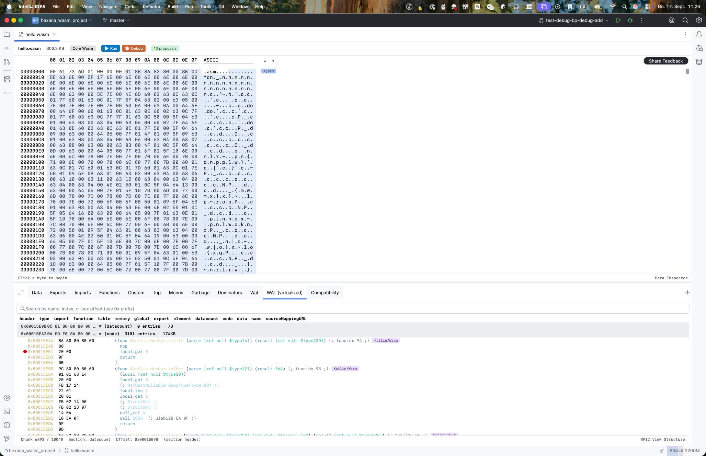
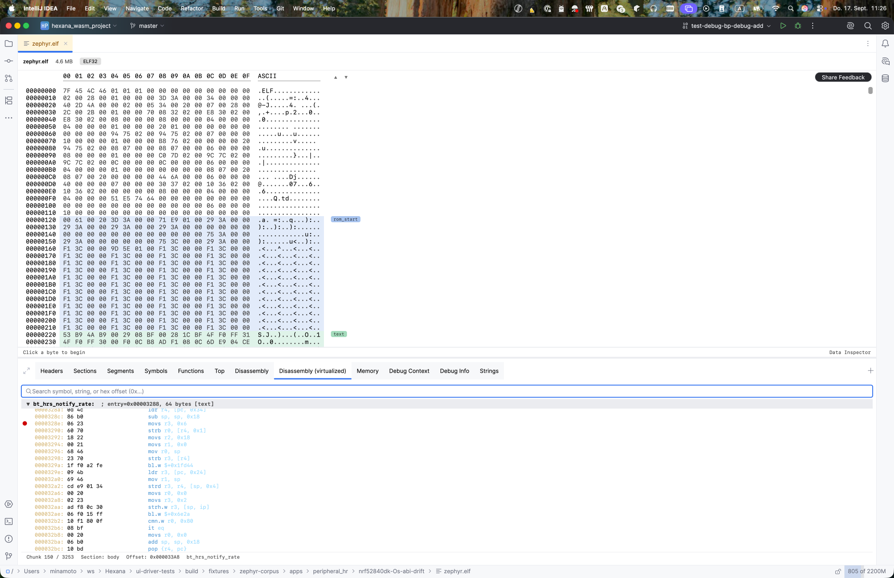
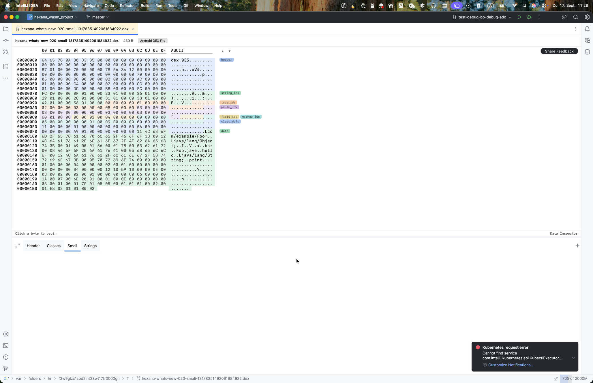

# Hexana 0.20 Release Notes

Released **2026-09-16**. No breaking changes from 0.19.

0.20 brings breakpoints directly into the binary views: click the gutter in the WAT (virtualized) or Disassembly view to set a breakpoint before, during, or after a debug session, with gutter icons that report what the runtime did with it. A new **Debugger Console** tab exposes the underlying LLDB or GDB command line for wasmtime, WAMR, and firmware sessions. Structural regions (the colored region tinting in the hex view) now cover every format Hexana parses, not just WASM and ELF. Android DEX files gain a **Smali** tab with baksmali-style Dalvik bytecode. A new **Compatibility** tab checks any `.wasm` file against the runtimes you declare in settings. The Component Model dependency graph nodes are now double-clickable for navigation. Script tabs are now sandboxed and gain a format-agnostic `binary` API with `open(path)`.

## Breakpoints in binary views

Breakpoints can now be set directly in the **WAT (virtualized)** and native **Disassembly** views by clicking the gutter, with no debug session required. The breakpoint is anchored to the binary's content hash, not its path, and survives IDE restarts.

The gutter icon reports what the runtime did with the breakpoint:

- **Registered**: accepted at the exact instruction.
- **Instruction-precise**: adjusted to the nearest valid stop point.
- **Degraded**: accepted but at reduced precision.
- **Stale**: the binary changed since the breakpoint was set.

Supported runtimes: GraalWasm, Node.js, browser (CDP), wasmtime, WAMR, and firmware ELF sessions running under QEMU or Renode.

Breakpoints appear under **Hexana Binary Breakpoints** in the IDE's Breakpoints dialog. Conditions and hit counts are not supported yet.

## Debugger Console tab

A **Debugger Console** tab appears in the Debug tool window for wasmtime, WAMR, and firmware QEMU/Renode sessions. It provides an interactive command line to the underlying debugger: LLDB commands for wasmtime and WAMR sessions, GDB commands for firmware sessions.

Execution-control commands (`continue`, `step`, `next`, etc.) are routed through the IDE's own actions so the console cannot desync the debugger state from the IDE UI. The tab is not available for GraalWasm and CDP sessions.

## Smali tab for Android DEX

Android `.dex` files gain a **Smali** tab showing baksmali-style Dalvik bytecode with resolved operands and decoded switch and fill-array payloads. Clicking an instruction row moves the hex view to that code unit.

## Structural regions for all parsed formats

Structural regions (the colored tinting, section labels, prev/next navigation, and **Structure** tool window entries) now cover every format Hexana parses. Previously this feature was limited to WebAssembly and ELF.

Formats added in 0.20: ZIP/JAR entries, TAR members, `ar` archive members, COFF sections, DEX id tables, PCAP/PCAP-NG packets, Parquet row groups, Arrow batches, `resources.arsc` packages, Java class files, and protobuf descriptors.

Where a region corresponds to a tab the editor renders, its label switches to that tab on click.

## Runtime compatibility for WebAssembly

A new **Compatibility** tab appears on every `.wasm` file and checks the proposals it uses against runtimes you declare.

**Configuration.** Declare target runtimes under **Settings | Build, Execution, Deployment | WebAssembly | Runtime Compatibility**. The declaration is written to `.hexana/runtimes.json`, which the VS Code extension shares.

**Tab behavior.** With target runtimes declared, the proposals badge in the editor toolbar turns into a warning for any unsupported proposal; clicking it opens the **Compatibility** tab. With no runtimes declared, the tab still lists which runtimes support each proposal, using verdicts from WebAssembly's `features.json`.

## Navigable Component Model dependency graph

Nodes in the WASM Component Model **Dependencies** graph are now double-clickable. Double-clicking a core module or nested component opens it in its own tab. Double-clicking an import or export node selects its bytes in the hex view.

## Script tabs: format-agnostic `binary` API and sandboxing

Script tabs gain a format-agnostic `binary` object with `format`, `size`, `path`, `dir`, `structure`, `strings`, `sizeAnalysis`, `binary.tabs`, and `binary.tab(name)`. Output functions `table(...)` and `row(...)` work alongside the existing API. `open(path)` parses another file on disk and returns the same members as `binary`.

Script tabs now run sandboxed. Previously a script tab ran with full host access and could call arbitrary Java. It now uses the same sandbox as the `run-script` CLI and the MCP tool: no host classes, processes, threads, or native access, plus a timeout and bounded output. `open(path)` remains the one way a script reaches the file system, returning a read-only `binary` object; arbitrary file reads are not available.

## Changed: DWARF tab grouping

The `.debug_abbrev`, `.debug_info`, and `.debug_line` tabs are now grouped under a single **DWARF** tab that is searchable and scrollable. A module that carries only one of those sections keeps its individual `.debug_*` tab.

## Fixed

**TypeScript destructuring accessors removed from bundled `.d.ts`.** The bundled `hexana-scripting-raw.d.ts` reference no longer lists Kotlin's generated `component1()`, `component2()`, ... destructuring accessors, which were noise in IDE completion.

**`binary.name` is consistent across hosts.** In a script tab, `binary.name` now returns the file name in every host. The VS Code extension previously passed the full filesystem path where the IntelliJ plugin and the `run-script` CLI passed a bare name.

## Upgrading to 0.20

No breaking changes. All additions are automatic or additive.

- **Binary-view breakpoints** appear in the WAT (virtualized) gutter and in the Disassembly view gutter on every supported file. Set them before starting a session; the gutter icon updates when a session reports its verdict.
- The **Debugger Console** tab appears in the Debug tool window automatically for wasmtime, WAMR, and firmware QEMU/Renode sessions.
- The **Smali** tab appears automatically for `.dex` files.
- **Structural regions** are active for all parsed formats without configuration.
- The **Compatibility** tab appears on every `.wasm` file. Declare target runtimes in settings to enable the warning badge.
- Component Model **Dependencies** graph nodes are double-clickable immediately.
- Script tabs run sandboxed. Scripts that called Java APIs directly will need to be updated; `open(path)` and the `binary` API cover the common use cases.
- Everything runs on your machine. No data is sent anywhere.

## Known limitations in 0.20

- Binary-view breakpoints do not support conditions or hit counts.
- The Debugger Console tab is not available for GraalWasm and CDP sessions.
- Carryover from prior releases: the Parquet / Arrow Data tab decodes the first row group or record batch only; schema-less protobuf decoding cannot recover field names; wazero runs modules only; native-binary and Cranelift backend support are experimental; Java integration covers Java sources only.

## Earlier releases

- [Hexana 0.16 release notes](changelog-0.16.md): 0.16 (2026-08-05): WAT (virtualized) for glue-only Component Model binaries, Components tab for nested component navigation.
- [Hexana 0.15 release notes](changelog-0.15.md): 0.15 (2026-07-29): call_indirect dispatch candidates in WAT, Dispatch tab in WASM diff, Go to Source from DWARF and source maps, exception-handling visibility (Tags and Exceptions tabs), Top size treemap, Save As for nested modules and archive entries, and the 0.14 Dominators empty-tree fix.
- [Hexana 0.14 release notes](changelog-0.14.md): 0.14 (2026-07-22): native binary diff, Component Model dependency diagram, data inspector, section highlighting and navigation, MCP schema v3, indirect-call synthetic node, memory64 scalability fixes.
- [Hexana 0.13 release notes](changelog-0.13.md): 0.13 (2026-07-08): Apache Parquet and Arrow IPC inspection, Protocol Buffers descriptor sets, Structure tool window, custom scriptable JS tabs, wazero run support.
- [Hexana 0.12 release notes](changelog-0.12.md): 0.12 (2026-06-24): static-library archives, Component Model diff and WAT view, Exports/Imports row affordances, Android DEX, ZIP64.
- [Hexana 0.11 release notes](changelog-0.11.md): 0.11 (2026-06-11) and 0.11.1 (2026-06-17): module diff with structural matching, Kotlin/Wasm source navigation, GraalVM Native Image with embedded SBOM.
- [Hexana 0.10 release notes](changelog-0.10.md): 0.10 (2026-05-27), plus the 0.10.1-0.10.3 patch line.
- [Hexana 0.9 release notes](changelog-0.9.md): 0.9 (2026-05-07), 0.9.1 (2026-05-20).
