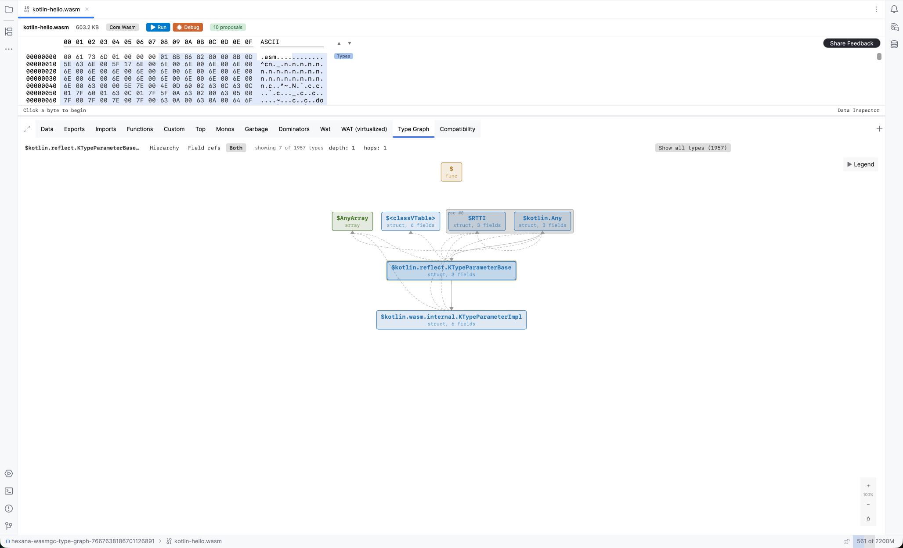
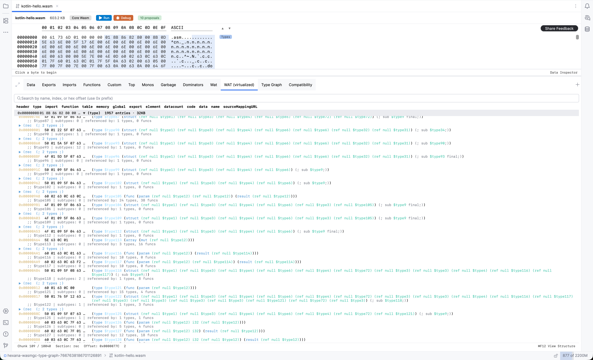
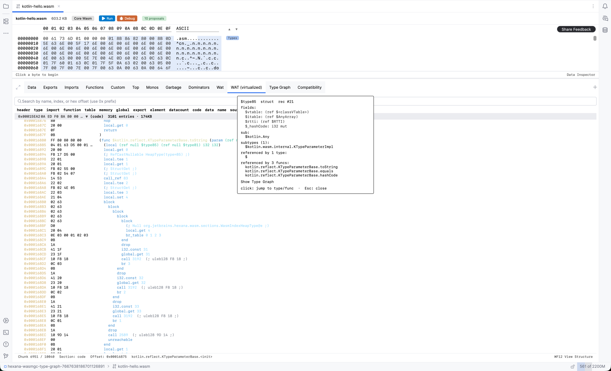
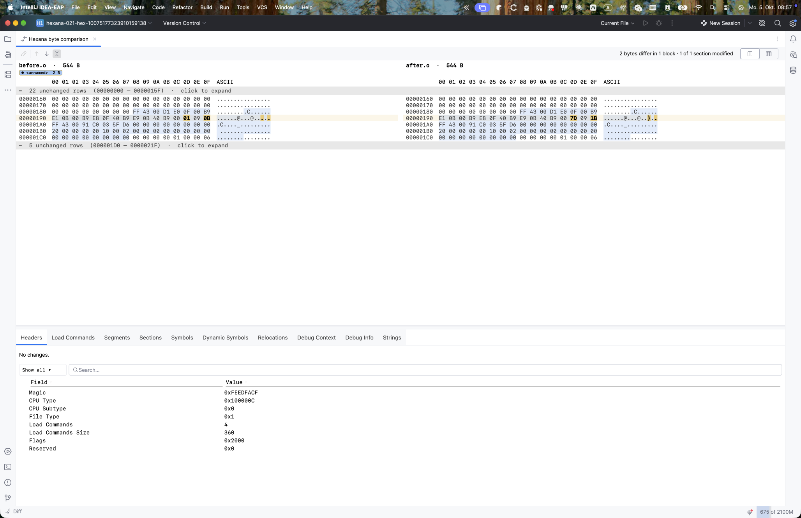
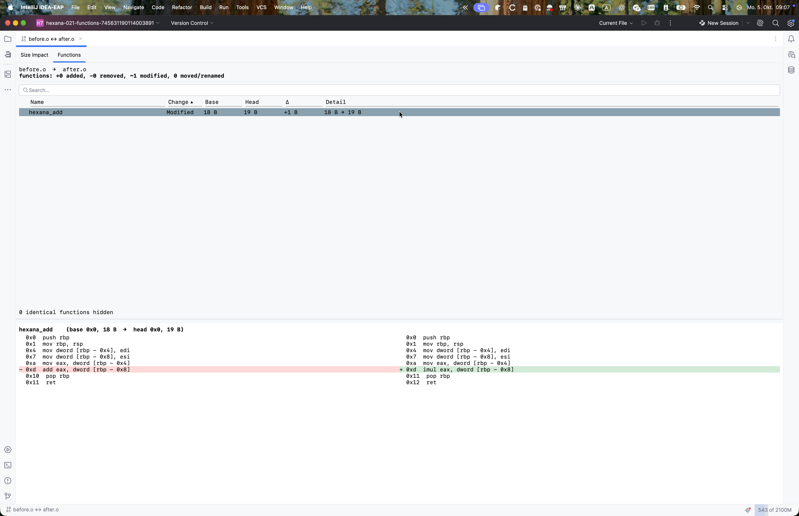
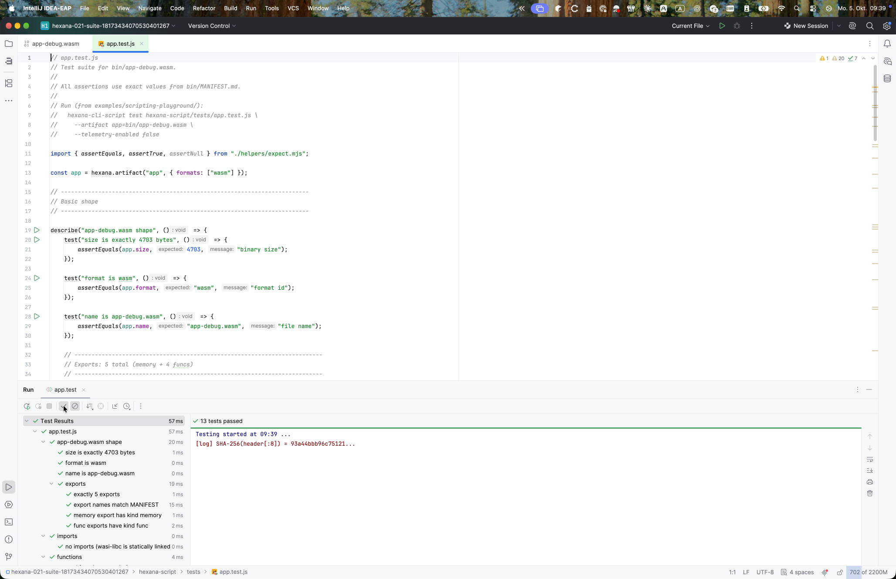

# Hexana 0.21 Release Notes

Released **2026-10-01**. No breaking changes from 0.20.

0.21 adds an interactive type graph to the WAT (virtualized) view for WasmGC modules, brings hex-level diffing into the IDE's own diff window with section tinting and collapsed unchanged rows, adds a per-function disassembly diff for ELF, Mach-O, and COFF files, and ships scripting v2 checks: `hexana.defineCheck` writes named findings to the Problems tab and to SARIF 2.1.0 output, and a new **Hexana Suite** run configuration runs `*.test.js` suites inside the IDE. Arrow IPC streams are now supported alongside IPC files, and binaries without file extensions open by content. A quadratic symbol-size lookup in native binaries is fixed, and gzip decompression is now bounded at 128 MiB.

## WasmGC type graph

For WasmGC modules the WAT (virtualized) view gains two additions: inline type annotations and an interactive type graph canvas.

### Inline type annotations

Every type in the type section now carries inline annotations showing its kind (struct, array, func) and fields. **Alt+click** opens a popup with the full structural detail: field names, types, supertypes and subtypes, and byte offset.

### Type graph canvas

**Show Type Graph** (type row context menu, or from the popup) opens an interactive canvas centered on that type. Nodes are types; edges are subtype and field-reference relationships. The initial view shows 1 subtype level and 1 field hop, configurable up to 5 via header dropdowns for each axis. `FUNC`-typed field targets fold into a `+N funcs` badge on the parent node; expanding materializes them.

**Navigation and layout.** Clicking a node expands its neighbors; double-clicking jumps back to the type's row in the WAT panel. Expanding or collapsing a node keeps all other nodes in place; only newly revealed nodes are added below the expanded parent. Rec-group frames draw only when their bounding box contains no non-member nodes; scattered groups get a left-edge accent bar per member instead of an engulfing slab.

**Controls.** Mouse wheel pans the canvas on both axes; Shift+wheel pans horizontally; Cmd/Ctrl+wheel (or Cmd/Ctrl +/-/0) zooms and resets. Overlay scrollbars track the pan offset; pan and zoom are clamped to content bounds. Node text is measured once per layout and cached, removing per-frame layout work. Tested at 294 nodes on `kotlin/hello.wasm`.

## Hex diff in the IDE diff window

Comparing two binaries with the platform **Compare Files** action (or viewing a binary's VCS change) now shows a side-by-side hex view. Changed bytes are highlighted; long unchanged stretches collapse into expandable "N unchanged rows" folds with previous/next difference navigation.

**Section bar.** One section bar spans both sides, pairing sections by name. Changed sections are marked with how much they changed; sections that exist on one side only are called out. Clicking a section jumps to its first change; collapsed folds name the sections they hide. Section colors are chosen to never clash with the diff highlight colors.

**Table tabs below the hex.** The file's table tabs (Headers, Sections, Symbols, Imports, and others) appear once for both sides as diffs: rows tinted added/removed/modified, changed cells shown as `old → new`, and a "Changed rows" filter on by default. Tabs with changes are marked with their count. Tree tabs are not diffed yet.

**Viewer switcher.** The diff window's viewer switcher also offers the **Size and functions diff viewer** (size impact, entities, functions) for WASM and native pairs. The platform's plain binary viewer, which previously showed two editors side by side without analysis, is no longer offered for these files.

**Compare Binaries With.** The **Compare WASM With** and **Compare Binary With** actions are merged into one **Compare Binaries With** action (Hexana context menu and Find Action). It resolves the comparison from the files' content rather than their extensions, so extensionless executables and modules are included. The IDE's own Compare Files starts on the hex diff; the Hexana action starts on the size and functions diff. Each remembers the viewer last chosen. Shortcuts bound to the old actions keep working.

## Per-function native binary diff

Comparing two ELF, Mach-O, or COFF files adds a **Functions** tab next to **Size Impact**. Functions are paired by name; renames are recognized by identical code; a function that moved only because the code before it grew is reported as moved rather than modified. Selecting a function shows its disassembly side by side with shifted addresses ignored when lining up instructions.

PE images (`.exe`, `.dll`) and archives keep the section size comparison only; the Functions tab is not shown for those formats.

## Scripting v2: checks, suites, and an IDE suite runner

Script tabs and the `run-script` CLI/MCP tool gain three new top-level APIs:

- `hexana.defineCheck(id, fn)` declares a named check whose findings land in the **Problems** tab and in SARIF 2.1.0 output.
- `hexana.defineFlags(schema)` declares typed per-run parameters.
- `hexana.defineSlice(name, fn)` is the existing table output, now named alongside the others.

`binary.functions()`, `.imports()`, and `.exports()` are curated facade members: typed arrays, zero-argument call.

### Suite runner

A new `run_script_suite` CLI command and MCP tool run `*.test.js` suite files. Each suite file declares artifact roles via `hexana.artifact(role, {formats})`, then uses `describe`/`test`/`beforeEach`/`afterEach` with async support. Seeded deterministic crypto (SHA-256 counter DRBG, seed derived from script and artifact content) is available. An ESM loader resolves bare specifiers from a `node_modules` directory rooted at the suite. Results output as a human test report or a JUnit XML file; the process exits 1 on any failure.

### Hexana Suite run configuration

The **Hexana Suite** run configuration brings suites into the IDE. The artifact-role table is filled from the suite's declarations. Test results stream into the SM test console as a tree; failures carry source locations for navigation. **Rerun Failed** and **Copy CLI Command** work.

Gutter run icons appear on `test()` and `describe()` calls in `*.test.js` files. The binary editor context menu adds **Run Suites for This Binary** for suites whose required artifact role matches the open file.

Check findings from any run are stored per binary and merged into the **Problems** tab rows next to parse problems; clicking a finding row navigates to the finding's function.

## Arrow IPC stream support

Arrow IPC streams (conventionally `.arrows`) now open correctly. Previously every `.arrow` file was read as an IPC file, so a stream showed no Schema or Messages tabs. Both extensions are now accepted and the format is resolved from content.

## Content-based format detection

Binaries whose name says nothing about their format now open by content. A WebAssembly module written without a `.wasm` extension gets the full Wasm editor instead of a raw hex view. A Parquet or Arrow export without an extension opens its analysis tabs. The format-detection logic is now in one shared factory (`createBinaryProvider`) used by the IDE, the VS Code extension, and the browser app. Previously Parquet, Arrow, and `.pb` Protobuf-message files resolved only in the IDE, and tar archives only in the IDE once gzipped.

## Analytics setting takes effect immediately

The "Send anonymous usage analytics" setting now takes effect immediately instead of at the next IDE restart. Turning it off flushes whatever was already captured under consent and tears the client down; turning it on starts reporting straight away.

## Fixed

**Quadratic symbol-size lookup in native binaries.** Opening a native binary with tens of thousands of symbols (such as an LLVM tool) no longer spends seconds inferring function sizes. The Mach-O and COFF "size = gap to the next symbol" rule was quadratic. This affects the Disassembly tabs and the native binary diff.

## Security

**Gzip decompression now bounded.** Opening a gzipped file no longer inflates it without a size limit. A payload over 128 MiB inflated is refused and the file is shown as compressed bytes, so a small archive cannot exhaust the IDE's heap.

## Upgrading to 0.21

No breaking changes. All 0.21 additions are automatic or additive.

- The **Type Graph** tab and inline type annotations appear automatically for WasmGC modules in the WAT (virtualized) view.
- The **hex diff viewer** appears in the IDE's Compare Files diff window for any binary pair Hexana recognizes.
- The **Functions tab** appears in the native binary diff for ELF, Mach-O, and COFF pairs.
- **`hexana.defineCheck`** and **`hexana.defineFlags`** are available in script tabs and the `run-script` tool immediately.
- The **Hexana Suite** run configuration is available in the IDE's Run/Debug configuration list.
- Arrow IPC streams open automatically by content.
- Extensionless binaries open by content in all hosts.
- Everything runs on your machine. No data is sent anywhere.

## Known limitations in 0.21

- The WasmGC type graph shows subtype and field-reference edges only; method dispatch through vtable fields is not traced.
- `FUNC`-typed field targets are shown as a count badge until expanded; the graph does not pre-expand large fan-outs.
- Hex diff tree tabs are not diffed yet; only flat table tabs are shown as diffs.
- The Functions tab in native binary diff is not available for PE images (`.exe`, `.dll`) or archives.
- Suite seeded crypto covers SHA-256 counter DRBG only; other algorithms are not seeded.
- Carryover from prior releases: the Parquet/Arrow Data tab decodes the first row group or record batch only; schema-less protobuf decoding cannot recover field names; wazero runs modules only; Android DEX support is basic; native-binary and Cranelift backend support are experimental; Java integration covers Java sources only.

## Earlier releases

- [Hexana 0.15 release notes](changelog-0.15.md): 0.15 (2026-07-29): call_indirect dispatch candidates, Dispatch tab in WASM diff, Go to Source from DWARF and source maps, exception-handling visibility, Top size treemap, Save As for nested modules.
- [Hexana 0.14 release notes](changelog-0.14.md): 0.14 (2026-07-22): native binary diff, Component Model dependency diagram, data inspector, section highlighting and navigation, MCP schema v3, indirect-call synthetic node, memory64 scalability fixes.
- [Hexana 0.13 release notes](changelog-0.13.md): 0.13 (2026-07-08): Apache Parquet and Arrow IPC inspection, Protocol Buffers descriptor sets, Structure tool window, custom scriptable JS tabs, wazero run support.
- [Hexana 0.12 release notes](changelog-0.12.md): 0.12 (2026-06-24): static-library archives, Component Model diff and WAT view, Exports/Imports row affordances, Android DEX, ZIP64.
- [Hexana 0.11 release notes](changelog-0.11.md): 0.11 (2026-06-11) and 0.11.1 (2026-06-17): module diff with structural matching, Kotlin/Wasm source navigation, GraalVM Native Image with embedded SBOM.
- [Hexana 0.10 release notes](changelog-0.10.md): 0.10 (2026-05-27), plus the 0.10.1-0.10.3 patch line.
- [Hexana 0.9 release notes](changelog-0.9.md): 0.9 (2026-05-07), 0.9.1 (2026-05-20).
