# Hexana Feature Reference

This page enumerates every user-visible capability Hexana ships. Capabilities are grouped by *surface* (file type or interaction point), not by chronological release. For per-release changes, see [`changelog-0.21.md`](changelog-0.21.md), [`changelog-0.20.md`](changelog-0.20.md), [`changelog-0.19.md`](changelog-0.19.md), [`changelog-0.18.md`](changelog-0.18.md), [`changelog-0.17.md`](changelog-0.17.md), [`changelog-0.16.md`](changelog-0.16.md), [`changelog-0.15.md`](changelog-0.15.md), [`changelog-0.14.md`](changelog-0.14.md), [`changelog-0.13.md`](changelog-0.13.md), [`changelog-0.12.md`](changelog-0.12.md), [`changelog-0.11.md`](changelog-0.11.md), [`changelog-0.10.md`](changelog-0.10.md), and the prior [`changelog-0.9.md`](changelog-0.9.md).

## WebAssembly module viewer

When Hexana opens a `.wasm` file, it presents a structured editor with the following tabs.

### Module overview tab
- Magic bytes (`\0asm`) and binary format version display.
- Section table with id, size, and offset for every section.
- Custom-section list, including DWARF (`.debug_*`) and name sections.
- Detection of the module kind: core WebAssembly module vs. Component Model component.
- Backreference to the containing module when the opened file is a nested module inside a component.

### Imports tab
- Imports grouped by kind (function, table, memory, global, tag).
- Resolved type signature per imported function.
- Click an entry to jump to its hex offset in the **Hex** tab.
- Search-as-you-type filter across import names.
- **(0.12)** Each row shows a tooltip with the module-qualified name (`module.field`).
- **(0.12)** **Copy Name** context-menu action copies the qualified name.
- **(0.12)** For function imports, **Find Usages** lists every function that calls the import (resolved from the call graph), capped at 15 entries; each entry navigates to the caller's body in the WAT (virtualized) tab. Beyond 15, or before the call graph finishes computing, the entry opens the Caller Paths panel. The call graph is computed off the EDT.

### Exports tab
- Exports listed with the resolved target index and kind.
- Goto Symbol contributes export names project-wide.
- Click an entry to jump to its hex offset.
- **(0.12)** Each row shows a tooltip with the full export name (for names truncated by the column width).
- **(0.12)** **Copy Name** context-menu action.
- **(0.12)** **Navigate to Function in WAT** context-menu action (shown only for function exports) switches to the WAT (virtualized) tab and scrolls to that function's body.
- **(0.15)** Right-click a row to invoke **Go to Source** — opens the source file at the function's first mapped line when DWARF or a source map is present. See [Go to Source](#go-to-source-015).

### Functions tab
- One row per defined function with index, type signature, local count, and code-section offset.
- Searchable, sortable, keyboard-navigable.
- For Kotlin/Wasm modules, a **Kotlin/Wasm** badge per function; clicking it jumps to the Kotlin source declaration — see [Kotlin/Wasm source navigation](#kotlinwasm-source-navigation-0111).
- **(0.15)** Right-click a row to invoke **Go to Source** — opens the source file at the function's first mapped line when DWARF or a source map is present. See [Go to Source](#go-to-source-015).

### Top tab — size profiler

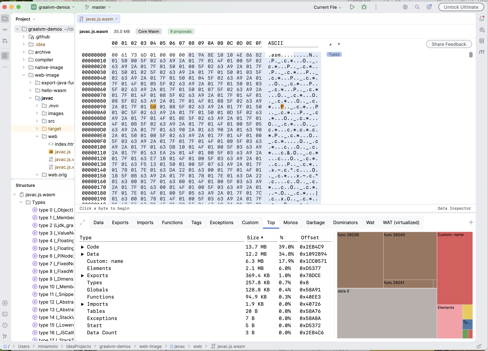

- Sortable breakdown of the largest functions, data segments, and sections by byte size.
- Click a row to navigate to the corresponding hex range.
- Useful first stop when "the binary got bigger" — the top of the list is where the bytes went.
- **(0.12)** For Component Model binaries, the tree attributes every nested sub-component and embedded core module with its correct byte count, expanding on demand to internal sections and then to functions, recursively.
- **(0.15)** A size treemap renders the largest entities as proportional areas alongside the table, for WASM and native binaries.

### Hex tab
- Byte-level view with section annotations.
- Text and hex panels with selection synchronised between them.
- Arrow-key navigation.
- Incremental search across the binary, including raw byte patterns.
- `hexana.goToOffset` (shares `Cmd/Ctrl+L`) jumps to a byte offset.
- `hexana.showStructurePopup` (shares `Cmd/Ctrl+F12`) opens a structure outline.
- Clickable hex offsets in the WAT tab navigate here.
- **(0.14)** Semantic section highlighting marks sections by kind (code, data, types, imports, exports, and so on), with navigation between sections from the editor.
- **(0.15)** Semantic section labels are clickable where a corresponding information tab exists: clicking a label opens that tab.
- **(0.14)** **Data Inspector** panel — appears to the right of the hex view when bytes are selected, decoding them as signed/unsigned 8/16/32/64-bit integers (little- and big-endian), IEEE 754 floats, UTF-8 text, and other common representations. Click the **Data Inspector** label in the bottom bar to toggle the panel. See [Data inspector](#data-inspector-014).

### WAT tab — virtualised, editable

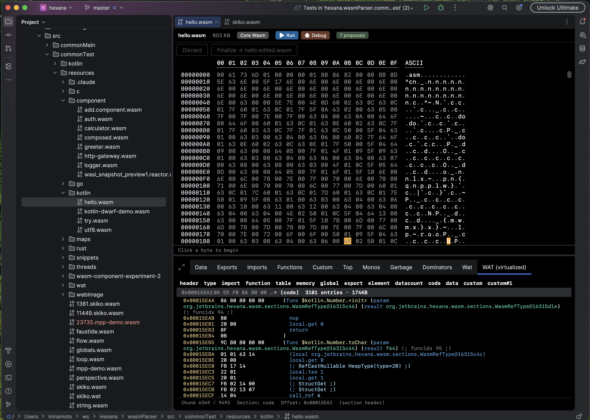

- Rendered WebAssembly Text format with offsets-based line numbers.
- Sections fold individually; a **section shortcut bar** at the top of the panel jumps directly to Function, Data, Import, or Export ranges.
- Sticky function headers; per-function and per-section fold state survives scroll.
- Syntax highlighting and brace matching; IDE zoom respected.
- Reference-types and bulk-memory instructions rendered.
- Legacy Exception Handling (`try`, `catch`, `throw`, `rethrow`, `delegate`, `catch_all`) supported alongside the finalised `try_table` proposal.
- **(0.12)** Component Model binaries: the WAT tab discovers every embedded core module recursively through nested sub-components and renders the selected one with the same three-column offset / bytes / mnemonic layout. A selector switches between modules when a component contains more than one. In-memory component views (such as a submodule opened from a diff) also gain a WAT tab this way.
- **(0.15)** Every `call_indirect` and `return_call_indirect` row shows its statically known dispatch candidates — see [call_indirect candidates](#call_indirect-dispatch-candidates-015). Right-clicking a WAT instruction row offers **Go to Source** when debug information is present — see [Go to Source](#go-to-source-015). Exception-handling instructions (`throw`, `try_table`, `throw_ref`) render with decoded index comments; clicking a `throw` row resolves where it is caught — see [Exception-handling visibility](#exception-handling-visibility-015).
- **(0.16)** Glue-only Component Model binaries (those with no embedded core modules) now render in the WAT (virtualized) view. Component-level constructs (types, imports, exports, instances, aliases) appear with foldable per-section headers, search by name or offset, and a clickable offset gutter. Sections that cannot be decoded per record (e.g. `canon`) show an explicit "not decoded" row instead of failing the view. Rendering works from the in-memory buffer, so nested components opened from the **Components** tab are also covered.
- **(0.21)** For WasmGC modules, every type entry in the type section gains inline annotations showing its kind and field count. **Alt+click** opens a popup with full structural detail (field names, types, supertypes, subtypes, byte offset). **Show Type Graph** in the context menu or popup opens an interactive canvas. See [WasmGC type graph (0.21)](#wasmgc-type-graph-021).

#### Inline row editing

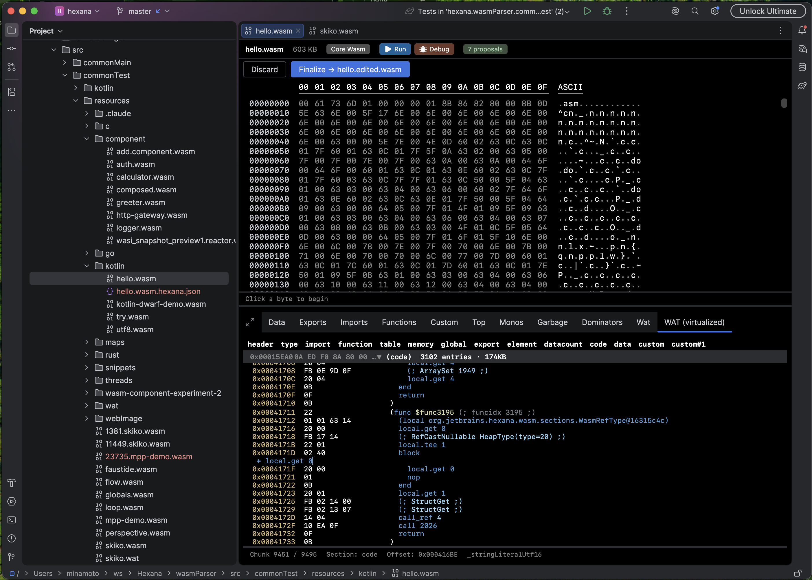

- Click an instruction row to enter an inline edit; press Enter to commit.
- Length-changing edits (replacing a 1-byte instruction with a 3-byte one) cascade through the WASM encoder so section sizes, function tables, and DWARF offsets stay coherent.
- Hex-cell edits in the **Hex** tab follow the same commit cycle.
- Undo / Redo follow the IDE keymap (`Cmd+Z` / `Cmd+Shift+Z` by default on macOS).
- **Discard** reverts every uncommitted edit back to the original bytes; **Finalize** writes the edited bytes to a sibling `<name>.edited.wasm` file.
- Edits persist across IDE restarts via a `<name>.hexana.json` sidecar next to the original file; reopening the file replays the journal on top of the original bytes (with hash verification so a stale sidecar is detected rather than blindly applied).

#### Data section view modes

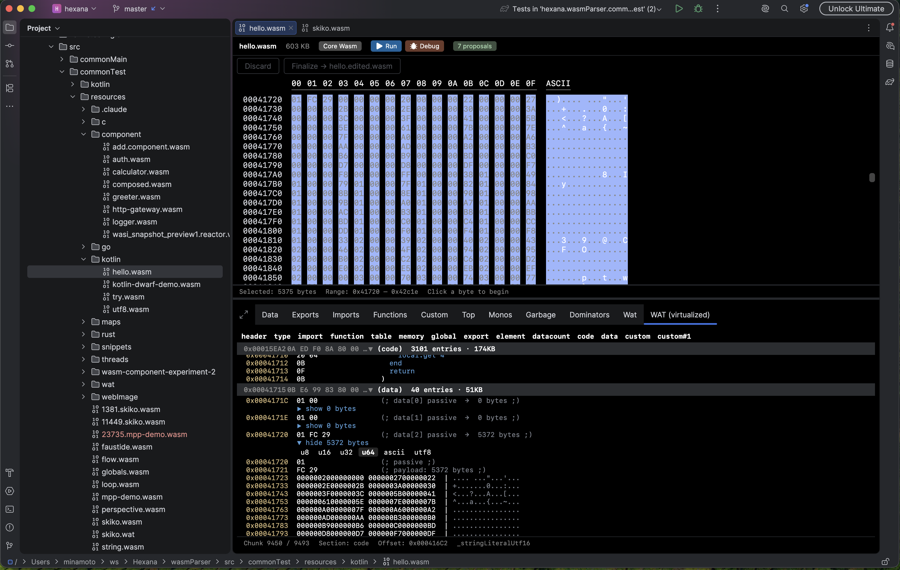

- Switch between `u8`, `u16`, `u32`, `u64`, `ascii`, and `utf8` renderings per data chunk.
- Expand and collapse data bodies independently of their containing section.
- Per-chunk view-mode choice persists across recompositions within a session.

### Components tab (0.16)

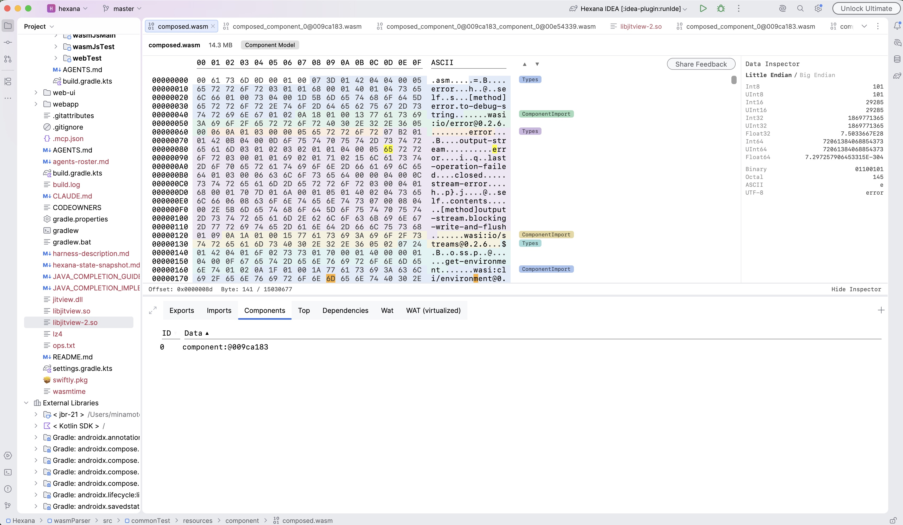

Component Model binaries that contain nested components gain a **Components** tab alongside the existing **Modules** tab. Clicking a row opens the nested component in its own editor view.

- Opening is recursive: modules and components inside an already-opened nested view open the same way.
- Byte offsets accumulate across levels, so every nested view is labelled with its absolute offset in the root file.
- Nested in-memory views do not offer Run actions and gain the full tab set of a disk-opened file (including the plain Wat tab and, for core modules, DWARF panels).

### Information bar

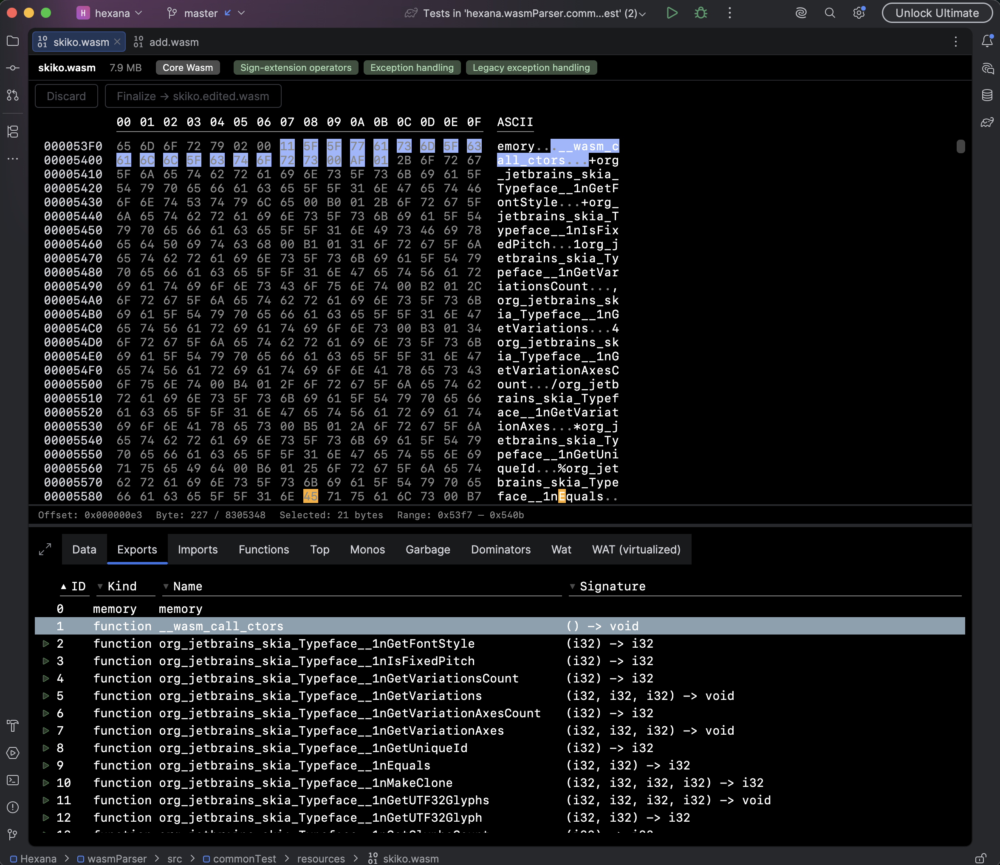

- File size (hover for per-section breakdown).
- Module kind (core / component).
- **Proposal pills** showing which WebAssembly proposals the binary uses — Threads, SIMD, GC, Tail Call, Reference Types, Bulk Memory, and so on. Hexana detects them and propagates the matching `--wasm-features` (or runtime-equivalent) flags to run / debug commands automatically.
- Run and Debug buttons when a runtime is configured.
- Backreference link to a parent component when applicable.
- Format badges where applicable — e.g. **Native Image** and **SBOM** on GraalVM Native Image binaries (see [GraalVM Native Image](#graalvm-native-image-011)), and **Kotlin/Wasm** on modules compiled by the Kotlin/Wasm backend (see [Kotlin/Wasm source navigation](#kotlinwasm-source-navigation-0111)).

### Kotlin/Wasm source navigation (0.11.1)

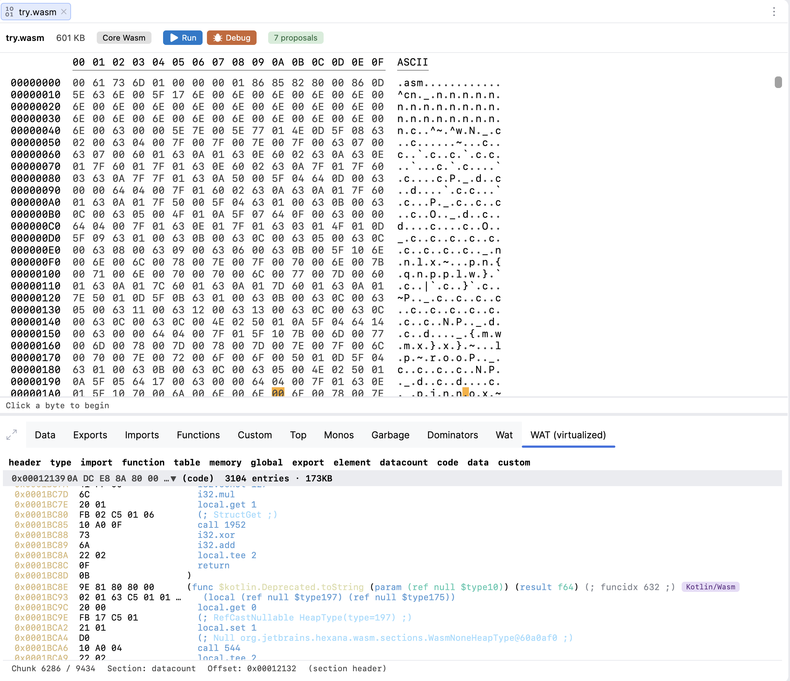

Modules compiled by the Kotlin/Wasm backend are recognised and made navigable back to their Kotlin sources.

- **Detection** — Hexana fingerprints the `kotlin.wasm.internal.*` import field-name prefix (not the host module), so detection works across Kotlin versions (current `js_code`, older `env`) and does not misfire on GraalVM Web Image or Emscripten, which also emit WasmGC.
- **Badge** — detected modules carry a **Kotlin/Wasm** badge on the Functions tab and in the virtualised WAT view.
- **Jump to source** — clicking a function's badge resolves the fully-qualified name the backend writes into the name section to the Kotlin declaration and navigates to it. Constructors, property accessors, and `$default` / `$lambda` synthetics are handled; overloads that share a name resolve to the method declaration.

## Comparing WebAssembly modules (0.11.1)

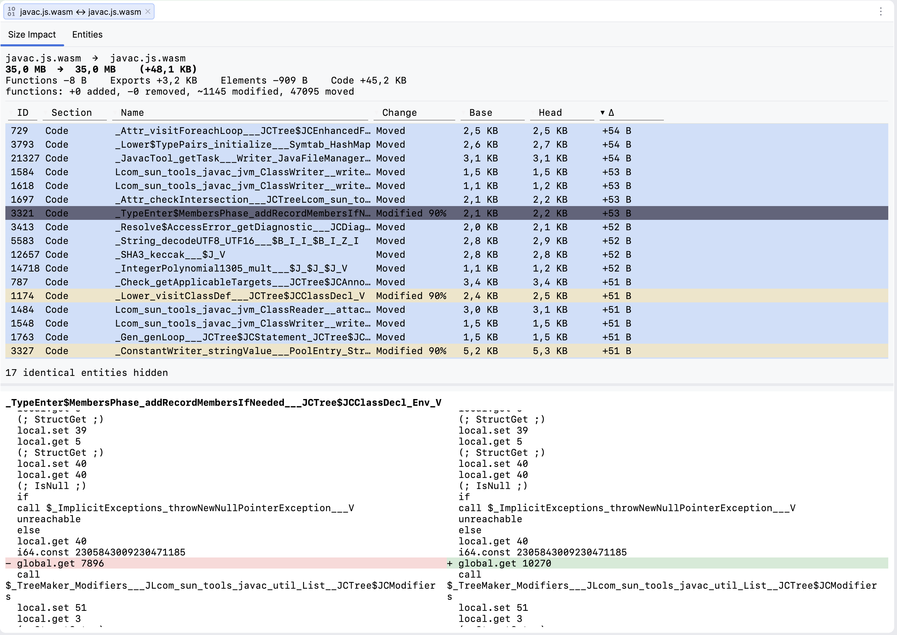

**Compare WASM With…** — from a `.wasm` file's project-view context menu or the **Tools** menu — opens a diff editor for two modules. It is built to answer "what changed, and what can this build now call into the host that the last one couldn't" without leaving the IDE.

- **Size Impact tab** — per-section and per-function byte deltas, sorted by impact. Functions are paired by a semantic matcher (content hash + call graph), not by position, so inserting or removing a function does not mis-attribute byte deltas to unrelated functions. Each row shows the match — *identical*, *moved*, or *modified* — and, for non-exact matches, a confidence; a pure renumber is reported as *moved* (zero bytes).
- **Entities tab** — every entity kind (imports, exports, functions, globals, tables, memories, types, data and element segments) classified as added / removed / modified / moved, colour-coded with aligned columns. A **supply-chain banner** highlights newly-introduced imports and flags host namespaces such as `env` and `wasi_*`.
- **Structural matching robust to optimisation** — a second hashing round substitutes already-matched call targets, so a rewritten body that still calls the same functions is paired; renaming or renumbering does not read as churn.
- **Minified modules** — detected (e.g. Binaryen `--minify-imports-and-exports`); a symbol-map sidecar (`<file>.symbols` from `--emit-symbol-map`, in either function-index or `original => minified` form) restores the original names so functions match by name.
- **On-demand WAT comparison** — selecting a function opens a side-by-side WAT diff rendered with symbolic names and red/green line-level highlighting, so an unchanged caller of a renumbered function reads identically.

For the full release notes on the core-module diff, see [`changelog-0.11.md`](changelog-0.11.md#0111-module-diff-and-kotlinwasm).

### Component Model diff (0.12)

**Compare WASM With…** now accepts Component Model binaries. Comparing two components opens a submodule view listing each component's embedded submodules (core modules and nested components, found recursively) and classifying each as identical, modified, added, or removed. Clicking a changed pair opens a dedicated tab:

- A **core-module pair** reuses the existing Size Impact / Entities / WAT diff.
- A **nested-component pair** recurses into the same submodule view.

Submodules are paired by content hash, with positional fallback when hashes do not match.

### Dispatch tab in WASM diff (0.15)

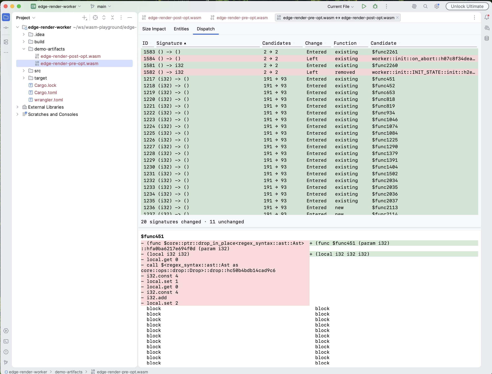

The WASM diff gains a **Dispatch** tab alongside Size Impact and Entities. It shows, per canonical signature, which dispatch candidates entered or left the function table between two builds.

- Cross-build identity uses the same content-hash matcher as the Entities tab — names are not trusted because tools such as wasm-bindgen rename closure shims on every build.
- Each row distinguishes a brand-new or removed function from an existing function that merely entered or left the table.
- Clicking a row opens the side-by-side WAT comparison for that candidate.

## Binary diff

### Section-level diff (0.14)

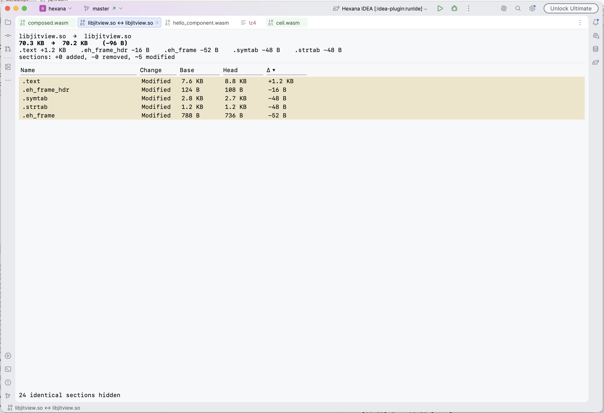

Select two native binary files (ELF, Mach-O, PE) in the project view and invoke **Compare Binaries With…** from the context menu (the action accepts any binary Hexana recognises by content, including extensionless files). The diff lists every section in either build with its Name, Change classification (Modified, Added, Removed), Base size, Head size, and byte delta. Sections that are bit-for-bit identical collapse behind a "N identical sections hidden" line.

### Per-function native diff (0.21)

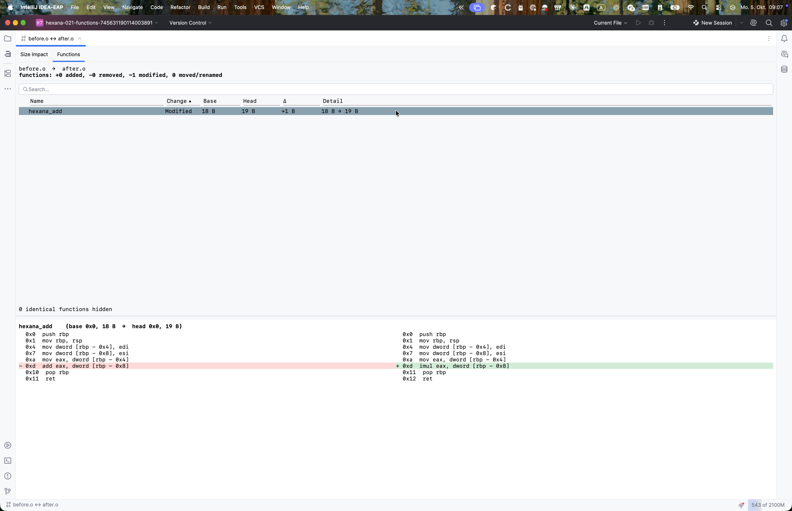

ELF, Mach-O, and COFF comparisons gain a **Functions** tab alongside Size Impact:

- Functions are paired by name; renames are recognised by identical code.
- A function that only moved because earlier code grew is reported as *moved*, not *modified*.
- Selecting a function shows its disassembly side by side, with shifted addresses ignored when lining up instructions.
- PE images (`.exe`, `.dll`) and archives keep the section size comparison only.

### Hex diff in the IDE diff window (0.21)

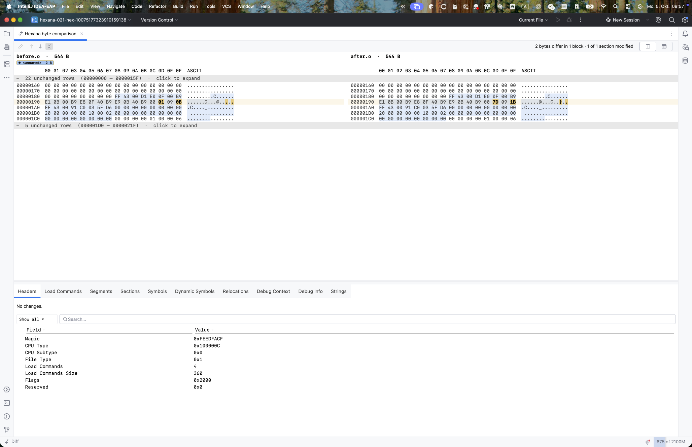

Using the platform **Compare Files** action on two binaries (or viewing a binary's VCS change) opens a side-by-side hex view:

- Changed bytes are highlighted; long unchanged stretches collapse into expandable "N unchanged rows" folds with previous / next difference navigation.
- Sections are tinted in colours that do not clash with the diff highlights. A section bar for both sides pairs sections by name, marks which changed and by how much, and marks sections present on one side only. Clicking a section bar entry jumps to its first change.
- Below the hex rows, the file's table tabs (Headers, Sections, Symbols, Imports, etc.) are shown once for both sides as diffs: rows tinted added / removed / modified, changed cells as `old → new`, and a "Changed rows" filter on by default. Tabs with changes are marked with their count. Tree tabs are not diffed yet.
- The diff window's viewer switcher also offers the **Size and functions diff viewer** (size impact, entities, functions) for WASM and native pairs.

The **Compare Binaries With…** action and the IDE's own Compare Files both open this diff window. **Compare Binaries With…** starts on the size and functions diff; the platform's Compare Files starts on the hex diff. Each viewer remembers the last tab picked.

## Component Model dependency diagram (0.14)

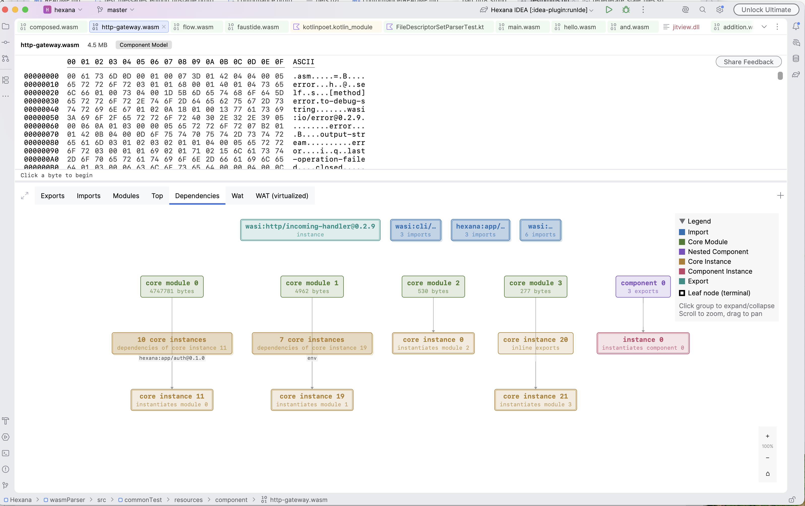

Component Model binaries gain a **Dependencies** tab that visualises the relationships among the component's internals: interface imports such as `wasi:cli/run@0.2.0`, core modules with their byte sizes, nested components, and the core and component instances created from them. Runs of similar instances collapse into a single group node (for example "9 core instances"). A **Legend** identifies node kinds by colour — Import, Core Module, Nested Component, Core Instance, Component Instance, Export, and terminal leaf nodes. Click a group to expand or collapse it; scroll zooms and drag pans the diagram.

## Data inspector (0.14)

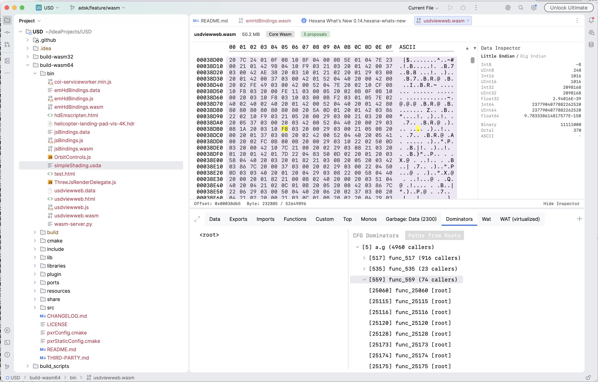

Selecting bytes in the hex view populates the **Data Inspector** panel: the selected bytes are decoded simultaneously as signed and unsigned 8/16/32/64-bit integers (little- and big-endian), 32-bit and 64-bit IEEE 754 floats, UTF-8 text, and other common representations. Click the **Data Inspector** label in the hex view's bottom bar to toggle the panel.

## call_indirect dispatch candidates (0.15)

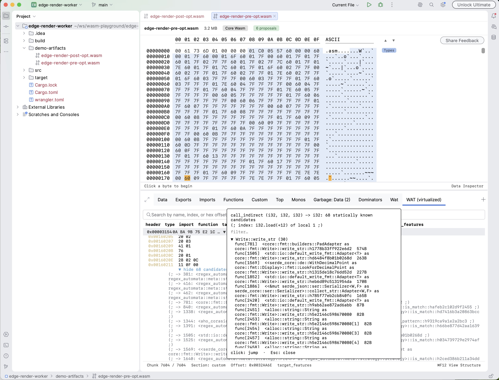

Every `call_indirect` and `return_call_indirect` row in the WAT (virtualized) view now shows its statically known dispatch candidates.

- **Candidates** are element-segment entries whose type signature matches the call site's type. Matching is structural, so functions declared under different but identical type entries are merged.
- **Navigation**: click the instruction row (or press Go to Declaration) for a popup; expand the inline `show N candidates` row for the full list as click-navigable rows.
- **Trapping call sites** are called out explicitly: when a signature has no matching table entries, the row reports that the call site can only trap.
- Lists say "statically known", not "all possible targets". Functions written into the table at runtime via `table.set` are not reflected.

## Go to Source (0.15)

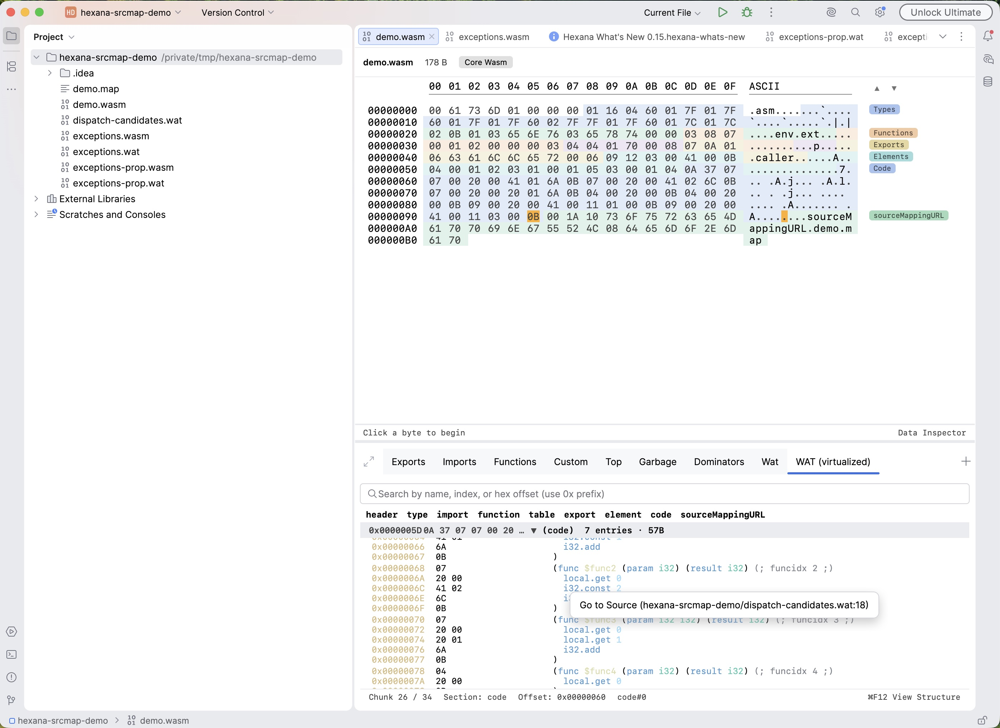

Right-clicking a row in the **Functions** or **Exports** tab, or an instruction row in the WAT view, offers `Go to Source (dir/file.rs:123)` when debug information is present. Clicking opens the source file at the resolved line in the IDE editor.

- **Function rows** resolve to the function's first mapped line (the signature).
- **WAT instruction rows** resolve per instruction.
- **Resolution order**: DWARF when present, source map otherwise.
- **Source map discovery**: the module's `sourceMappingURL` custom section (the form Kotlin/Wasm and Emscripten emit). A path resolves relative to the wasm file; absolute paths and inline `data:` maps are accepted. The existing `<file>.map` sidecar is the fallback. Remote `http(s)` URLs are not fetched.

## Exception-handling visibility (0.15)

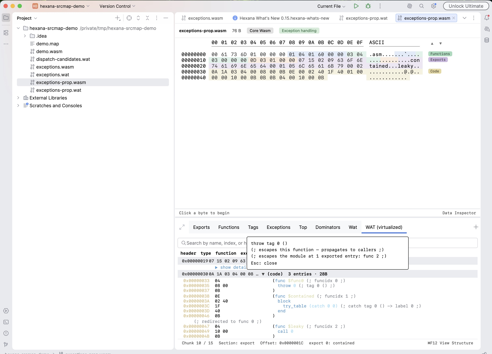

Exception-handling proposal instructions render with full decoded annotations, and two new tabs expose the module's panic surface.

- `throw 0` renders with a trailing comment naming the tag and its payload signature.
- `try_table (catch 0 1) (catch_all 2)` renders each clause with its tag and target label decoded.
- Clicking a `throw` row resolves where it is caught — the enclosing `try_table` and clause, or a report that the throw escapes and names the exported entry points it reaches.
- **Tags tab** — decodes the module's exception tags (index, origin, attribute, payload type signature), the exception-handling equivalent of the Types tab.
- **Exceptions tab** — lists exported entry points whose exceptions escape to the host, with the tags that can get out. `throw_ref` and imported-function throws appear as a dynamic category. A `catch_all` on the path correctly marks a throw as caught. Analysis is a sound static under-approximation.

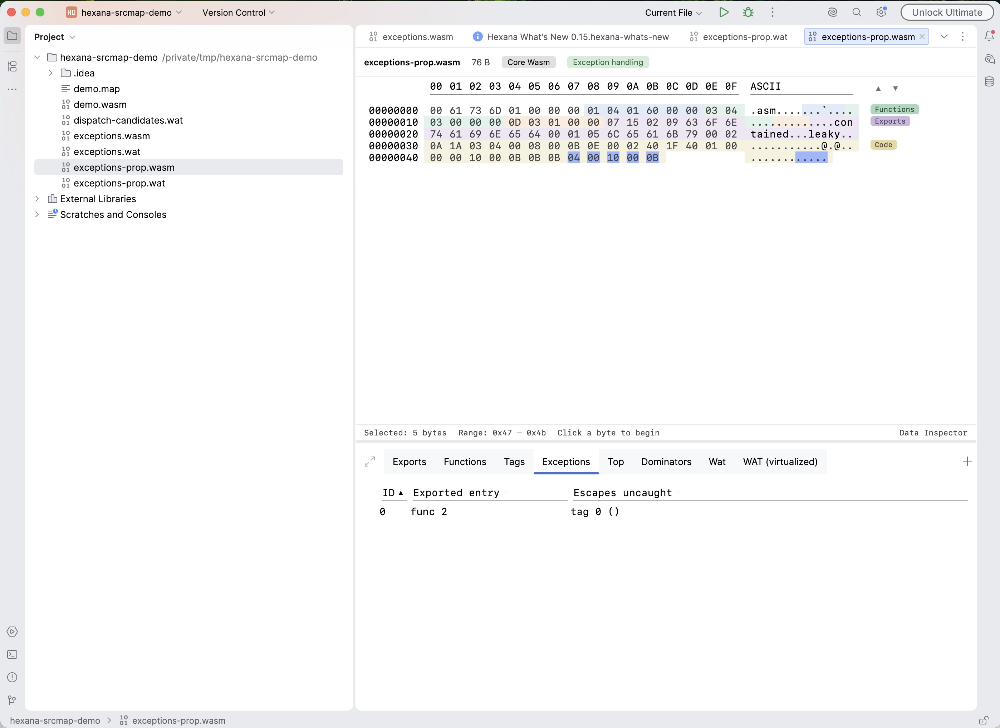

## Problems tab (0.17)

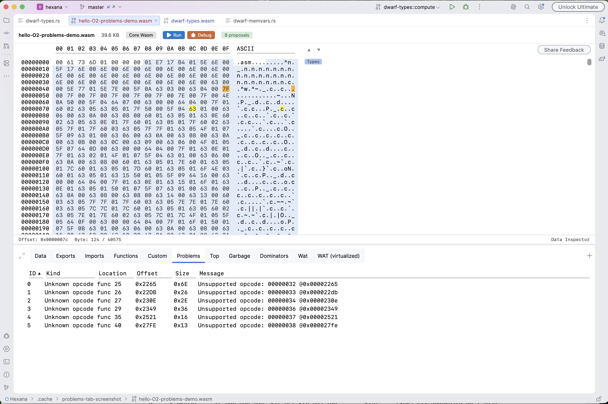

When the parser encounters bytes it cannot decode (for example instructions from an unsupported proposal, or type-section encodings from the custom-descriptors proposal), it records the failure as an unparsed region rather than discarding the whole function body. Every such region becomes a row in the **Problems** tab.

- Each row shows the kind, location, byte offset, size, and message.
- Clicking a row tied to a function jumps to that function in the **WAT (virtualized)** tab (the context menu also offers the plain **Wat** tab, which scrolls to the nearest annotated line).
- Rows not tied to a function select the failed byte range in the hex view.
- The tab appears only when the module has parse problems.
- **(0.17)** Covers core WASM modules. Also covers Component Model binaries from the same release: an unknown instance-encoding tag or a decode failure mid-entry records a problem row rather than crashing the dependency graph or the component WAT view.
- **(0.21)** Check findings from scripting runs are stored per binary and merged into the Problems tab alongside parse problems. See [Scripting: checks and suites (0.21)](#scripting-checks-and-suites-021).

## Save As for nested content (0.15)

**Save As** is available from the editor context menu for nested WASM modules (opened from a Component Model component or a diff submodule view) and for entries inside JAR and ZIP archives. The action writes the content to a file of your choice on disk.

## WIT language support

Hexana registers a full `wit` Language with the IntelliJ Platform. The complete WIT feature surface is documented in [`wit-language.md`](wit-language.md). Headlines:

- Lexer, parser, and PSI for the WIT grammar.
- Syntax highlighting and semantic keyword highlighting.
- Brace matching, code folding, breadcrumbs.
- Code formatter and line-wrap strategy.
- Keyword completion and `@gate` completion.
- 5 inspections: empty definition, world name uniqueness, missing semicolon, gate validation, use-declaration missing names.
- Find Usages with a dedicated handler factory.
- Rename validation.
- Goto Symbol contributes WIT declarations.
- Documentation provider for WIT elements.
- Built-in WIT type definitions indexed and resolved.
- Component-Model index for cross-file resolution.
- Line-marker provider for related-symbol navigation.

## WAT language support

- File type and language registered for `.wat`.
- Parser definition, syntax highlighter, brace matcher.
- File-view provider factory.
- Problem-highlight filter.
- Use-scope optimizer for performance on large WAT files.
- Documentation target provider.
- Find Usages handler factory.
- File-size checker that gates expensive operations on very large files.

## Hex view and binary file type

- Hexana registers a generic binary file type covering `.bin` and similar generic-extension files. These open in the hex view directly.
- File-type overrider claims `.wasm`, `.wat`, `.wit` for Hexana.
- A separate magic-byte detector claims ELF, Mach-O, PE, and other native-binary formats — see [Native binaries](#native-binaries-experimental).
- **(0.21)** Binaries whose name says nothing about their format open by content: a WebAssembly module written without a `.wasm` extension gets the full Wasm editor, and so does a Parquet or Arrow export dumped extensionless. Arrow IPC streams (conventionally `.arrows`) are now also accepted alongside `.arrow`; the format is resolved from the content.

### Structural regions in the hex view (0.20)

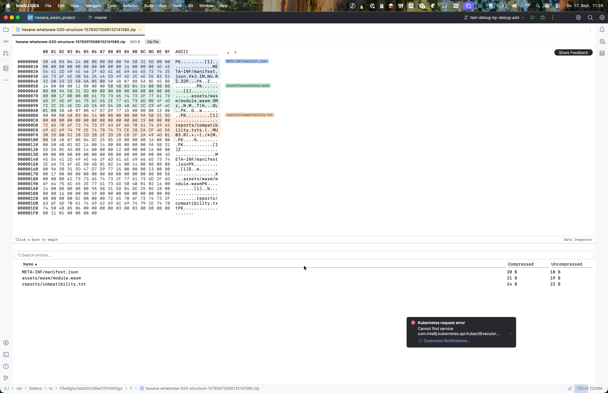

Structural region tinting, labels, prev/next navigation, and the **Structure** tool window now cover every format Hexana parses, not just WebAssembly and ELF. Added in 0.20: ZIP/JAR and TAR entries, `ar` members, COFF sections, DEX id tables, PCAP/PCAP-NG packets, Parquet row groups, Arrow batches, `resources.arsc` packages, class files, and protobuf descriptors. Where a region matches a tab the editor renders, its label switches to that tab.

## Native binaries (experimental)

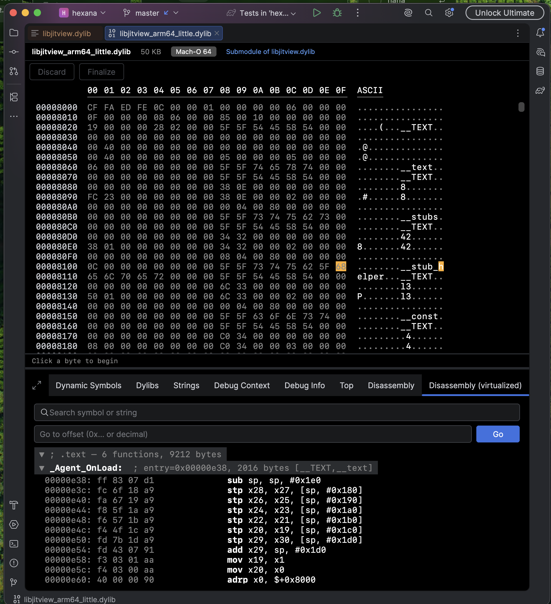

Hexana detects ELF, Mach-O, and PE binaries from their magic bytes regardless of extension. The same hex + structure layout applies as for WebAssembly modules, plus a dedicated **Disassembly** tab.

- **Format coverage** — ELF (`.elf`, `.so`), Mach-O (`.dylib`, `.bundle`), PE (`.exe`, `.dll`, `.sys`), plus fat Mach-O and `.a` archives.
- **Multi-architecture disassembly** — x86, x86-64, ARM, AArch64, RISC-V 32 and 64. The disassembler ships as a bundled Rust / WebAssembly module — no host `objdump`, Capstone, or similar toolchain required.
- **Virtualised rendering** — function bodies are sub-chunked by instruction window; only the visible portion is decoded and laid out. Even multi-megabyte `.text` sections render incrementally.
- **Symbol-driven function discovery first**, with a fallback to per-executable-section ranges when symbols are stripped.
- **Switchable disassembler backend** — by default the bundled Capstone module runs as compiled JVM bytecode; an experimental Cranelift-native path is available via a Registry toggle. See [`disassembler-backends.md`](disassembler-backends.md).

### GraalVM Native Image (0.11)

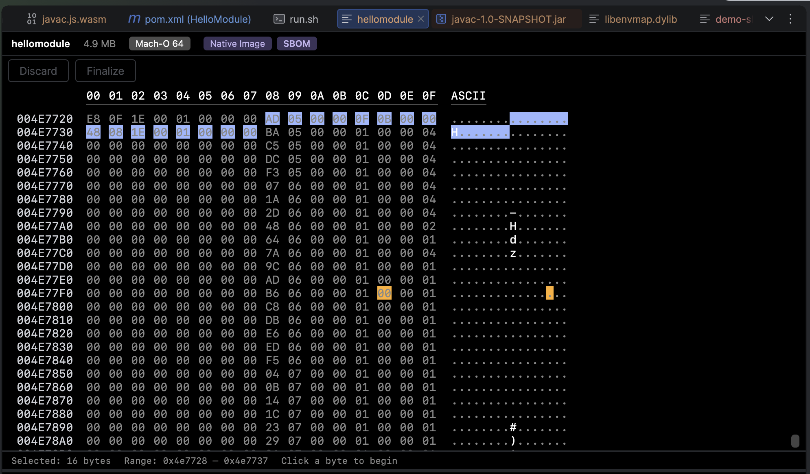

Native executables and shared libraries produced by `native-image` are a recognised sub-kind of native binary.

- **Detection** — Hexana fingerprints the SubstrateVM build: the `com.oracle.svm.core.VM=GraalVM …` identity string, `.svm_*` / `__svm*` sections, and the `__svm_version_info` marker. Matching binaries get a **Native Image** badge whose tooltip reports the GraalVM version, edition, and target platform. Because the identity string lives in read-only data, detection survives release stripping.
- **Embedded SBOM** — binaries built with `--enable-sbom` (default-on in Oracle GraalVM for JDK 25+) get an **SBOM** badge and a dedicated **SBOM** tab: a metadata header (subject, timestamp, generating tool) over a searchable, sortable component table (type, group, name, version, licences, PURL), with a **View raw JSON** action for the decompressed CycloneDX document.

#### SBOM vulnerability reachability

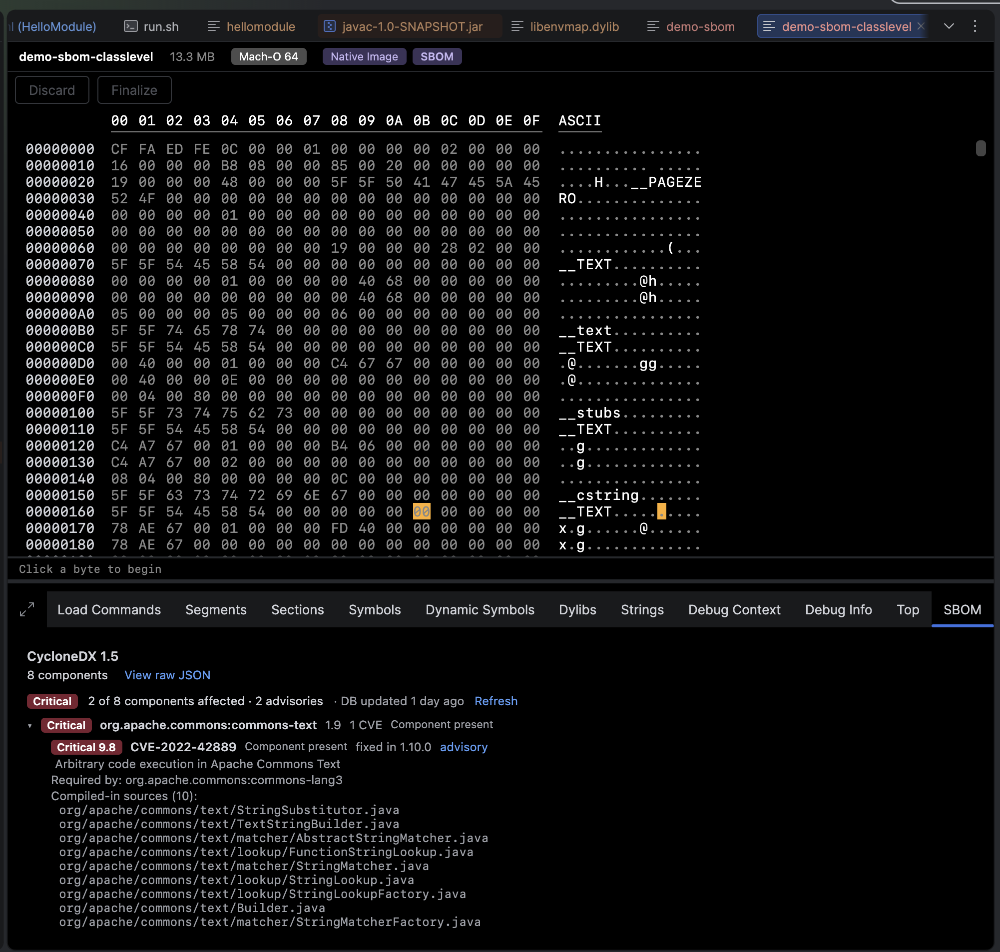

The SBOM tab can match components against the **OSV** database and overlay known CVEs with CVSS severity, the fixed version, and an advisory link.

- A component only appears in the SBOM if `native-image` retained it, so every CVE shown is for code that actually survived dead-code elimination.
- With `--enable-sbom=class-level`, Hexana uses the compiled-in class/method tree to refine the verdict to **"vulnerable class retained"** vs **"eliminated by DCE"**.
- Matching is **offline by default** (the OSV database is downloaded once; the component list never leaves your machine), with an opt-in online `api.osv.dev` query. Both toggles are off until enabled in **Settings → Tools → Hexana** — see [`settings.md`](settings.md#sbom-vulnerability-matching).

### Memory tab for ELF binaries (0.19)

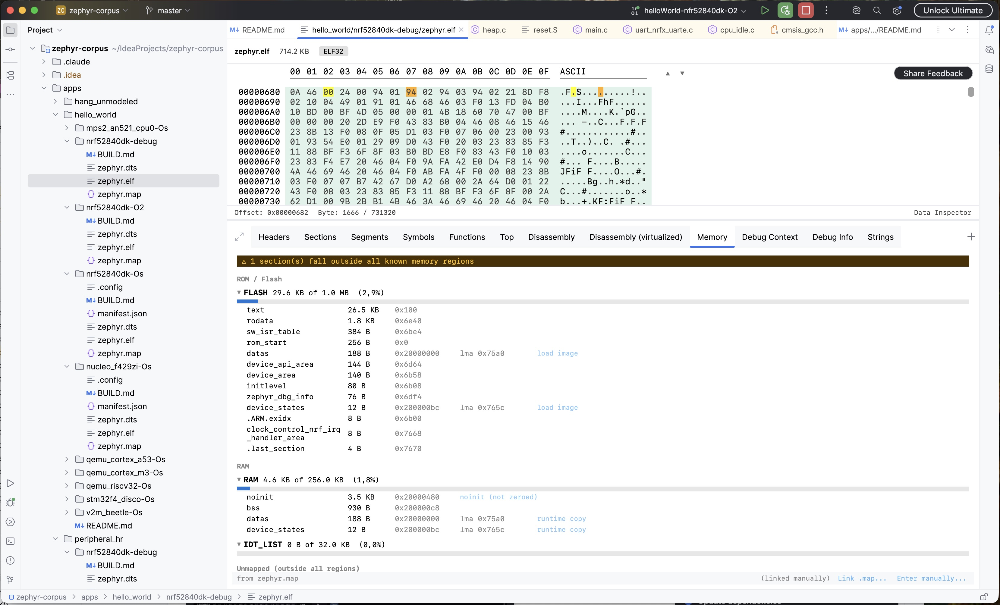

ELF binaries that are executable or shared objects gain a **Memory** tab: a section-level Flash/RAM budget view answering "how full is my device".

- One block per memory region with used/capacity in human units (exact bytes on hover) and a fill bar that turns yellow at 80% and red at 95%; ROM regions listed before RAM.
- Initialized data is annotated in both places it lives ("load image" in flash, "runtime copy" in RAM). `.bss` counts only toward RAM; `noinit` sections are marked.
- Region capacities come from a linker map (`<name>.map`, `zephyr.map`, or any other `*.map` sibling), or from a `zephyr.dts` found next to the ELF. A stale map (section addresses do not match the ELF) is detected and ignored with a warning, and a footer names the active source.
- Without any capacity source the tab still shows the full ROM/RAM breakdown from the ELF's load segments, capacity-free, and a **Link capacity source…** strip lets you point to a `.map`, a `.dts`, or enter manual flash/RAM sizes; the choice is remembered per file.
- The budget measures address-space bytes, complementing the **Top** tab's file-byte profile: debug info that never reaches the device is excluded, and a zero-file-byte `.bss` heap arena shows up as the RAM consumer it is.
- No symbols or DWARF required; fully stripped ELFs work.

## JVM artifacts

Hexana opens Java archives, class files, and Hotspot JIT dumps as structured documents.

### Class files

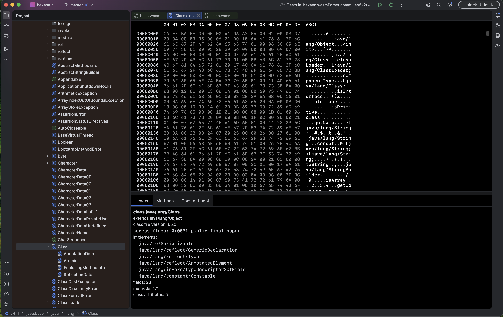

`.class` files render as a three-tab view: header (access flags, parent class, interfaces), methods (with decoded bytecode), and constant pool. Each tab is searchable and keyboard-navigable.

### Archives — JAR, WAR, APK, ZIP

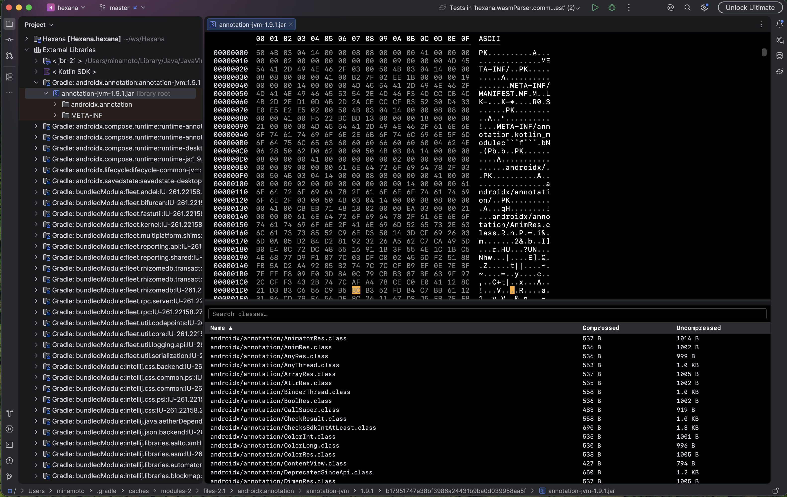

`.jar`, `.zip`, `.war`, `.apk` archives open with a hex view on top and a searchable, sortable class list below. Click a class to open its decoded bytes in a nested tab. An **Open in… → Hexana** action surfaces from the Project tool window for archive entries, including entries under External Libraries.

### Static-library archives — `.a` and `.lib` (0.12)

<!-- TODO: screenshot for static-library Members view -->

`.a` (Unix `ar`) and `.lib` (Windows COFF import library) archives open as a **Members** list. Each row shows the member name, detected format (ELF / Mach-O / PE / COFF / short-import), and size. The archive's bookkeeping entries (symbol tables, long-names table) are hidden.

Clicking a member extracts the object file to the IDE's temp folder and opens it in the matching disassembly view. Both the Capstone and llvm-objdump backends are available for extracted members. The member tab is titled `archive-name/member-name`; duplicate names get an index suffix.

Archives are detected by `!<arch>\n` content magic, not extension. Plain MSVC import `.lib` files without this header are left to their normal handler.

**Per-function disassembly**: relocatable object files (ELF `.o`, Windows COFF `.obj`/`.o`, Mach-O) carry section-relative symbols. Hexana resolves each symbol's file offset through its owning section so the virtualized Capstone view lists named functions individually. Stripped members fall back to whole-section disassembly.

### Android DEX — `.dex` (0.12)

`.dex` files open with a basic classes-and-members view.

#### Smali tab (0.20)

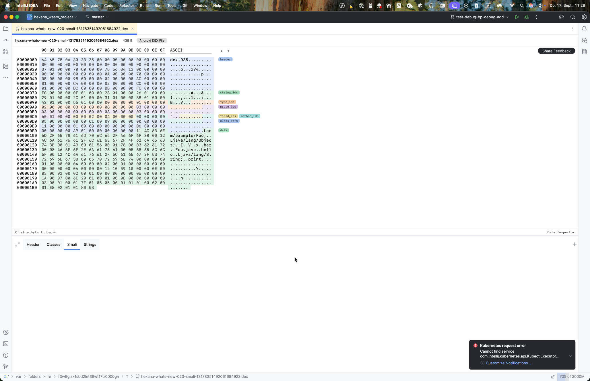

A **Smali** tab renders baksmali-style Dalvik bytecode with resolved operands and decoded switch/fill-array payloads. Clicking an instruction row moves the hex view to that code unit.

### JIT dumps

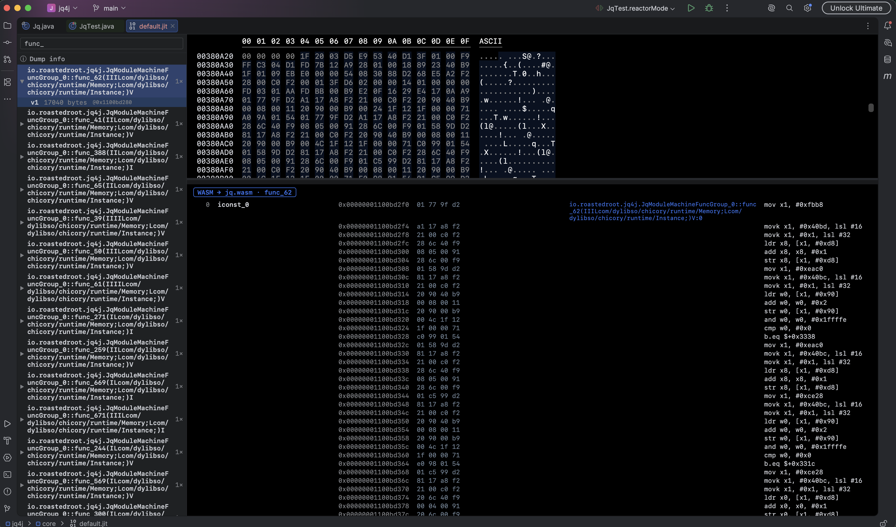

`.jit` dumps produced by Hexana's bundled JVMTI agent open in a three-pane view: symbol tree on the left, native bytes for the selected method on the top right, decoded JVM bytecode and inline-tree on the bottom right.

The agent is opt-in per Java run configuration — check **Hexana JIT Viewer** in the run-configuration editor. The agent attaches at JVM startup, records each `CompiledMethodLoad` event into a configurable dump file (`default.jit` by default), and Hexana auto-opens the dump when the run completes.

## Columnar data formats (0.13)

### Apache Parquet

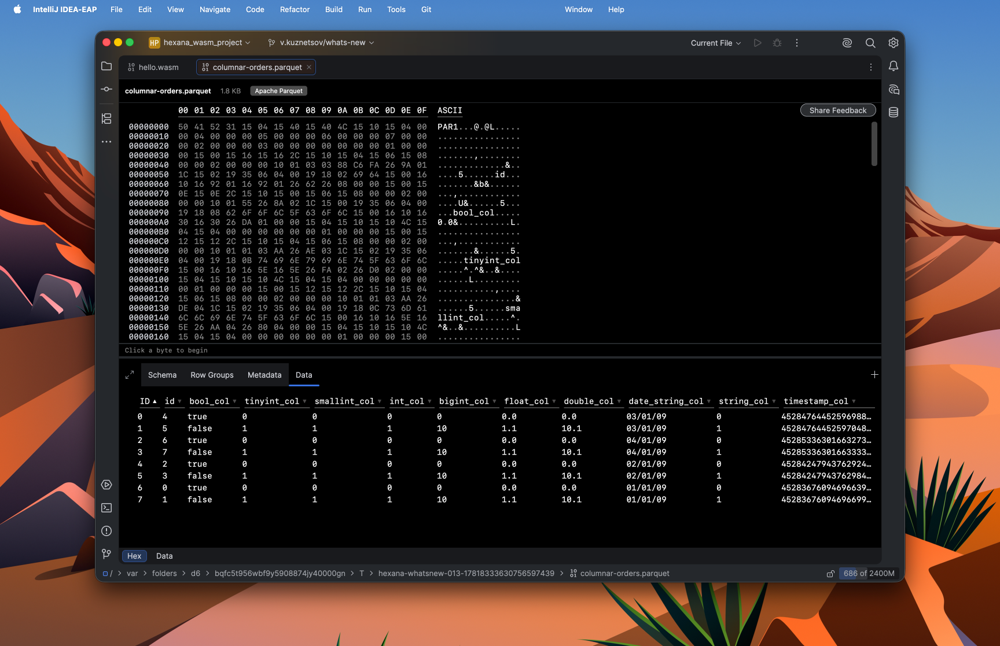

Parquet files are recognised by their `PAR1` content magic, not by extension. A Parquet file opens to **Schema**, **Row Groups** (each expanding to its column chunks with path, type, codec, and value count), and **Metadata** tabs, plus a **Data** tab — see below.

### Apache Arrow IPC

Arrow IPC files are recognised by the `ARROW1` magic (file format) or the `0xFFFFFFFF` continuation marker (stream format). An Arrow file opens to **Schema**, a **Record Batches** or **Messages** tab depending on format, and **Metadata**, plus the same **Data** tab.

### Data tab (Parquet and Arrow)

- Decodes the actual contents into a table: one column per schema leaf field, one row per record.
- Selecting a row highlights that record's bytes in the hex editor as disjoint spans — an exact per-value range for uncompressed PLAIN data, a page or chunk box for compressed or encoded data.
- The first row group (Parquet) or first record batch (Arrow) is decoded, capped at 10,000 rows, with a note when more rows or batches exist.
- Page compression: SNAPPY, GZIP, ZSTD, and LZ4 on the JVM. Parquet encodings: PLAIN, dictionary, RLE/bit-packed, the DELTA variants, and BYTE_STREAM_SPLIT, with Dremel definition levels for nullable columns. Arrow buffer reconstruction covers primitive, boolean, string/binary, and the temporal, interval, and decimal types.
- Parquet INT96 values (legacy 12-byte timestamps) are shown as their signed 96-bit integer in base-10.
- A recognised file that decodes to no rows (empty or malformed) still shows the Data tab with an explanatory empty state.

## Protocol Buffers (0.13)

### Descriptor sets — `.desc` / `.protoset`

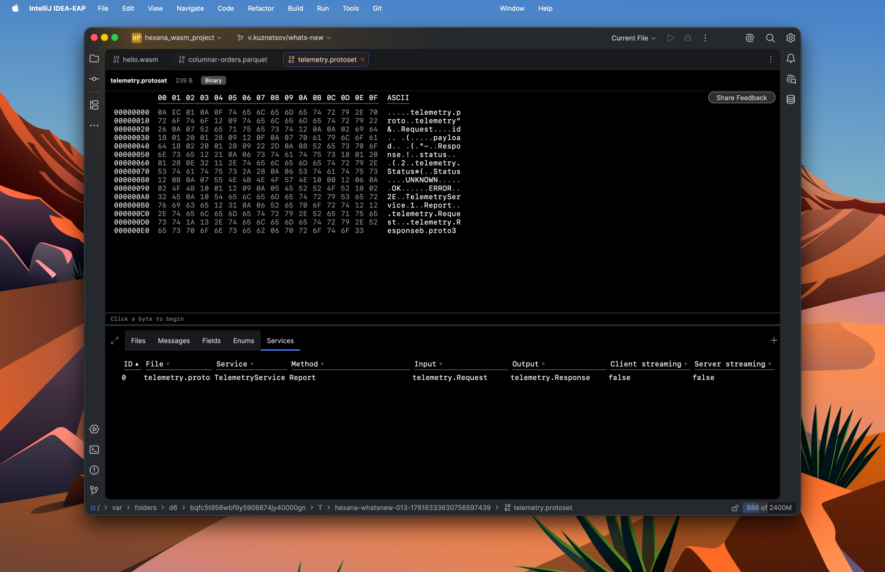

Compiled descriptor sets (produced by `protoc --descriptor_set_out`) are recognised by content structure (a leading length-delimited field whose embedded `FileDescriptorProto` name ends in `.proto`) as well as by extension. They open to **Files**, **Messages**, **Fields**, **Enums**, and **Services** tabs. Messages and enums are flattened with dotted qualified names (`Outer.Inner`); fields show their number, label, type, and any message or enum type reference; services list each method with its input and output types and streaming flags.

### Open As Protobuf Message

**Open As Protobuf Message** (project-view context menu) decodes any file as a raw, schema-less Protocol Buffers wire message — an explicit action, since a bare wire message has no magic bytes. One row per field with positional path, field number, guessed type, value, and byte range; length-delimited payloads that parse cleanly as nested messages expand into indented child rows, otherwise showing as a UTF-8 string or hex preview. Selecting a row highlights that field's bytes in the hex view. Decoding is fault-tolerant, so the action is safe to try on any file. Field names and declared types are not recovered.

## Structure tool window (0.13)

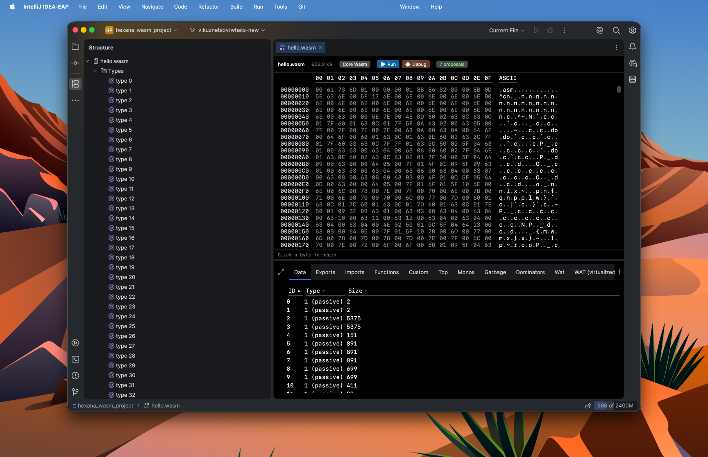

The IDE's **Structure** tool window populates for WASM modules, WASM components, and ELF files opened in Hexana.

## Custom scriptable JS tabs (0.13)

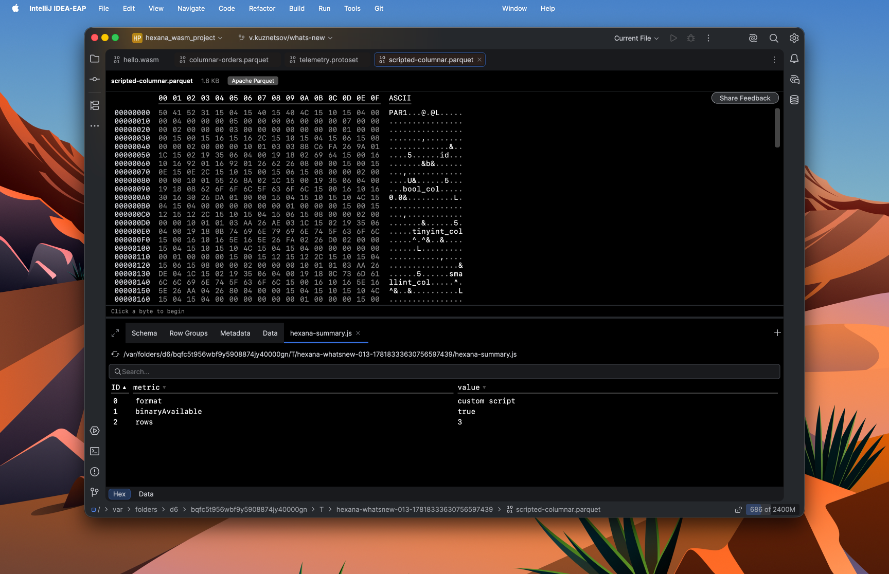

Any open binary can gain user-written JavaScript analysis tabs. Click **+** in the tab bar to add a script tab — a dialog with instructions and an API reference is shown. Use `print` to show information and `binary` to access the binary data; CSV and TSV output is shown as a table.

- **(0.20)** The `binary` API is format-agnostic: `format`, `size`, `path`, `dir`, `structure`, `strings`, `sizeAnalysis`, `binary.tabs`/`binary.tab(name)`. `table(...)`/`row(...)` output is available; `open(path)` parses another file and returns the same members as `binary`.
- **(0.20)** Script tabs are sandboxed. No host classes, processes, threads, or native access; a timeout and bounded output are enforced. The one way a script reaches the file system is `open(path)`, which parses into the same read-only API.
- **(0.21)** The `run-script` CLI and MCP tool gain `hexana.defineCheck`, `hexana.defineFlags`, `hexana.defineSlice`, and suite support. See [Scripting: checks and suites (0.21)](#scripting-checks-and-suites-021).

## WasmGC type graph (0.21)

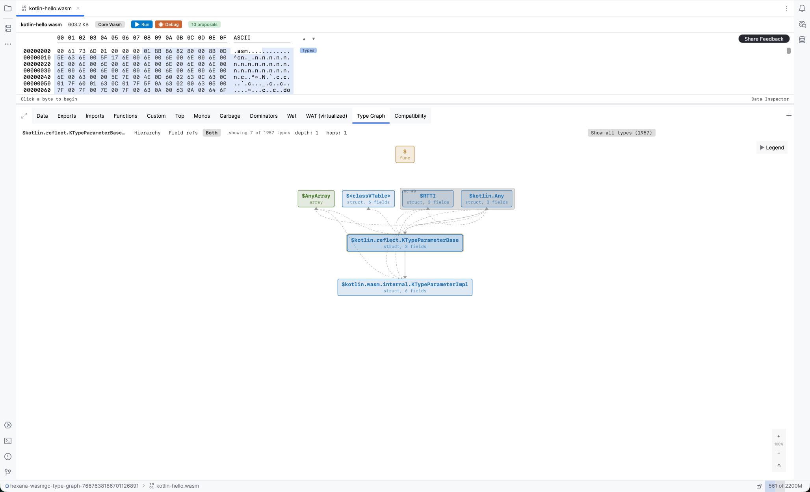

For WasmGC modules, the **WAT (virtualized)** tab adds an interactive type graph alongside the inline type annotations and the Alt+click popup described in [WAT tab](#wat-tab--virtualised-editable).

**Show Type Graph** (in a type row's context menu or the Alt+click popup) opens a canvas centered on the selected type:

- Nodes are types; edges are subtype and field-reference relationships.
- The initial view shows 1 subtype level and 1 field hop, configurable up to 5 via header dropdowns.
- `FUNC`-typed field targets fold into a "+N funcs" badge on the parent; expanding materializes them.
- Expanding or collapsing a node keeps all other nodes in place; newly revealed nodes appear below the expanded parent without relaying out the graph.
- Rec-group frames draw only when their bounding box contains no non-member nodes; scattered groups get a left-edge accent bar per member instead of a frame.
- Double-clicking a node jumps back to that type's row in the WAT panel.
- Mouse wheel pans on both axes; Shift+wheel pans horizontally; Cmd/Ctrl+wheel (or Cmd/Ctrl+/-/0) zooms and resets. Overlay scrollbars track the pan offset; pan and zoom are clamped to content bounds.

## Scripting: checks and suites (0.21)

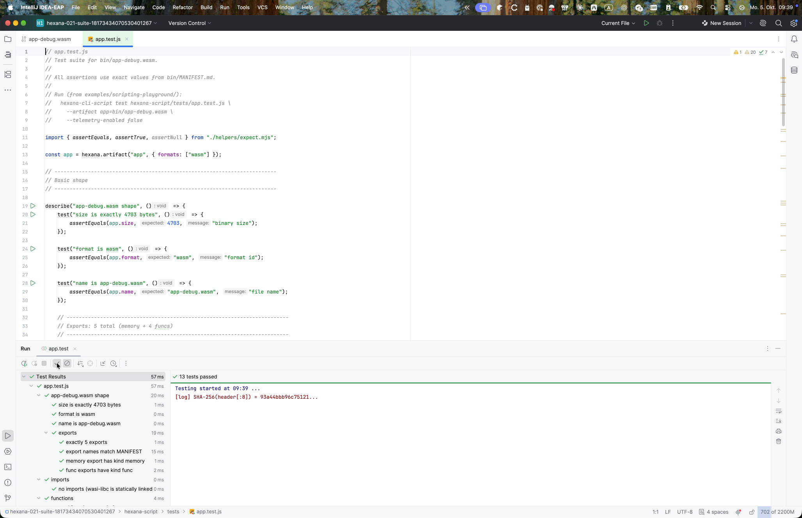

The scripting API and the `run-script` CLI/MCP tool gain structured output APIs and a suite runner. This extends the existing custom scriptable JS tabs added in 0.13.

### Check API

`hexana.defineCheck(id, fn)` declares a named check whose findings land in the **Problems** tab and in SARIF 2.1.0 output. `hexana.defineFlags(schema)` accepts typed per-run parameters. `hexana.defineSlice(name, fn)` covers the existing table output. `binary.functions()`, `.imports()`, and `.exports()` are curated facade members (typed arrays, zero-arg call).

### Suite runner

A new `run_script_suite` CLI command and MCP tool run `*.test.js` suite files:

- Each file declares artifact roles via `hexana.artifact(role, {formats})`.
- Test structure: `describe` / `test` / `beforeEach` / `afterEach` with async support.
- Seeded deterministic crypto (SHA-256 counter DRBG, seed from script and artifact content).
- An ESM loader resolves bare specifiers from a `node_modules` directory rooted at the suite.
- Results output as a human test report or a JUnit XML file; exit 1 on any failure.

### Hexana Suite run configuration

The **Hexana Suite** run configuration brings suites into the IDE:

- The artifact-role table is filled from the suite's declarations.
- Test results stream into the SM test console as a tree; failures carry source locations for navigation.
- **Rerun Failed** and **Copy CLI Command** work.
- Gutter run icons appear on `test()` and `describe()` calls in `*.test.js` files.
- The binary editor context menu adds **Run Suites for This Binary** for suites whose required artifact role matches the open file.

Check findings from any run are stored per binary and merged into the **Problems** tab rows next to parse problems; clicking a row navigates to the finding's function.

## Run configurations and debugging

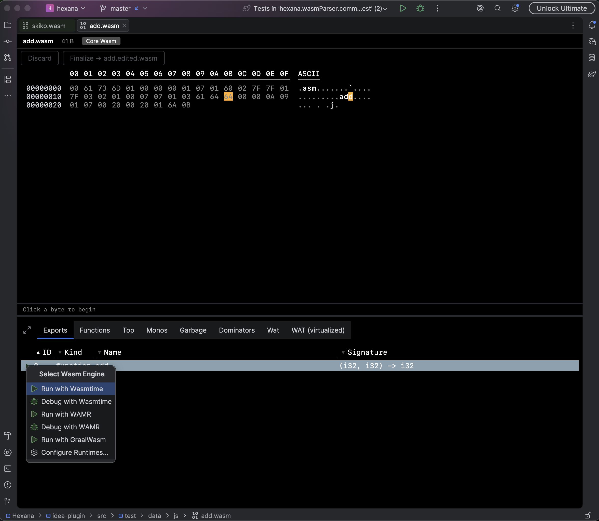

Hexana ships a `WasmRunConfigurationType` with a producer that creates a run configuration from any open `.wasm` file. Supported runtimes:

- **Wasmtime** — run and debug (debug requires LLVM 22.1+).
- **WAMR** — run and debug.
- **GraalWasm** (built-in or custom GraalVM installation) — run only. Builds of GraalVM without the embedded WASM runner are detected and supported.
- **Node.js** — run and debug (0.11). Debugging uses Node's built-in inspector.
- **Browser** — run and debug (0.11). Debugging drives **Chrome** via the Chrome DevTools Protocol.
- **wazero** — run only (0.13). Module execution only; running individual functions is not supported.

The runtime is selected per-project in **Settings → Build, Execution, Deployment → WASM Runtime**. The configuration also accepts a custom GraalVM home directory. See [`run-and-debug.md`](run-and-debug.md).

Hexana detects which WASM proposals a module uses (Threads, SIMD, GC, EH, etc.) and propagates the correct `--wasm-features` (or runtime-equivalent) flags automatically. Debugging via DWARF works against breakpoints set in the source files the binary was compiled from, including when debug information is encoded in `.debug_loc` sections.

The debugger is registered via `WasmDebugRunner` and `WasmLineBreakpointType`; breakpoints are placed on WAT lines and back-mapped through DWARF when available.

### Wasm debugger tab (0.17)

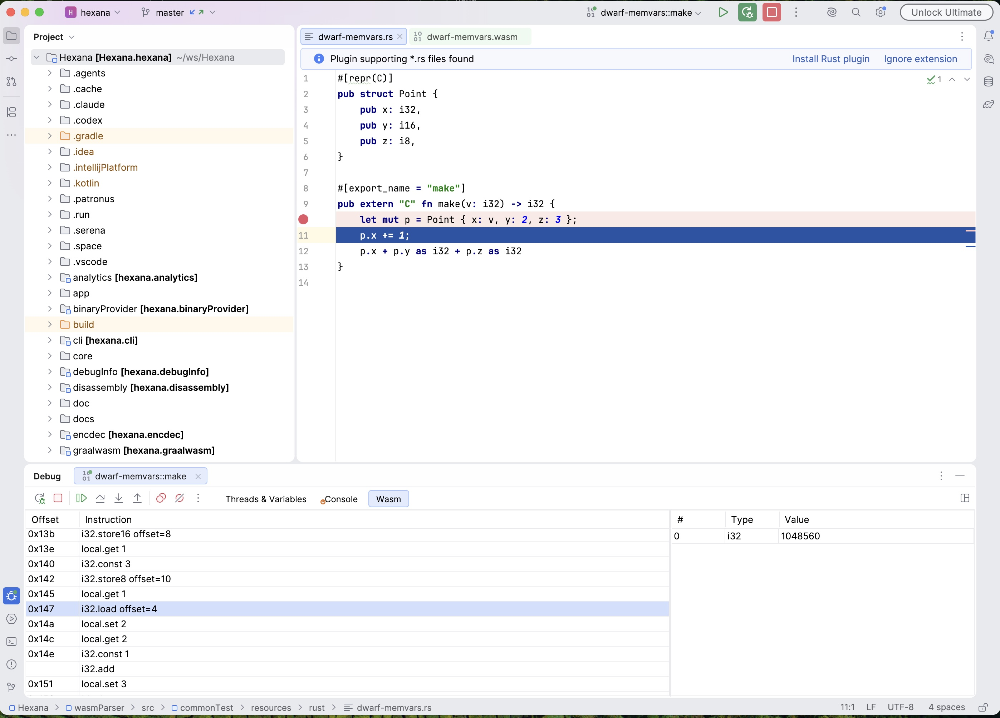

A **Wasm** tab appears in the debugger tool window when debugging a wasm module. The left pane disassembles the paused function to WAT (same mnemonics and symbolic `call $name` operands as the WAT view) with the current instruction selected and following every step; the right pane shows the operand stack with typed entries.

- **Stepping granularity**: while the Wasm tab is selected, one Step Over or Step Into advances exactly one wasm instruction (including `local.get`, `i32.const` and similar instructions that emit no machine code). Selecting another tab reverts to source-line granularity.
- **Node.js and browser**: V8 natively steps one wasm instruction at a time; a single source line previously took several clicks to cross.
- **wasmtime (0.17)**: the current-instruction highlight and symbolic operand stack work via the native-address-to-wasm-offset table serialized into every compiled module. Cranelift compiles the wasm stack machine away, so the 0.17 release shows static origins (local name, constant value, or producing instruction) per slot rather than live values.
- **wasmtime with gdbstub (0.18)**: wasmtime debugging switched to wasmtime's built-in gdbstub guest debugger (`wasmtime run -g <port>`). Requires wasmtime 44 or newer. Live operand-stack values are now served by the gdbstub and shown next to their static origin (e.g. `7 (i32.add @0x7c)`). Arguments and locals show concrete values (previously hidden behind Cranelift's compilation). Requires an LLDB with the wasm process plugin; the managed wasi-sdk download provides one.
- **WAMR (0.18)**: the Wasm tab also appears for WAMR sessions. WAMR reports wasm byte offsets directly, so per-instruction highlight and stepping work the same way as under wasmtime's gdbstub. Live values are shown for slots that mirror a local or global; computed intermediates keep their statically reconstructed origin. Requires `iwasm` built with `WAMR_BUILD_DEBUG_INTERP=1`.

#### Linear-memory variables (0.17)

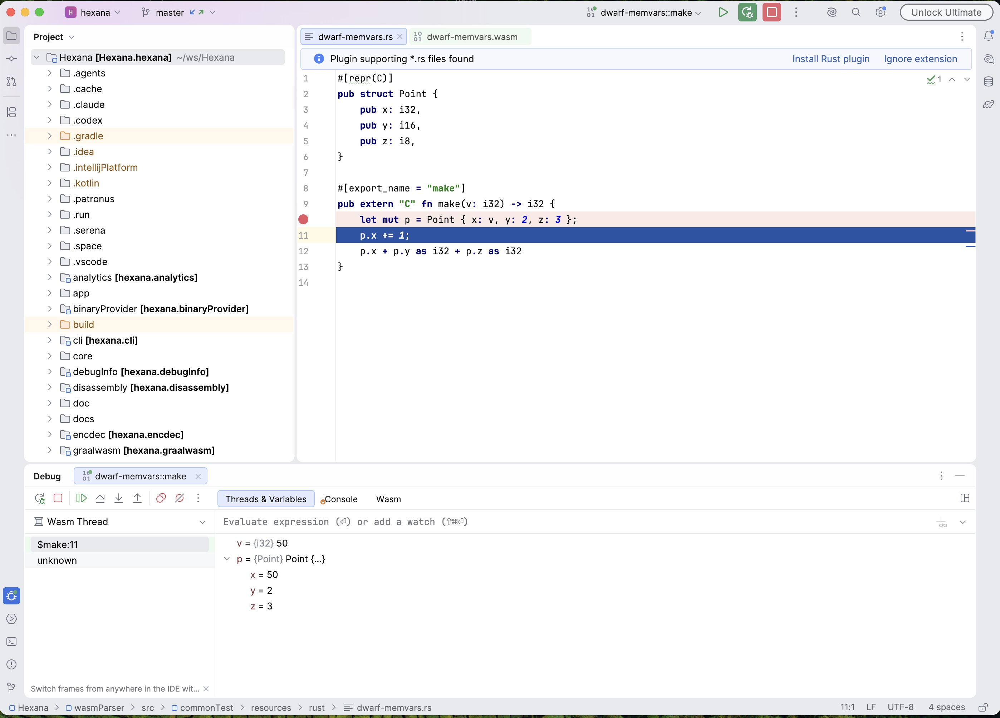

Variables stored in linear memory now appear in the Variables view under Node.js. V8 only surfaces wasm locals and globals natively; anything on the shadow stack or at a fixed address (structs, arrays, enums) is now located via DWARF, read from the module's memory over the debugger protocol, and decoded per its DWARF type. Structs expand to members at their recorded offsets; enums render by enumerator name; arrays are bounded. Reads are capped per variable.

#### Inlined frames (0.17)

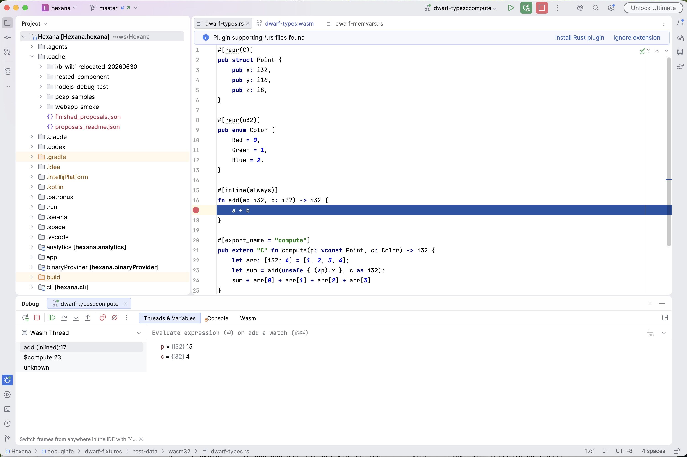

When a pause lands inside inlined code, the stack shows synthetic frames suffixed `(inlined)`, reconstructed from DWARF: the innermost inlined function at the pause location and each caller at its recorded call site. Variables and evaluation stay attached to the physical frame; stepping remains physical.

#### Conditional breakpoints (0.17)

Conditional breakpoints work in wasm debug sessions. Condition expressions are translated from DWARF source variable names to V8's internal wasm-local names before registration, so conditions use the same names the Variables view shows.

### Managed wasi-sdk installation (0.18)

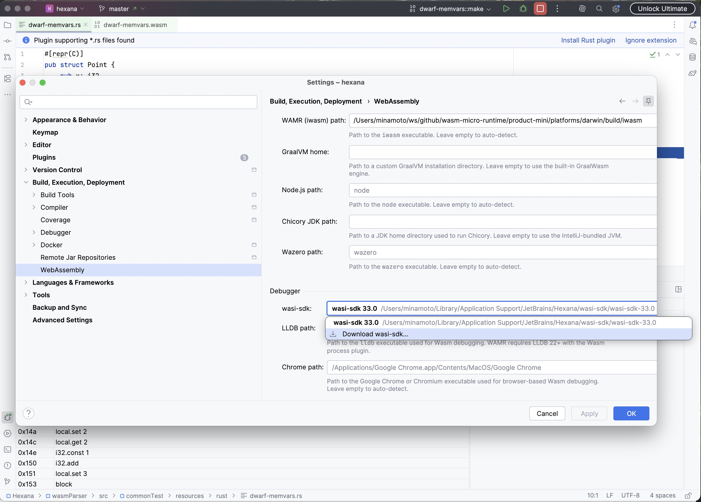

The WebAssembly settings page has a JDK-style selector that lists installed wasi-sdk versions and ends with a **Download wasi-sdk…** action opening a version chooser fed from the GitHub releases (download sizes shown, sha256 verified against the release digest, cancellable, versions installed side by side). The SDK lands under the IDE's common data directory, so one download serves every project and every JetBrains IDE on the machine.

The LLDB selection is unchanged: the managed SDK takes effect only through an explicit **Use as LLDB path** action (in the settings row and in the install notification). When a debug session cannot find LLDB, a notification offers the download.

### Breakpoints in binary views (0.20)

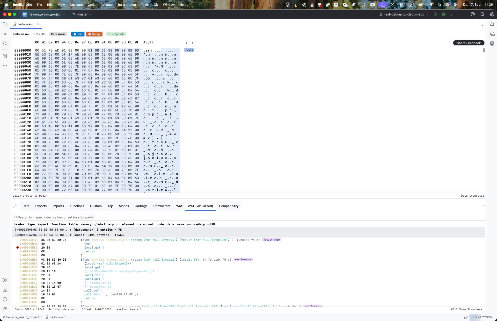

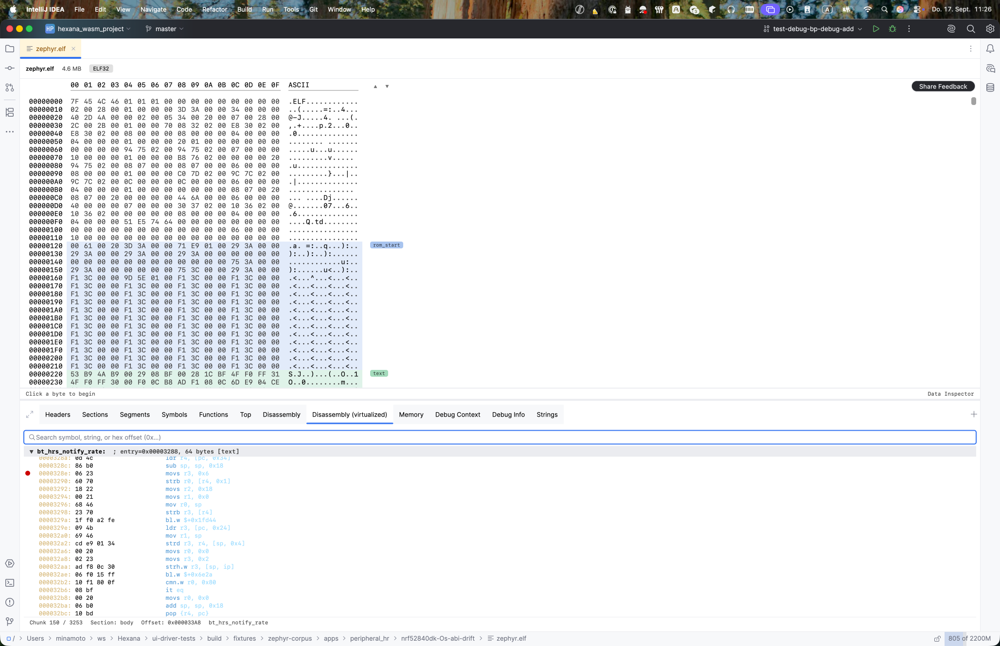

Click the gutter in the **WAT (virtualized)** or native **Disassembly** view to set a breakpoint without a running debug session. The breakpoint is anchored to the binary's content hash (not its path) and survives IDE restarts. The gutter icon reports what the runtime did with it: registered, instruction-precise, degraded, or stale after a rebuild.

Supported for GraalWasm, Node.js, browser, wasmtime, WAMR, and firmware ELF (QEMU/Renode) sessions. Listed under **Hexana Binary Breakpoints** in the Breakpoints dialog. Conditions and hit counts are not supported yet.

### Debugger Console tab (0.20)

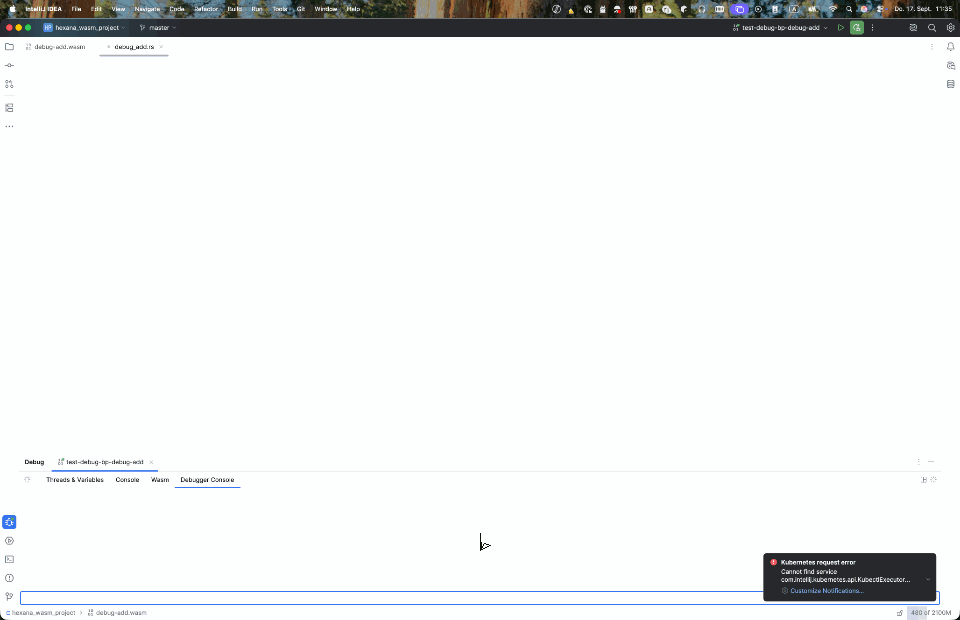

A **Debugger Console** tab appears in the Debug tool window for sessions that have an underlying command-line debugger: LLDB commands for wasmtime and WAMR sessions, GDB commands for firmware QEMU/Renode sessions. Execution-control commands are routed through the IDE's own actions so the console cannot desync it. Not available for GraalWasm or CDP (Node.js/browser) sessions.

### Firmware ELF Run and Debug (0.19)

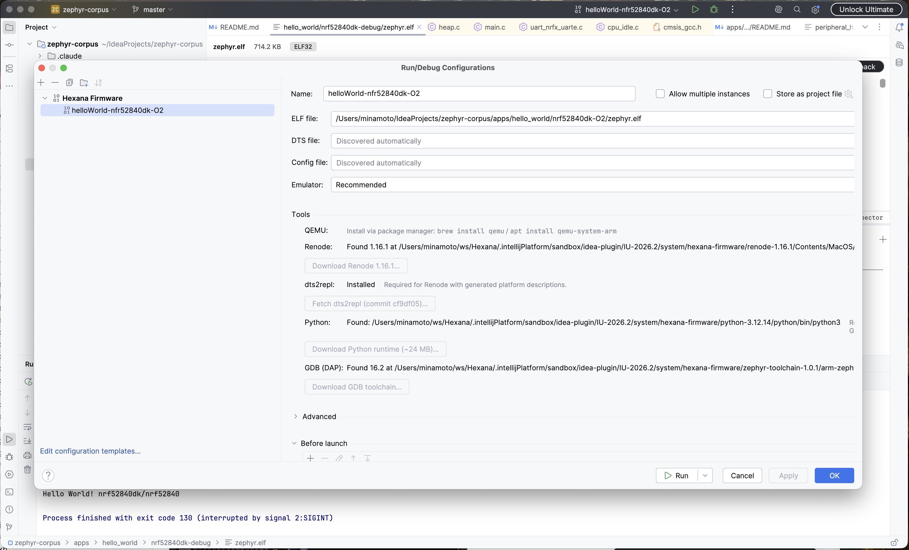

Opening a Zephyr-class ELF offers **Run** and **Debug** buttons in the editor header when a target profile resolves from the ELF header plus the `zephyr.dts` and `.config` found next to it.

- **QEMU boards** (`qemu_cortex_m3`, `mps2/an521`, `qemu_riscv32`, `qemu_cortex_a53`, and others) launch with the exact machine flags from a curated table.
- **MCU-class boards** run under Renode, on a built-in platform where Renode ships one (nRF52840 DK, STM32F4 Discovery) or on a platform generated from the devicetree by dts2repl.
- Console output streams to the Run tool window; a startup watchdog reports "did not reach console output" naming the first unimplemented-peripheral access.
- **Debug** attaches GDB in DAP mode (preferring the Zephyr SDK's `arm-zephyr-eabi-gdb-py`; minimum GDB 14 with Python) to the emulator's frozen gdb stub. An LLDB fallback covers machines without a suitable GDB.
- Emulator tooling (Renode 1.16.1 portable build, per-architecture Zephyr SDK GDB toolchain, standalone CPython for dts2repl) is acquired on demand from the run configuration's Tools section with consent-gated, checksum-verified, cancellable downloads; each tool is also overridable by path in **Settings | Build | Firmware Emulator**. QEMU comes from the system package manager.
- The configuration persists as a **Hexana Firmware** run configuration. A combination the target cannot support fails at validation time with a named reason and the alternative, never as a hung emulator.
- Stop kills the whole emulator process tree; nothing is left behind on IDE exit.

### Runtime compatibility tab (0.20)

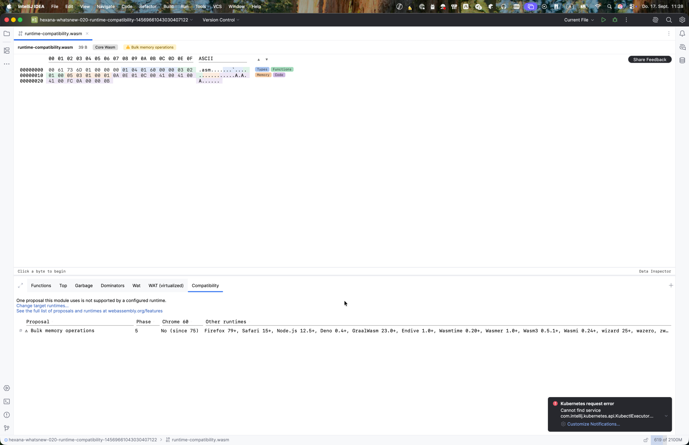

Declare target runtimes under **Settings | Build, Execution, Deployment | WebAssembly | Runtime Compatibility** and every `.wasm` file is checked against them. The proposals badge turns into a warning for unsupported proposals and opens a **Compatibility** tab. With nothing declared, the tab lists which runtimes support each proposal. Verdicts come from WebAssembly's `features.json`; the declaration lives in `.hexana/runtimes.json`, shared with the VS Code extension.

## MCP server

Hexana registers `HexanaToolset` against the platform MCP server (`com.intellij.mcpServer`). The embedded IntelliJ provider exposes a **29-tool default profile** as of 0.14. Advanced inventory and raw-detail tools remain available from the standalone MCP server's `advanced` profile.

Schema version 3 (0.14) adds bounded list inputs — for example `indices.maxItems` — so MCP clients can validate oversized requests before sending them.

Each tool is documented per-section in [`mcp-tools.md`](mcp-tools.md).

## Java-side WebAssembly API support

Loaded when the host IDE includes the Java module (`com.intellij.modules.java`). Hexana 0.9 contributes:

- **GraalWasm completion** for `org.graalvm.polyglot.*` calls that load WASM (`Source.newBuilder("wasm", url)`, `Context.eval(...)`, `module.newInstance(ProxyObject.fromMap(Map.of(...)))`, `getMember`/`invokeMember`).
- **Chicory completion** for `com.dylibso.chicory.*` calls (`Parser.parse(...)`, `Instance.builder(...)`, `instance.export("...")`, `ExportFunction.apply(...)`, `new HostFunction(...)`, `Store.addFunction`, `ImportValues`, `FunctionType.of(...)`).
- **`JavaWasmReferenceIndex`** indexes Java string literals that name `.wasm` exports / imports and resolves them across files.
- **Five inspections**:
  - `WasmExportInspection` — unresolved WebAssembly export name.
  - `WasmExportArgCountInspection` — export argument count mismatch.
  - `WasmExportArgTypeInspection` — export argument type mismatch.
  - `WasmImportInspection` — unresolved WebAssembly import name.

See [`java-integration.md`](java-integration.md).

## JavaScript and TypeScript integration

Loaded when the host IDE includes the JavaScript plugin (WebStorm by default; opt-in for IntelliJ IDEA, RustRover, PhpStorm, Rider). Hexana 0.9 contributes a `WasmFrameworkIndexingHandler` that hooks into the JetBrains JS type-inference pipeline and provides:

- **Imports completion** inside the second argument of `WebAssembly.instantiate(...)` / `instantiateStreaming(...)` — module names and per-module item names typed against the resolved `.wasm`'s real imports.
- **Exports type inference** on `.instance.exports.<name>` — function exports become typed callables with argument-count and argument-type checking; memory, table, and global exports get the right `WebAssembly.*` types.
- **Literal-union argument types** — when a WASM function branches on a string-literal argument, the parameter is typed as the literal union (e.g. `"add" | "sub"`), not just `string`.
- **`compile` / `compileStreaming` support** — `WebAssembly.Module` returned by `compile(...)` carries the resolved path forward into a later `new WebAssembly.Instance(module, imports)`.
- **`fetch` heuristic** — when instantiating from an `ArrayBuffer`, Hexana traces a sibling `fetch("…wasm")` call to identify the source binary.
- **TypeScript-aware** — recognises `WebAssembly.Instance` / `Module` / `WebAssemblyInstantiatedSource` resolved through TypeScript's `WebAssembly` namespace.
- **Application-level cache** (`WasmBinaryDataCacheService`) — each `.wasm` is parsed once and reused across all JS resolves in the session.

See [`js-integration.md`](js-integration.md) for the full reference.

## Indexes

Hexana ships four file-based indexes:

| Index | Purpose |
|---|---|
| `WasmIndex` | Maps `.wasm` file content into a queryable module representation. Used by Goto Symbol, run-config producer, MCP tools, and Java/JS integrations. |
| `WasmExportIndex` | Symbol index keyed by export name → owning `.wasm` file. |
| `DwarfIndex` | Indexes DWARF debug information for source mapping. |
| `WitComponentIndex` | Cross-file index for WIT component declarations. |
| `JavaWasmReferenceIndex` | Java string-literal → WASM export/import resolver (Java module only). |

JavaScript-side resolution is not file-based; it uses the application-level `WasmBinaryDataCacheService` instead. See [`js-integration.md`](js-integration.md).

## DWARF debug information

Hexana parses DWARF v4 and v5 sections embedded in `.wasm` custom sections:

- `.debug_str` — string table, original offsets preserved.
- `.debug_abbrev` — abbreviation tables.
- `.debug_info` — compilation units, DIE trees.
- `.debug_line` — line-number programs.

Used by the debugger for source-line mapping (via `WasmDwarfInjector` and `WasmDwarfUtil`) and by the **Source mapping** feature (added 0.8) which lets the user navigate from WAT back to the source file the binary was compiled from when DWARF is present.

## Goto Symbol contributor

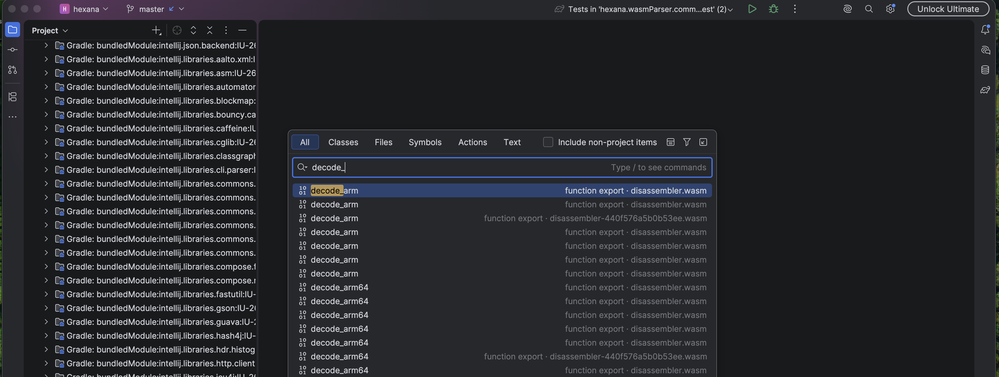

Hexana adds a `gotoSymbolContributor` (`HexanaGotoSymbolContributor`) that surfaces:

- `.wit` interface, world, and type declarations.
- Component-model exports.
- Regular `.wasm` exports — picking one opens the file and selects the matching row in the Exports tab.

`Shift+Shift` (Search Everywhere → Symbols) finds all of the above alongside regular code symbols.

## Notifications

Hexana registers the `hexana` notification group (balloon display). Currently used for the `MissingWasmToolsNotification` editor notification that surfaces when a `.wat` file is opened but Hexana cannot find the binary tooling needed to operate on it.

## Settings pages

Two registered `applicationConfigurable` entries (see [`settings.md`](settings.md)):

- **Tools → Hexana** — general Hexana settings.
- **Build, Execution, Deployment → WASM Runtime** — runtime selection (Wasmtime, WAMR, GraalVM), runtime paths, default-runtime configuration.
- **(0.18)** The WebAssembly settings page gains a wasi-sdk selector with a **Download wasi-sdk…** action. See [Managed wasi-sdk installation (0.18)](#managed-wasi-sdk-installation-018).
- **(0.19)** **Settings | Build | Firmware Emulator** overrides the per-tool paths for Renode, Zephyr SDK GDB, and CPython used by the firmware Run/Debug configuration.
- **(0.20)** **Settings | Build, Execution, Deployment | WebAssembly | Runtime Compatibility** declares target runtimes for the compatibility check. See [Runtime compatibility tab (0.20)](#runtime-compatibility-tab-020).

## Usage statistics

`HexanaCounterUsagesCollector` registers event group `org.jetbrains.hexana` (recorder `FUS`) with one event in 0.9: `wasm.file.opened`. Subject to the IDE's standard statistics-collection consent.
