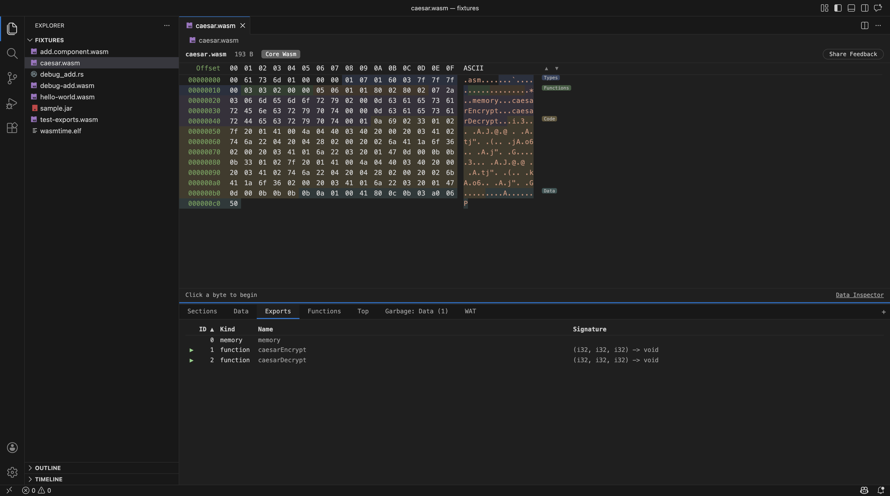
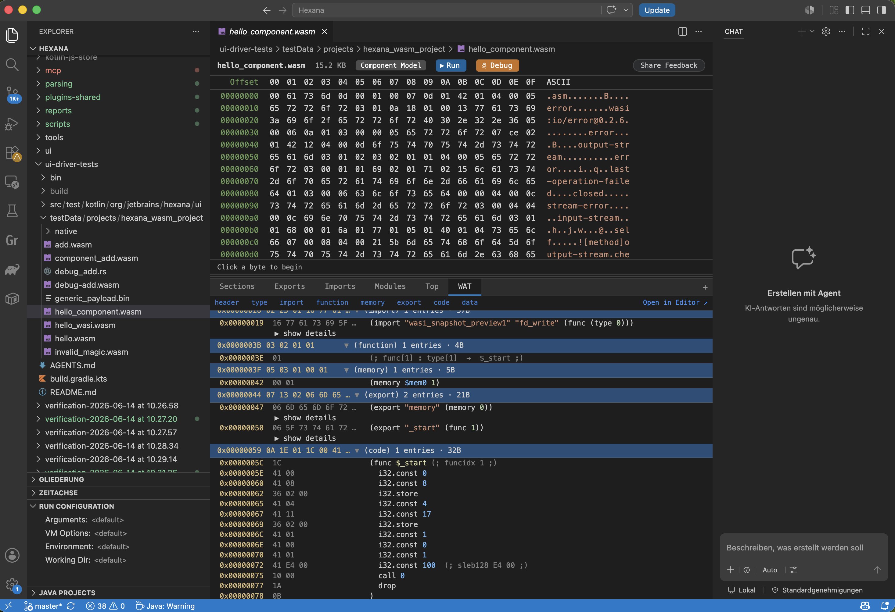
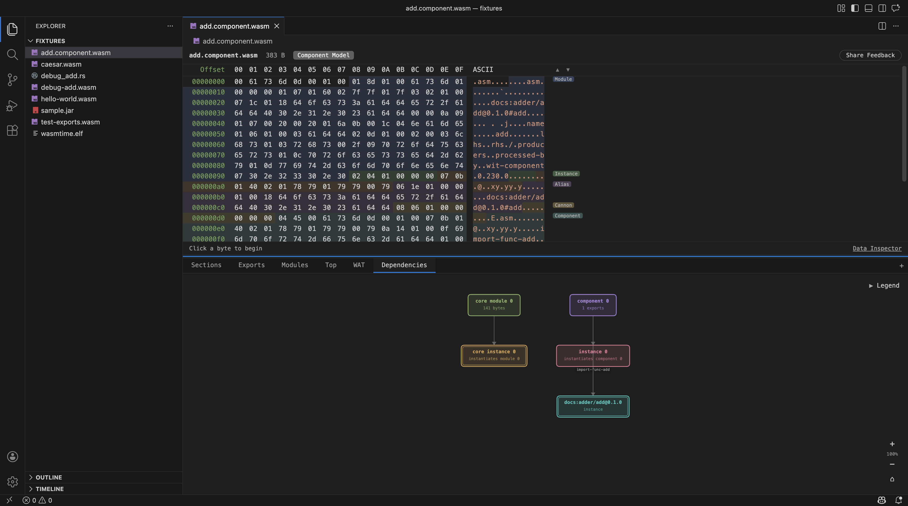

# Analysis Tab Reference

The Hexana custom editor shows up to **12 built-in tabs** in its analysis panel, surfaced based on the loaded binary's kind (core Wasm, Component Model, or generic), plus any number of scriptable tabs you add with **"+"** (see [`features.md`](features.md#scriptable-info-tabs-060)). All tables on every tab are **sortable** (click a header) and **searchable** (type in the built-in search field — unified across all tabs since 0.6.0). Protocol Buffers descriptor sets open with their own five-tab set, documented at the end of this page.

This page documents each tab in the order Hexana renders them.

## Summary

**Available for**: all binary kinds.

Shows the high-level shape of the module:

- **Section table** — every section in the binary with id, byte offset, byte size, and a percentage of total file size. Custom sections (including `name`, DWARF, and producer-tool sections) appear in this list.
- **Statistics** — total file size, magic bytes, binary format version, detected kind, function count, import count, export count, type count, memory count, global count, table count, and data-segment count where applicable.

Use this tab as the first stop on any new binary — it tells you whether you are looking at a core module, a component, or something unrecognised.

## Exports

**Available for**: core Wasm and Component Model.

Lists everything the module exposes:

| Column | Description |
|---|---|
| Kind | `func`, `table`, `memory`, `global`, `tag`, or component-model interface kind. |
| Name | Export name, verbatim from the binary. |
| Index | Numeric index in the appropriate index space (function index for `func`, etc.). |
| Signature | Resolved type signature for function exports. |

For Component Model files, exports include interface and resource exports as well as plain functions.

## Imports

**Available for**: core Wasm and Component Model.

Lists everything the module requires from its host:

| Column | Description |
|---|---|
| Kind | `func`, `table`, `memory`, `global`, `tag`, or component-model interface kind. |
| Module | Import module name. For core Wasm this is the first half of the import descriptor (`env`, `wasi_snapshot_preview1`, etc.). |
| Name | Import item name. |
| Signature | Resolved type for function imports. |

## Functions

**Available for**: core Wasm only.

One row per defined function:

| Column | Description |
|---|---|
| Index | Function index (zero-based across imports + defined functions). |
| Name | Function name from the `name` custom section if present, otherwise blank. |
| Signature | Parameters and results. |

Imports are excluded from this tab — they appear under **Imports**.

## Data

**Available for**: core Wasm only.

Lists data segments:

| Column | Description |
|---|---|
| Index | Data segment index. |
| Kind | Passive or active. |
| Memory | Memory index for active segments. |
| Offset | Init expression for active segments. |
| Size | Byte size of the segment payload. |

Used to understand how much of the binary is static data versus code, and where the static data lands at runtime.

## Custom

**Available for**: core Wasm only.

Lists custom sections by name:

| Column | Description |
|---|---|
| Name | Custom section name (e.g. `name`, `.debug_info`, `producers`). |
| Size | Byte size. |
| Offset | Byte offset in the file. |

Helps diagnose DWARF presence, producer-tool fingerprints, and the relative cost of debug information.

## Top

**Available for**: core Wasm and Component Model.

Hexana's **size profiler**. Lists the largest contributors to binary size:

| Column | Description |
|---|---|
| Kind | Function, data segment, custom section, etc. |
| Index / Name | Identifier of the contributor. |
| Size | Byte size. |
| % of file | Share of the total file. |

Sorted by size descending by default. Use this tab to answer "why is my `.wasm` 8 MB?" — usually the answer is a small number of giant functions or a debug section, not death by a thousand cuts.

## Monos

**Available for**: core Wasm only.

**Monomorphisation analysis**. Looks for clusters of functions that share a signature prefix or naming pattern and may represent the same generic function instantiated for different type arguments. Useful for Rust / C++ codebases where template / generics expansion bloats the binary.

| Column | Description |
|---|---|
| Group | Inferred base name of the monomorphisation cluster. |
| Count | Number of instantiations in the cluster. |
| Total size | Combined byte size of all instantiations. |
| Per-instance avg | Average size of one instantiation. |

Sorted by total size descending — the costliest clusters surface first.

## Garbage

**Available for**: core Wasm only.

**Unreferenced-code detection**. Functions that appear unreachable from any export or from the start function. Likely candidates for dead-code elimination if your build pipeline missed them.

| Column | Description |
|---|---|
| Index | Function index. |
| Name | Function name if available. |
| Size | Byte size. |

Note: detection is conservative. Tail-called functions through complex indirect-call patterns may show up as garbage when they are actually live. Treat as a candidates list, not a delete-without-thinking list.

## Modules

**Available for**: Component Model only.

Lists the nested modules inside a component binary:

| Column | Description |
|---|---|
| Path | Hierarchical path to the nested module within the component. |
| Kind | Core module or sub-component. |
| Size | Byte size. |

Each row is **clickable** — clicking opens the nested module in a separate VS Code editor tab via Hexana's virtual filesystem provider. The nested editor itself has the same 11-tab analysis panel and can drill further if the nested module is also a component. See [`component-model.md`](component-model.md) for the nested-module URL scheme and back-navigation.

## WAT

**Available for**: core Wasm and Component Model.

Generates the **WebAssembly Text** representation of the loaded binary and opens it in a **native VS Code editor tab** (not inside the Hexana webview). This gives you:

- VS Code's syntax highlighting via the `wat` language association.
- Find / replace and Go-to-Line working through VS Code's own machinery.
- Coexistence with any other VS Code WAT extension you have installed.

The conversion runs in the webview via a WASM-based wat printer (`WasmPrinterJs`), so there is no external dependency.

Since **0.5.0** the WAT view uses **virtual scrolling** — only the visible portion of the text is rendered at any given time. For large modules with thousands of functions (e.g. a multi-MB Emscripten or Kotlin/Wasm binary), this keeps initial render and section navigation fast.

Since **0.6.1**, Component Model binaries also use the virtualized WAT renderer for their embedded core modules. A **module selector** at the top of the WAT panel lets you switch between modules when the component contains more than one embedded core module. Each module's WAT is rendered independently with the same virtual scrolling.

The WAT view is read-only and is regenerated on each open. Inline WAT editing — present in the JetBrains plugin — is not yet in the VS Code extension.

## Dependencies (0.8.0+)

**Available for**: Component Model only.

A graph view of the internal dependency structure of the open component. Each node represents an entity in the component — a core module, a nested component, a core or component instance, or an interface import / export such as `docs:adder/add@0.1.0` — and edges show how they are wired together.

The diagram is generated from the component's binary structure and requires no external tool. A **Legend** identifies node kinds by colour.

## Protocol Buffers descriptor set tabs (0.6.0+)

**Available for**: `.desc` and `.protoset` files (compiled Protocol Buffers descriptor sets).

When a descriptor set is open, the analysis panel shows five tabs instead of the Wasm set:

- **Files** — one row per embedded `.proto` file: name, package, syntax, top-level message / enum / service counts, and dependencies.
- **Messages** — one row per message type: defining file, dotted qualified name (`Outer.Inner`), and field / nested-type / enum counts.
- **Fields** — one row per field across all messages: file, message, field name, number, label, type, and any message or enum type reference.
- **Enums** — one row per enum value: file, qualified enum name, value name, and number.
- **Services** — one row per RPC method: file, service, method name, input and output types, and client / server streaming flags.

## See also

- [`features.md`](features.md) — full feature reference.
- [`component-model.md`](component-model.md) — what the Modules tab opens and how nested modules navigate.
- [`run-support.md`](run-support.md) — using Exports and Imports tabs to drive the Run button.
