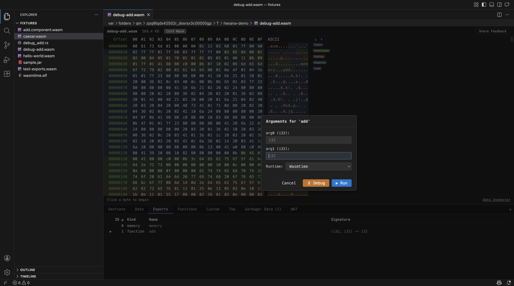
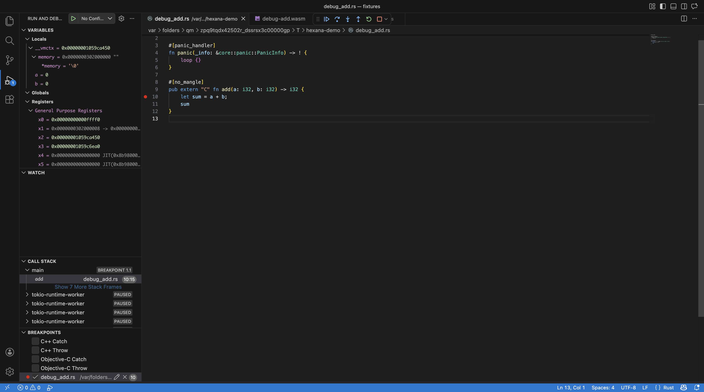
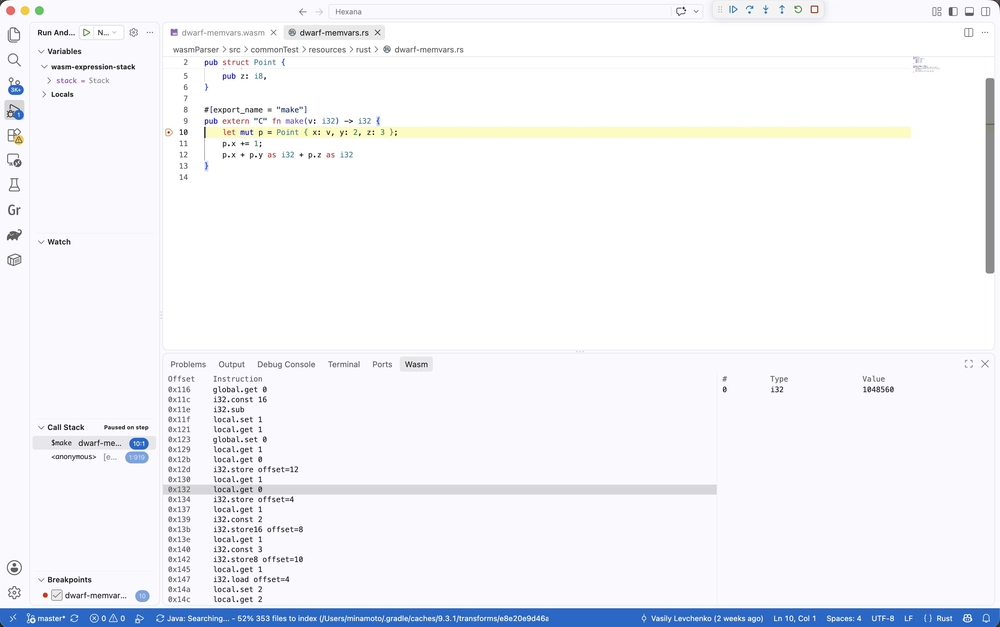
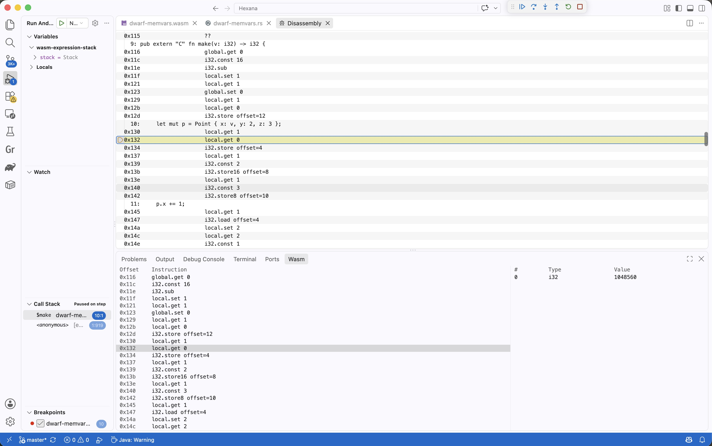
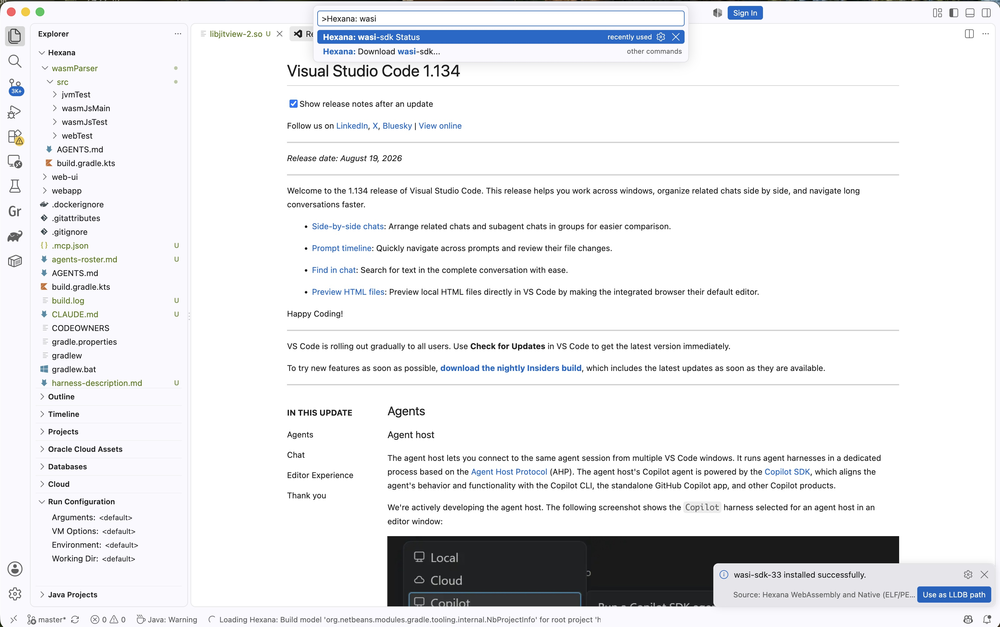

# Running and Debugging WebAssembly from Hexana for VS Code

Hexana ships **Run** and **Debug** buttons in the editor toolbar. You can invoke a module through one of six runtimes (**Wasmtime**, **WAMR**, **GraalVM**, **wazero**, **Node.js**, or the **browser**) and (experimental) attach a debugger to all of them except GraalVM and wazero. Wasmtime 44+ uses the built-in gdbstub (since **0.10.0**); older wasmtime and WAMR use an `lldb`-backed debugger (LLVM 22.1+ required); Node.js and Chrome use the Chrome DevTools Protocol (since **0.4.0**). Node.js and the browser were added as run targets in 0.3.0; wazero was added in 0.6.0. Both core WebAssembly modules and Component Model binaries are supported, with different orchestration for each.

## Requirements

| Tool | Required for | Install |
|---|---|---|
| **[wasmtime](https://wasmtime.dev/)** | Wasmtime runtime + Wasmtime debug | `curl https://wasmtime.dev/install.sh -sSf \| bash`, or via your package manager. |
| **[WAMR](https://github.com/bytecodealliance/wasm-micro-runtime)** | WAMR runtime + WAMR debug | Build from source or grab a release binary. |
| **[GraalVM](https://www.graalvm.org/) + GraalWasm** | GraalVM runtime | Install GraalVM and the GraalWasm component; or let Hexana auto-detect. |
| **[wazero](https://wazero.io/)** | wazero runtime (0.6.0+) | Install the `wazero` CLI and make sure it is on `PATH`. |
| **[wasm-tools](https://github.com/bytecodealliance/wasm-tools)** | Component Model composition (preferred) | `cargo install wasm-tools`. |
| **[wac](https://github.com/bytecodealliance/wac)** | Component Model composition (alternative) | `cargo install wac-cli`. |
| **LLVM 22.1+** (for debug only) | WAMR debugging and Wasmtime older than 44 | Required because Hexana uses `lldb` 22.1+ wire-protocol features. |
| **wasmtime 44+** | Wasmtime gdbstub debug path (0.10.0) | The gdbstub path is preferred; older wasmtime falls back to `lldb` with a visible warning. |

At least one runtime must be on `PATH` (or pointed at via the corresponding setting, e.g. `hexana.wasmtimePath`). `wasm-tools` / `wac` must be on `PATH` only when running component-model binaries with unresolved imports.

## Core WebAssembly modules

### How the Run flow works

1. Click **Run** in the editor toolbar of an open `.wasm`.
2. A dialog opens listing all exported functions and a **runtime picker** (Wasmtime / WAMR / GraalVM / wazero / Node.js / browser). Pick an entry point and the runtime. Under wazero the module is executed as a whole — individual exported-function invocation is not supported on that path.
3. Optionally supply program arguments. Hexana parses the argument string using a shell-aware splitter (quoted strings are preserved as single arguments).
4. Hexana checks for unresolved imports:
   - **All imports resolved**: invokes the chosen runtime directly.
   - **Unresolved imports**: Hexana generates **import stubs** — functions that satisfy the import signatures and do nothing (or trap, depending on the kind) — and supplies them via the runtime's preload / linking mechanism.
5. A VS Code terminal opens with the runtime's command line, runs the export, and shows output.

The Run dialog is always shown so you can confirm runtime, export, and arguments before launch.

### Generated import stubs

For an unresolved import like `env.print_i32(i32) -> ()`, Hexana synthesises a minimal stub component that re-exports a noop with the matching signature, then preloads that stub at Wasmtime invocation. The user-facing effect: the run succeeds even when the WASM was compiled against a host the user hasn't fully wired up.

This is **most useful for inspection runs** — confirm that a function is callable and see what it computes from constant inputs — and **least useful when the host functions are part of the program's semantics** (e.g. an export whose result depends on what `env.read_file` returns).

## Component Model binaries

### How the Run flow works

1. Click **Run** on a component binary.
2. Hexana inspects the component's imports and tries to satisfy them by scanning the workspace.
3. **Dependency resolution** (see [`component-model.md`](component-model.md) for the full algorithm) walks every `.wasm` in the workspace, identifies components that export the interfaces the target imports, and chains them transitively.
4. If all imports are resolved through workspace components:
   - **Composition** runs `wasm-tools compose` (or `wac plug` if `wasm-tools` is unavailable) to produce a single self-contained component.
   - **Invocation** runs the chosen runtime on the composed component.
5. If imports remain unresolved, Hexana falls back to import-stub generation (same as core modules).

### Composition tool selection

| Tool | When Hexana picks it |
|---|---|
| `wasm-tools compose` | First choice. Mainstream Bytecode Alliance tool, broader support. |
| `wac plug` | Fallback when `wasm-tools` is not on `PATH`. |

You can install only one — Hexana adapts. If neither is installed and your binary has unresolved component imports, the Run flow stops with an actionable error pointing you at the install commands.

## Run dialog

The dialog has four sections:

- **Runtime** — dropdown of detected runtimes (Wasmtime / WAMR / GraalVM / wazero / Node.js / browser). Unavailable runtimes are greyed out with a tooltip explaining why. All runtimes except GraalVM and wazero can also be debugged (see [Debugging](#debugging-experimental)).
- **Export** — dropdown of all exported functions (core modules) or the component's primary entry interface (components).
- **Arguments** — free-text field. Shell-style quoting is supported via Hexana's `splitShellArgs` Kotlin/JS utility. Backslash escapes work for spaces; single and double quotes group arguments.
- **Environment** (implicit) — Hexana passes through your current shell environment to the chosen runtime.

Click **Run** (or **Debug** to launch under the debugger — see below) to start; the dialog closes and a terminal opens with the live invocation.

## Debugging (experimental)

Click **Debug** instead of **Run** to launch the module under a debugger. Hexana has three debug backends, selected by the runtime and its version; **GraalVM is run-only**.

### gdbstub-backed: Wasmtime 44+ (0.10.0)

The preferred Wasmtime debug path since 0.10.0:

- The module runs under `wasmtime run -g`. LLDB attaches through the wasm process plugin.
- DWARF is read directly from the wasm binary, removing the JIT-loader and trap-advance workarounds of the native path.
- When the resolved wasmtime is older than 44, the extension checks wasmtime's own installer location (`~/.wasmtime/bin`), and only then falls back to native debugging with a visible warning in the Output channel.
- The operand stack (slot, type, value) is available via the "Wasm" debugger view using the gdbstub stack accessor.

### `lldb`-backed: Wasmtime (older than 44) and WAMR

- **Requirements** — LLVM 22.1 or newer must be on `PATH`, and the WASM binary must be compiled with debug info that `lldb` can interpret.
- **Breakpoints** — set them in source files associated with the module (Hexana maps PCs to source via DWARF). Breakpoints inside nested modules of a Component Model binary are supported on Wasmtime only.
- **Stepping** — step over, into, and out; continue past hit breakpoints.
- **Variables** — local-variable inspection works for compilers that emit DWARF with reasonable location expressions (Rust, C/C++, Emscripten with `-g`).

### CDP-backed — Node.js and Chrome (0.4.0)

Choosing **Debug** with the Node.js or browser runtime drives the runtime over the **Chrome DevTools Protocol (CDP)** instead of `lldb`:

- Node.js is launched with `--inspect-brk`; Chrome with `--remote-debugging-port`. Hexana connects over a CDP WebSocket and translates DAP ↔ CDP so VS Code's standard debugger UI (breakpoints, stepping, call stack, variables) works against the WASM running in the JS host.
- Chrome/Chromium is located from common install locations for your platform; install Google Chrome (or a Chromium build) to use the browser path.
- No LLVM is required for this backend.
- **Source-level stepping (0.10.0)**: a step repeats V8's per-instruction wasm step until the DWARF source line or stack depth changes. Frames without DWARF info keep single-instruction steps.
- **Inlined call frames (0.10.0)**: inlined frames are marked "(inlined)" in the call stack; variables and evaluation stay on the physical frame.
- **Conditional breakpoints (0.10.0)**: conditions are evaluated by V8; expressions referencing wasm-level names work directly.
- **Linear-memory variables (0.10.0)**: structs, arrays, and enums stored in linear memory are located via DWARF, read from the module's memory, and decoded per type in the Variables view.

### "Wasm" debugger view (0.10.0)

"Hexana: Open Wasm View" opens a panel in the bottom area (next to the Debug Console) showing:

- WAT-style disassembly of the paused function, with the current instruction highlighted.
- The operand stack on the right: slot index, type, and value.

While the view is visible, each step moves one wasm instruction. When the view is hidden, stepping returns to source-line granularity. Available for nodejs, browser, wasmtime gdbstub, and WAMR sessions. For Component Model binaries, disassembly and the operand stack resolve against the embedded core module the debug stub reports.

### Disassembly View integration (0.10.0)

"Open Disassembly View" while paused in a nodejs or browser wasm debug session opens VS Code's built-in Disassembly View with:

- One WAT-style instruction per row.
- Module-absolute byte offsets as addresses.
- Interleaved DWARF source location annotations.

While the view is focused, stepping switches to per-instruction granularity, matching the Wasm view behavior.

### Managed wasi-sdk (0.10.0)

- **"Hexana: Download wasi-sdk..."** lists GitHub releases with sizes shown, sha256-verified, and cancellable. Versions install side by side into the extension's global storage; one download serves all workspaces.
- **"Hexana: wasi-sdk Status"** shows the active version with update and version-switch actions.
- The SDK takes effect only via an explicit "Use as LLDB path" button, which writes the `hexana.lldbPath` setting. The lldb resolution order is otherwise unchanged.

Known limitations:

- GraalVM debug is not wired (run-only).
- wazero debug is not wired (run-only).
- Some compilers' DWARF (especially aggressive-CGU Rust builds) produces source paths that need fuzzy matching; if a breakpoint does not bind, check the **Debug Console** for the path Hexana tried to resolve and file a tracker issue.

## Terminal output

Each run gets its own VS Code terminal named after the run target (export name or component path). Stderr and stdout are shown verbatim — Hexana does not parse or filter the runtime's output. Use the terminal's normal search and copy.

Killing the terminal kills the runtime process.

## Configuration

| Setting | Default | Effect |
|---|---|---|
| `hexana.wasmtimePath` | `""` (use PATH) | Absolute path to a specific Wasmtime executable. Useful for testing pre-release builds or pinning to a vendored copy. |
| `hexana.mcp.javaHome` | `""` (use JAVA_HOME / PATH) | Absolute path to a JDK 21+ home directory. Only relevant when the MCP server is enabled (used by AI tooling); not required for Run / Debug. |

There is no setting to override `wasm-tools`, `wac`, WAMR, or GraalVM paths — all must be on `PATH` (GraalVM is auto-detected from common install locations as well).

## What this version does not do

- **GraalVM debug is not wired.** GraalVM is run-only. (Wasmtime uses the gdbstub path since 0.10.0 or `lldb` on older wasmtime; WAMR uses `lldb`; Node.js / Chrome use CDP since 0.4.0.)
- **wazero is run-only, modules only.** Debugging under wazero is not wired, and individual exported-function invocation is not supported on the wazero path.
- **No proposal-flag selection UI.** Hexana detects which proposals the binary uses and passes the appropriate `--wasm-features` flags automatically, but there is no UI to override.
- **No run-configuration persistence.** Each Run is ad-hoc; arguments are not saved between runs. The dialog remembers the last set within the editor session but discards them on close.
- **No host-function injection.** You cannot supply your own implementations for unresolved imports; you get auto-generated stubs or nothing.

## Troubleshooting

If **Run** is greyed out:

- Check Wasmtime is installed and on `PATH`, or that `hexana.wasmtimePath` points at the executable.
- Reload the editor (`Cmd/Ctrl+Shift+P` → **Developer: Reload Window**) so the extension re-detects.

If Run fails on a component binary with "unable to compose":

- Install `wasm-tools` (`cargo install wasm-tools`).
- Confirm all required dependency `.wasm` files are present in the workspace.
- See [`component-model.md#dependency-resolution`](component-model.md) for the resolution algorithm.

See [`troubleshooting.md`](troubleshooting.md) for the full list.

## See also

- [`features.md`](features.md), [`component-model.md`](component-model.md), [`settings.md`](settings.md), [`troubleshooting.md`](troubleshooting.md).
- The Bytecode Alliance docs for [wasmtime](https://docs.wasmtime.dev/), [wasm-tools](https://github.com/bytecodealliance/wasm-tools), and [wac](https://github.com/bytecodealliance/wac).
